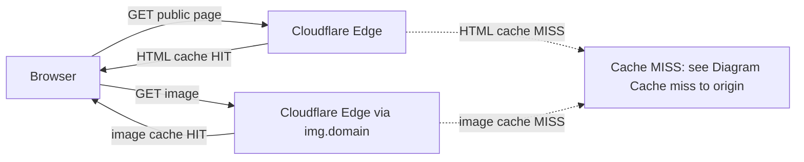
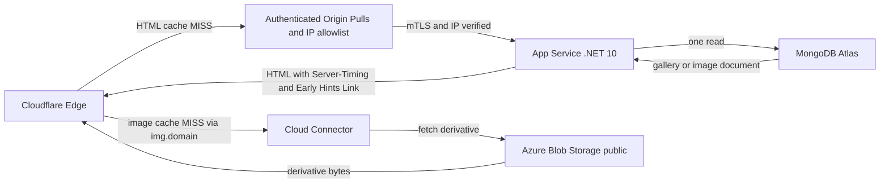
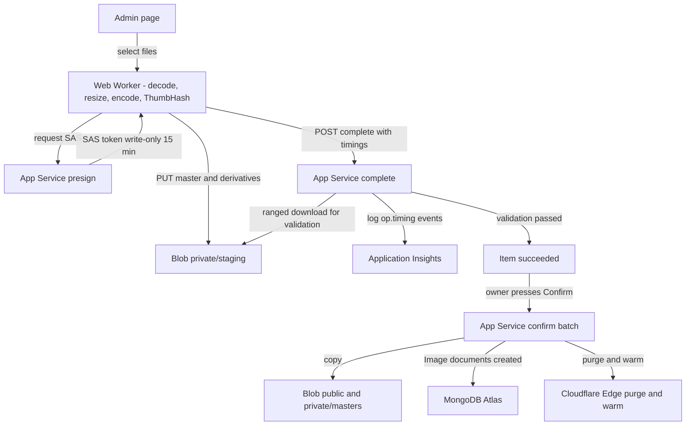
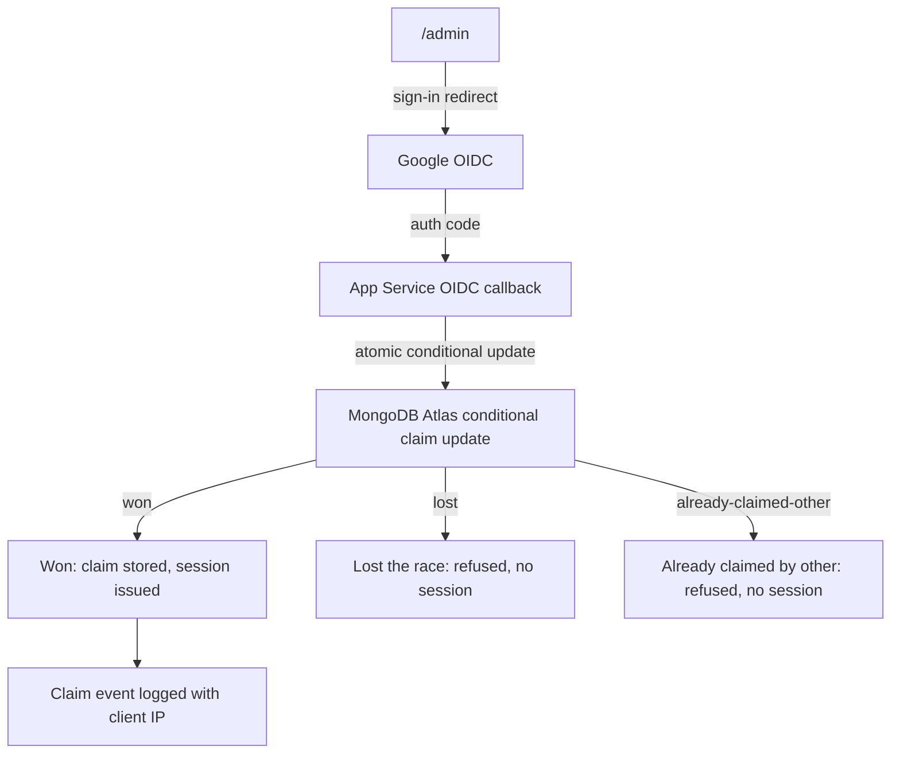
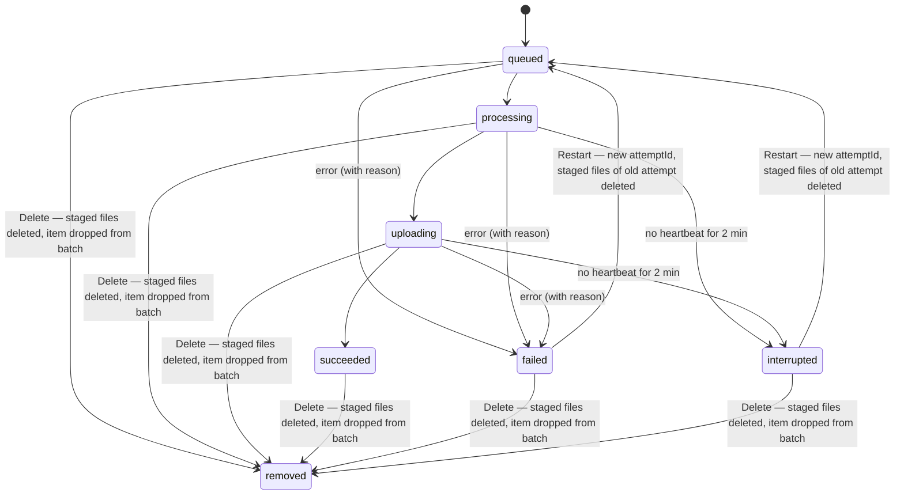
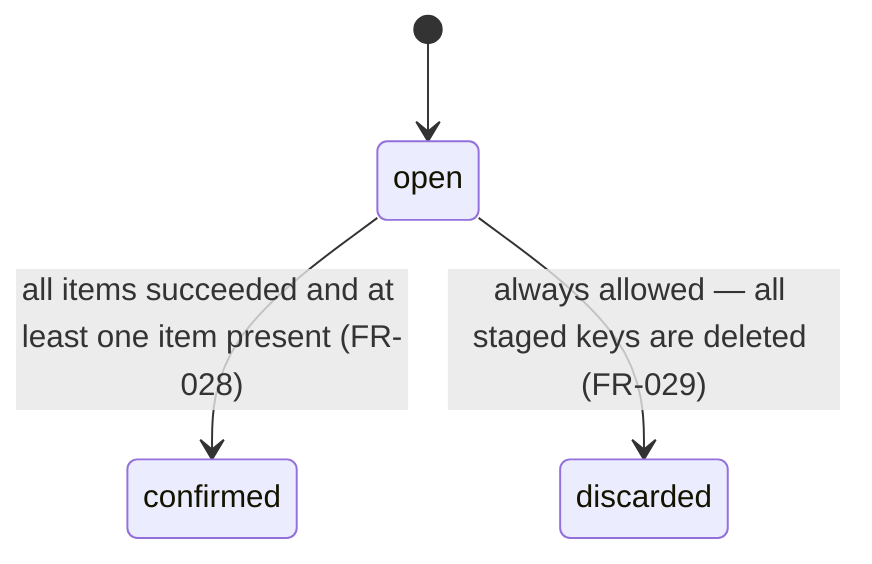

# Gallery Architecture and Stack Design

Source of truth for later features (Constitution VII.2). Generated from specs/001-architecture-stack-design/draft/ — do not edit by hand.

## 1. Overview

This document is the Gallery architecture and stack design. It is the source of truth for all
later features (Constitution VII.2). Any plan that deviates from it must say so in its
Constitution Check and update this document in the same feature. No application source, project
files, or infrastructure changes are produced here; those belong to the first build feature
(FR-001, FR-022).

**Stack at a glance** (Platform Constraints v3.0.0):

- **Application**: .NET 10 minimal APIs, server-rendered HTML; htmx and web components for admin
  interactivity.
- **Hosting**: Azure App Service (Linux, B1); the origin accepts traffic only from Cloudflare.
- **Edge**: Cloudflare DNS, proxy, cache, and TLS in Full (strict) mode. Never Flexible.
- **Identity**: Google OIDC, with a cookie session that has a 7-day sliding expiry renewed while
  it is in use.
- **Data**: MongoDB Atlas free tier, same region as the app.
- **Image storage**: Azure Blob Storage (general-purpose v2, LRS, same region as the app) behind
  a storage abstraction. Two containers: public Hot derivatives for anonymous read via the edge;
  private Cool masters kept permanently. The app uses managed identity; uploads use short-lived
  SAS tokens.
- **Image delivery**: derivatives are served on a custom image hostname through Cloudflare Cloud
  Connector to the public container. If Cloud Connector is unavailable on the zone, a Cloudflare
  Worker on the free plan fetches from the container instead. Browsers never fetch directly from
  the Blob endpoint.
- **Observability**: workspace-based Azure Application Insights with 30-day retention and a daily
  ingestion cap that keeps it inside the free monthly allowance (VIII.4).
- **Forwarded headers**: the app honors `CF-Connecting-IP` and the forwarded scheme from
  Cloudflare so that generated URLs and audit logs are correct.

**Scale assumption**: cost projections and sizing figures throughout this document assume
approximately 5,000 library images, 50 galleries, and low thousands of visitor page views per
month.

**How to read this document**: Section 2 is the decision record; each entry states one
architectural area with its choice, rationale, alternatives rejected, and pivot cost. Section 3
has four system diagrams covering the main request paths. Sections 4 and 5 define the content
model and the lifecycle of every event that changes stored records or visible pages. Section 6
covers edge cases. Section 7 traces every numbered constitution rule to a mechanism and a
verification method. Section 8 gives the cost table and the configured spending limits. Section 9
is the accepted-risk register. Section 10 lists items deferred to later features. Section 11 is
the source list.

This document is machine-validated by `specs/001-architecture-stack-design/evidence/validate.sh`,
which checks headings, labels, diagrams, traceability, cost figures, and hygiene before any
human review.

## 2. Decision Record

### D-01: App Service Linux B1 with .NET 10 Minimal APIs
**Area**: hosting-runtime
**Status**: given
**Choice**: Azure App Service Linux B1 with Always On enabled, running .NET 10 minimal APIs.
**Rationale**: Platform Constraints (v3.0.0) fix the hosting tier to Azure App Service Linux B1 and the runtime to .NET 10 minimal APIs; Constitution VIII.1 bounds the fixed recurring cost to one B1 plan; Always On prevents the Atlas cluster from pausing after 30 days of zero connections (research R-08; research R-03).
**Alternatives**: None; the hosting tier and runtime are binding Platform Constraints (v3.0.0) with no alternative configurations evaluated in this design.
**Pivot cost**: high: changing the hosting tier or runtime requires a constitution amendment, re-provisioning the managed identity and access restrictions, and re-validating all cost projections.

### D-02: Cloudflare Free in Full (Strict) TLS Mode with Origin CA
**Area**: edge-dns-tls
**Status**: given
**Choice**: Cloudflare Free plan with DNS proxy, Full (strict) TLS mode, and a 15-year Cloudflare Origin CA certificate installed on the origin [cf Q5].
**Rationale**: Constitution VIII.2 mandates free TLS certificates; Platform Constraints (v3.0.0) specify Cloudflare DNS, proxy, cache, and TLS in Full (strict) mode — never Flexible. Cloudflare Universal SSL covers the edge; the Origin CA is free and lasts 15 years (research R-01; [cf Q5]).
**Alternatives**: Flexible TLS mode was rejected because it leaves the edge-to-origin hop unencrypted and the Platform Constraints forbid it. A paid or publicly trusted origin certificate was rejected by Constitution VIII.2. Cache Reserve was rejected as paid-only [cf Q8]. A Cloudflare Worker in front of the origin was rejected as unnecessary because Cache Rules already handle the session-cookie bypass (research R-01).
**Pivot cost**: low: switching to a different edge or TLS provider requires DNS record changes and replacing the origin certificate, with no data migration.

### D-03: Cloudflare IP Allowlist plus Authenticated Origin Pulls
**Area**: origin-lockdown
**Status**: chosen
**Choice**: Cloudflare's published IPv4 and IPv6 ranges added to App Service access restrictions (up to 512 IP rules); Authenticated Origin Pulls (mTLS, free on all Cloudflare plans) enabled; the app reads the real client IP from `CF-Connecting-IP` and trusts only Cloudflare ranges as known networks [az Q2], [cf Q6], [az Q7].
**Rationale**: An IP-only allowlist can be bypassed by any attacker routing through a Cloudflare account, because the IP ranges are public; Authenticated Origin Pulls closes that gap at no extra cost. The forwarded-header middleware using `CF-Connecting-IP` ensures audit logs and generated URLs carry the real visitor IP (research R-08; decisions #14; [az Q2], [cf Q6], [az Q7]).
**Alternatives**: IP allowlist alone was rejected because the Cloudflare IP ranges are public and any Cloudflare account can be used to reach an IP-only origin [az Q2]. Direct origin exposure without the allowlist was rejected because it would allow cache bypasses and expose the origin to unfiltered traffic.
**Pivot cost**: low: removing Authenticated Origin Pulls and the IP allowlist is a Cloudflare and App Service configuration change with no data migration (decisions #14).

### D-04: Google OIDC, Host-Prefixed Cookie, Atomic Conditional Claim
**Area**: identity-claim
**Status**: given
**Choice**: Google OIDC via the built-in ASP.NET OIDC handler; session stored in a `__Host-` prefixed cookie (Secure, HttpOnly, SameSite=Lax) with a 7-day sliding expiry; ownership established by an atomic conditional write to the datastore as specified in data-model.md; a winning claim emits a `claim` event to Application Insights carrying the Google subject, the client IP from `CF-Connecting-IP`, and the timestamp, which are also stored on the site document; no claim token is used (research R-11; decisions #3; spec FR-018).
**Rationale**: Constitution I.1 requires the first successful Google OIDC sign-in from `/admin` to claim ownership atomically — when two sign-ins race, exactly one becomes owner and the other is refused; Constitution I.2 binds ownership to the Google subject identifier, never an email address; Constitution I.5 requires the claim event to be logged with identity, client IP, and timestamp; Platform Constraints (v3.0.0) specify Google OIDC with a 7-day sliding session renewed while in use (research R-11; decisions #3; spec FR-018).
**Alternatives**: An optional claim token to pre-seed the owner before the first sign-in was noted in Constitution I as a design option for the unclaimed-window risk but was not adopted. No other identity providers were evaluated because the constitution mandates Google OIDC.
**Pivot cost**: low: changing the session duration is a single configuration setting; switching the identity provider requires a constitution amendment and re-provisioning (decisions #3).

### D-05: MongoDB Atlas Free Cluster Co-Located with App Service
**Area**: datastore
**Status**: given
**Choice**: One MongoDB Atlas Free cluster in a Free-eligible Azure region co-located with the App Service; Always On keeps a persistent connection open so the cluster never pauses after 30 days of inactivity (research R-03; [st Q7], [st Q10]).
**Rationale**: Platform Constraints (v3.0.0) specify MongoDB Atlas free tier in the same Azure region as the app; Constitution VIII.1 requires free tiers wherever one covers the need. The Free cluster supports transactions and unique indexes; at 5,000 images the document store occupies about 15 MB, which is 3% of the 0.5 GB quota; the 100 ops/s limit and 10 GB per 7 days of transfer are comfortable at the stated scale (research R-03; [st Q7], [st Q10]).
**Alternatives**: None; MongoDB Atlas Free is a binding Platform Constraint (v3.0.0) with no alternative datastores evaluated in this design.
**Pivot cost**: medium: migrating to a different datastore requires updating the data-access layer, rewriting all queries, and performing a live data migration, though image files in Blob Storage are unaffected.

### D-06: Built-In Antiforgery for Forms and Header Token for JSON Endpoints
**Area**: csrf
**Status**: chosen
**Choice**: ASP.NET Core built-in antiforgery middleware protects all HTML form posts; JSON admin endpoints (presign and complete) require an explicit antiforgery header token validated by the middleware (research R-11; [az Q8]).
**Rationale**: Constitution I.6 requires all admin state-changing requests to be protected against cross-site request forgery. The built-in antiforgery service is automatically enforced for form binding; for JSON endpoints the header token must be required explicitly because minimal APIs do not enforce it automatically for non-form binding ([az Q8]; research R-11).
**Alternatives**: None documented in the research; the built-in ASP.NET antiforgery middleware is the only CSRF mechanism evaluated for the minimal APIs pattern ([az Q8]).
**Pivot cost**: low: CSRF protection is implemented entirely in middleware configuration and does not affect stored data or external service integrations (research R-11).

### D-07: Storage layout
**Area**: storage-layout
**Status**: given
**Choice**: One GPv2 LRS account in the same region as the App Service. Container `public` is Hot tier with anonymous blob-level read and is served to visitors via `img.<domain>`. Container `private` is Cool and holds `staging/` (staging blobs) and `masters/` (permanent originals kept forever). Derivative blob names are content hashes (`{sha256-16hex}.{avif|webp}`); the app authenticates to storage via system-assigned managed identity with no account keys in any config.
**Rationale**: Constitution Platform Constraints PC.6 binds the layout: GPv2 LRS, Hot public derivatives, Cool private masters, managed identity, two containers, and permanent master retention (III.1). Permanent masters supersede the R2-era delete-after-confirm default (decisions #1, #2; research R-02, R-05; data-model "Blob layout").
**Alternatives**: Cold tier for masters would reduce storage cost but adds retrieval latency and a different minimum-stay charge (decisions #2). A single container is rejected because staging blobs would be anonymously readable (decisions #8). Sequential or title-derived derivative names are rejected because they are guessable, violating II.3 (decisions #9).
**Pivot cost**: high: after launch, derivative URLs are immutable content-addressed hashes; changing the layout requires re-copying all public blobs, updating every link, and purging the edge — reversible only during a maintenance window (decisions #1, #8, #9).

### D-08: Upload intake
**Area**: upload-intake
**Status**: chosen
**Choice**: JPEG only, at most 20 MB per file; the admin page refuses any other file before processing starts, and the server enforces the same type and size limits again before issuing the SAS and when validating the staged master. Each upload is a direct browser PUT to `private/staging/{batchId}/{itemId}/{attemptId}/master.jpg` using a per-blob user delegation SAS that is write-only, scoped to that exact path, and expires after 15 minutes.
**Rationale**: A 20 MB file is far below the 5,000 MiB single-PUT limit, avoiding multipart complexity (spec FR-014; research R-05 [asl Q5]). Routing directly to Blob keeps large files off the single-vCPU B1. Managed identity removes every stored storage key (decisions #7; research R-05).
**Alternatives**: Streaming uploads through the app were rejected because B1 has 1 vCPU and 1.75 GB RAM; a 20 MB upload under concurrent use would saturate them (research R-05). Presigned POST or chunked upload is unnecessary because a single Put Blob request covers files up to 5,000 MiB.
**Pivot cost**: medium: switching to a server-side streaming path requires a new upload endpoint, a change to the storage abstraction, and removal of the SAS issuance step (decisions #7).

### D-09: Client-side derivative pipeline
**Area**: client-derivatives
**Status**: chosen
**Choice**: A dedicated Web Worker runs the full pipeline: decode with `createImageBitmap(file, {imageOrientation:'from-image'})`, resize at ladder widths 320, 640, 960, 1280, 1920, and 2560 px with no upscaling past the source width, encode each width as AVIF and WebP with single-threaded jSquash WASM, output sRGB only (P3 exports are silently converted), compute a ThumbHash from the 320 px bitmap and render it to a ≤32 px WebP data URI stored on the image record. Timings for decode, each encode width, and the total are posted with the `complete` call as `op.timing` events.
**Rationale**: Running in a Web Worker avoids blocking the admin page (research R-07 [br Q1, Q2]). Single-threaded jSquash builds require no COOP/COEP cross-origin isolation, reducing fragility on the admin page (decisions #10). sRGB-only output is chosen because jSquash has no ICC passthrough; this is a documented decision with low revert friction (decisions #12; research R-07 [br Q7]). The ThumbHash data URI is inlined as a CSS background so public pages need no JavaScript for placeholders (decisions #13; research R-07 [br Q6]).
**Alternatives**: A native worker process on the owner's own machine (for example a Rust program) was rejected (FR-023): it would need an owner credential other than the browser session, which affects Constitution I.3 (every non-owner identity is refused and only the Google session is admin), and it adds an install step; its pivot cost is medium — add a scoped upload credential and an upload endpoint, with no change to the storage layout. Server-side encoding was rejected by Constitution III.8 and the single-vCPU B1 (research R-08). Canvas `toBlob` for WebP was rejected because Safari cannot encode WebP from a canvas, and no browser reliably encodes AVIF natively (research R-07 [br Q3]). Multithreaded jSquash builds were rejected because they need COOP/COEP cross-origin isolation (decisions #10; [br Q4]).
**Pivot cost**: medium: adding ICC passthrough or switching encoders requires a new WASM build and changes to the pipeline; the rest of the Worker interface is unchanged (decisions #12).

### D-10: Server-side validation
**Area**: server-validation
**Status**: given
**Choice**: For each staged derivative, the server reads it via a ranged blob download and parses only the container structure: AVIF (`ftyp` must be `avif`; dimensions from `ispe`; no `Exif` or XMP `infe`/`mime` items; `colr` box only with nclx or sRGB ICC) and WebP (RIFF/WEBP with VP8, VP8L, or VP8X; EXIF and XMP flags clear; no EXIF or XMP chunks). MetadataExtractor is used as a second independent check and must report zero Exif and XMP directories. The whole image is rejected if any derivative fails. For the master, the server reads EXIF camera-allowlist fields only via a ranged download of the first 256 KB; pixels are never decoded anywhere on the server.
**Rationale**: Constitution III.5 requires that the server validate every uploaded derivative by parsing the file structure, never trusting client-declared values. III.6 requires rejecting the whole image when any derivative fails. III.7 requires the server to extract the camera allowlist from the master. III.8 prohibits the origin from decoding or encoding pixels. A fixture AVIF and a fixture WebP, each with injected GPS, must be rejected (research R-06 [az Q5, Q6]; decisions #11).
**Alternatives**: Trusting client-declared dimension and metadata flags is prohibited by Constitution III.5. Using a full image decoder such as ImageSharp would violate III.8 and add image-decode CPU load to the fixed-cost B1. MetadataExtractor alone without hand-written parsers was rejected because two independent readers are required for the GPS-rejection guarantee (decisions #11; research R-06).
**Pivot cost**: low: the parsers are about 200 lines each and are isolated behind a validation interface; replacing them does not affect storage, upload, or confirm paths (decisions #11).

### D-11: Upload batch lifecycle
**Area**: upload-batch
**Status**: chosen
**Choice**: At most one open batch exists, enforced by a unique partial index on `{state:"open"}`. Each BatchItem has a state machine (`queued → processing → uploading → succeeded`; `failed` and `interrupted` from any non-terminal state; Restart resets to `queued` with a new `attemptId`; Delete removes the item and its staged blobs). An item is marked interrupted when no heartbeat has arrived in 2 minutes, evaluated when the batch is read. Confirm is gated client- and server-side on every item being in `succeeded`, and each confirm copy step is idempotent. A 7-day Blob lifecycle rule and a best-effort server timer sweep orphaned staging blobs.
**Rationale**: A single open batch matches the single-owner model and prevents concurrent batch confusion (spec FR-029). Heartbeat-based interrupted detection requires no running timer and is deterministic on read (decisions #17; spec FR-026, FR-027). Idempotent confirm copies allow safe retry after a mid-confirm crash (data-model "Upload batch"; decisions #16; spec FR-028). The 7-day lifecycle rule is a free backstop requiring no error-path code (spec FR-030; decisions #16; research R-05 [asl Q6]).
**Alternatives**: A server-side timer enforcing item timeouts in real time was rejected as unnecessary complexity when the interrupted state can be computed lazily on read (decisions #17). Immediate staging cleanup on every failure path was rejected because the lifecycle rule backstop covers the same ground for free (decisions #16).
**Pivot cost**: low: the state machine and heartbeat logic are self-contained in the batch service; adding a real-time timer or changing the interrupted threshold requires only changes to that service (decisions #16, #17).

### D-12: Observability
**Area**: observability
**Status**: given
**Choice**: Workspace-based Application Insights via the `Microsoft.OpenTelemetry` distro, with sampling explicitly off. HTTP requests are auto-collected as `http.request` events. `op.timing` events are ILogger structured logs whose fields land in `customDimensions` and are queryable via KQL. Retention is 30 days; a 150 MB daily ingestion cap keeps usage inside the 5 GB/month free allowance. `Server-Timing` headers are sent on public pages. Evidence is collected by running saved KQL queries with `az monitor app-insights query` and committing the output.
**Rationale**: Constitution Platform Constraints PC.8 requires workspace-based Application Insights with 30-day retention and a daily ingestion cap that keeps usage inside the free allowance (VIII.4). Sampling is off because the time-bound success criteria require every event; at low-thousands of origin requests per month, volume is about 2% of the free 5 GB (research R-09 [asl Q8, Q9]; decisions #4, #18; spec FR-020, FR-024).
**Alternatives**: App Service file logs are free but not searchable and were rejected by the owner (decisions #4; research R-09). An external log service was rejected for adding a vendor without a cost or capability advantage over the included Application Insights free tier.
**Pivot cost**: low: changing the telemetry backend is a one-package swap; the structured log schema and saved KQL queries are reusable on any OpenTelemetry-compatible backend (decisions #4).

### D-13: Library-First Content Model
**Area**: content-model
**Status**: chosen
**Choice**: Images are first-class objects in the owner's library. A gallery is an ordered selection of library images; one image can belong to any number of galleries. Images carry a required title (defaulting to the file name without its extension) and an optional caption shown in the solo view. Galleries carry a title and a description. On the home page, galleries are ordered manually by the owner; within a gallery, images are ordered manually via an `items` id list. The cover image is the pinned image (`pinnedCover`) if set, otherwise `items[0]`; when the gallery has no images the cover is null. GalleryCard fields (coverImageId, placeholder, dimensions, imageCount) are denormalized onto each gallery and onto the site document's `homeCards` array so the home page is a single datastore read.
**Rationale**: A library-first model lets one image appear in multiple curated galleries without duplication and decouples image identity from gallery membership (spec FR-009; data-model `Gallery`, `GalleryCard`; decisions #19). Denormalization satisfies the single-read home-page constraint (data-model `homeCards`, IV.9).
**Alternatives**: Gallery-first (images exist only inside a gallery) was rejected because it requires duplication when one image appears in multiple galleries and couples delete semantics to gallery membership, complicating the hard-delete path (spec FR-013). A flat, gallery-less library was rejected because the spec requires manually ordered galleries with a cover and a description (spec FR-009).
**Pivot cost**: medium: changing from library-first to gallery-first after data exists requires restructuring the data model and migrating every gallery-membership and `homeCards` record; no URL changes occur.

### D-14: Visibility and Addressing
**Area**: visibility-addressing
**Status**: chosen
**Choice**: Gallery and image identities are 128-bit random values encoded in base32 (26 characters, never sequential, never derived from titles). Gallery pages use `/g/{id}/{slug}`; a stale or missing slug triggers a 301 redirect to the current canonical URL. New galleries default to `private`. Private galleries are marked `noindex` and excluded from the home-page listing, feeds, and sitemaps, but remain reachable by direct link. Library images and private-gallery images are unlisted; their derivatives are reachable by direct content-addressed URL, including through the raw Azure Blob endpoint (`blob.core.windows.net`). The app never emits raw Blob URLs in markup or API responses.
**Rationale**: Opaque base32 ids satisfy the unguessability rule so addresses cannot be inferred from titles or sequence numbers (Constitution II.3). The cosmetic `{slug}` segment keeps URLs readable while the stable id in the path satisfies the rename-without-breaking-links rule (Constitution II.4). The raw Blob URL is reachable because the public container requires anonymous read for edge-cache pull; derivative names are content hashes so they are unguessable in practice, and the budget alert covers egress abuse — derivatives are "unlisted, not secret" (research R-04; spec FR-011, FR-012).
**Alternatives**: Sequential numeric IDs were rejected because they are guessable in violation of Constitution II.3. UUID v4 paths without a slug were rejected because the owner cannot produce readable share links; slug-only paths were rejected because renaming would break every shared link (II.4). Returning 404 for a stale slug was rejected because it breaks existing shares (II.4). Making the public container private and signing every URL was rejected because it prevents immutable edge caching (research R-04).
**Pivot cost**: high: changing the ID scheme after deployment changes every gallery and derivative URL, breaks all shared links, and requires an edge-purge of the full public namespace and a full data migration.

### D-15: Public Page Rendering
**Area**: public-rendering
**Status**: given
**Choice**: Public pages are server-rendered HTML with no client-side framework. Critical CSS is inlined; system fonts are used so no web-font request is made. The .NET 10 minimal-API host uses the built-in output cache for anonymous public pages. Images are served with a `<picture>` element listing the AVIF source first, then WebP, then ``, with `srcset` and `sizes` so every viewport gets the smallest sufficient derivative. Every `` carries the stored width and height. The solo view paints the gallery thumbnail, already in the browser cache, at full size as the image's initial layer and reveals the sharp `<picture>` over it once decoded; this is CSS layering, so it needs no JavaScript. The home page renders from the denormalized `site.homeCards` in one datastore read. Pages work with JavaScript disabled; scripted behaviour on public pages is progressive enhancement only.
**Rationale**: Constitution IV.8 requires dimensions in markup, IV.15 requires the thumbnail-first paint, and IV.9 requires a single home-page read. Constitution IV.22 prohibits shipping a client-side framework and mandates inlined critical CSS and system fonts. Constitution V.3 mandates that public pages work without JavaScript. Constitution IV.21 mandates origin output caching for public pages and one-year immutable caching for content-addressed assets. The `<picture>` element with AVIF-first ordering satisfies IV.6's format ladder (research R-10; [wp Q6]).
**Alternatives**: React or a similar SPA framework was rejected by Constitution IV.22 and V.3 (adds a dependency, the page fails without JS, and IV.22 prohibits it). Server-side image transcoding at view time was rejected by Constitution III.8 (origin MUST NOT decode pixels) and the IV precomputation model. An external web-font CDN was rejected by Constitution IV.22 (system fonts are the required default; a single self-hosted variable font is the allowed exception).
**Pivot cost**: medium: adding a client-side framework after launch requires replacing every server-rendered template and re-verifying compliance with Constitution IV.22 and V.3; removing it again would be equally disruptive.

### D-16: Edge Caching and Purge
**Area**: edge-cache
**Status**: chosen
**Choice**: Anonymous HTML responses for public pages are cached at the Cloudflare edge with a 1-day TTL. The cache is bypassed when the owner session cookie is present. On a content change, affected pages are purged by URL (limit: 800 URLs/s, 100 URLs per API call). Images are served on `img.<domain>` through Cloud Connector, which routes to the Azure Blob `public` container, with a 1-year edge TTL matching the blob's `Cache-Control: public, max-age=31536000, immutable` header. When Cloud Connector is unavailable on the zone, a Cloudflare Worker (~20 lines) proxies the same hostname and uses the Cache API so cache hits do not pull from Blob. Smart Tiered Cache is enabled. Public pages and their referenced derivatives are warmed after each purge.
**Rationale**: A 1-day HTML TTL bounds the staleness window when a purge fails, satisfying IV.18's self-healing requirement. URL purge is the most precise and fastest purge available on the Free plan (research R-01; [cf Q1]). Cloud Connector is free on all plans and routes `img.<domain>` to Blob without a Host-header override, which Azure Blob requires; Cloudflare's Origin Rules Host-header override is Enterprise-only and unavailable on Free (research R-04; [asl Q4]; decisions #5, #15). Tiered Cache reduces origin pull frequency ([cf Q2]).
**Alternatives**: Azure Front Door was rejected because it costs about $35/month, violating the Constitution VIII.1 cap (research R-04). Tag and prefix purge were rejected because the Free plan rate-limits them to 5 requests/min, which is too slow for a batch of page purges ([cf Q1]). Cache Reserve was rejected as paid-only ([cf Q1]). Serving images directly from the Blob endpoint without a CDN was rejected because it bypasses the edge cache and bills egress (research R-04).
**Pivot cost**: low: adjusting TTL values and purge strategy is Cloudflare dashboard and Cache Rules configuration; switching between Cloud Connector and the Worker fallback is a single routing change and does not alter image URLs (decisions #5, #15).

### D-17: Predictive Loading and View Transitions
**Area**: predictive-loading
**Status**: given
**Choice**: An inline Speculation Rules script prerenders gallery and image links at `eagerness: moderate`. A hover/touch script (~20 lines) adds a `<link rel=preload>` for the destination image's `srcset` on `pointerenter`/`touchstart`. The solo view prefetches the previous and next images after the `load` event. Both scripts check `navigator.connection?.saveData` and skip when Save-Data is true; Chromium also suppresses prerender automatically under Battery Saver. Cross-document View Transitions use `@view-transition {navigation:auto}` with `view-transition-name: img-{id}` on source and destination pages; unsupported browsers navigate normally. The LCP image gets `fetchpriority=high`; all others get `loading=lazy decoding=async`. Anonymous responses carry no `no-store` and pages have no `unload` handlers, keeping them bfcache-eligible. Early Hints are sent via the Cloudflare edge from the origin's `Link: rel=preload` headers; extension-free paths qualify ([cf Q3]; [wp Q8]).
**Rationale**: Constitution IV.11 mandates Speculation Rules for gallery and image links. Constitution IV.12 mandates hover/touch preload of the destination image. Constitution IV.13 mandates solo-view prefetch of previous and next images. Constitution IV.14 mandates Save-Data suppression. Constitution IV.16 mandates cross-document View Transitions with graceful fallback. Constitution IV.17 mandates high fetch priority on the primary image and lazy loading on others. Constitution IV.19 mandates Early Hints. Constitution IV.20 mandates bfcache eligibility. All mechanisms are confirmed available on the chosen stack (research R-10; [wp Q1–Q5, Q8]).
**Alternatives**: A JavaScript-only prefetch library without Speculation Rules was rejected because Speculation Rules add full prerendering at no extra cost and Chromium handles the Save-Data guard automatically (IV.11). Disabling View Transitions was rejected because Constitution IV.16 mandates them where supported. Omitting the Save-Data guard was rejected because Constitution IV.14 requires it. Skipping Early Hints was rejected because Constitution IV.19 requires them; the Cloudflare edge generates them from `Link` headers with no origin change needed ([cf Q3]).
**Pivot cost**: low: all features are progressive enhancement; adjusting or removing them requires changes to inline scripts and CSS only, with no data-model impact.

### D-18: Metered Cost Cap
**Area**: other
**Status**: given
**Choice**: Metered spend on everything beyond the fixed B1 plan is capped at $10/month by governance: exceeding it requires a constitution amendment. An Azure budget on the subscription notifies the owner at $7/month and again at $10/month; an Azure budget sends alerts and does not stop resources. The Application Insights daily ingestion cap of 150 MB is the one configured hard limit, because it is the only metered service in this design that offers one (Constitution VIII.4). The B1 plan is the fixed cost.
**Rationale**: Constitution VIII.1 requires that metered spend not exceed $10/month and that a budget alert fire at $7/month. Constitution VIII.4 requires that every metered service offering a hard spending limit have one configured inside the VIII.1 cap. Application Insights offers a daily ingestion cap; 150 MB/day keeps monthly ingestion well inside the 5 GB/month free allowance at about 4.5 GB/month worst case (research R-09; decisions #6).
**Alternatives**: The owner was offered caps of $2 (alert $1.50), $5 (alert $3), $10 (alert $7), or no cap, and chose $10 with a $7 alert in the hosting interview (decisions #6). A higher daily Application Insights cap was rejected because 150 MB/day already keeps monthly ingestion inside the 5 GB free allowance (research R-09).
**Pivot cost**: low: changing the cap requires an amendment to Constitution VIII.1 and an update to the Azure budget rule; neither touches application code (decisions #6).

### D-19: Image Delivery Fallback
**Area**: other
**Status**: chosen
**Choice**: When Cloud Connector is present on the Cloudflare zone, it routes `img.<domain>/*` to `https://<account>.blob.core.windows.net/public/`. When Cloud Connector is absent from the zone, a Cloudflare Worker (~20 lines) is deployed on the same `img.<domain>` route; it proxies requests to the same Blob URL and uses the Cache API so cache hits do not pull from Blob on every request. The image URLs (`img.<domain>/<hash>.<ext>`) are identical under both paths. The owner confirms Cloud Connector availability at provisioning time; the Worker is the fallback if it is not offered.
**Rationale**: Cloud Connector is free on all plans and routes the custom hostname to Blob without requiring an Enterprise Host-header override. The Worker free plan allows 100,000 requests/day, covering about 5,000 page views/day at ~20 images per page, which is well above expected traffic (research R-04; decisions #5). Because image URLs are unchanged in both cases, switching between the two paths requires no purge and no change to markup or records.
**Alternatives**: Azure Front Door was rejected because it costs about $35/month, which breaks the Constitution VIII.1 cap (research R-04). Serving images with direct Blob URLs in app markup was rejected because it bypasses the edge cache and bills egress above 100 GB (research R-04). Making the Worker the primary path was rejected because it is code to maintain and every image request on a Worker route counts against the 100,000 requests/day free limit, whereas Cloud Connector is a configuration rule with no request quota (research R-04; [cf Q7]; decisions #5).
**Pivot cost**: low: swapping Cloud Connector for the Worker route, or vice versa, is a single Cloudflare routing change; image URLs and application code are unchanged (decisions #5).

### D-20: Contact-Sheet Grid Component
**Area**: public-layout
**Status**: chosen
**Choice**: The home page (gallery cards) and the gallery page (image thumbnails) render through one shared server-side contact-sheet component, modelled on Nadav Kander's works-in-series grid (https://www.nadavkander.com/works-in-series, measured 2026-10-27). The component takes a column count for each of three viewport classes: large (≥ 1200 px), medium (600–1199 px) and small (< 600 px). Each usage sets its own counts: home is 3 / 3 / 1 and gallery is 4 / 3 / 1. Every tile is a cell of one fixed shape (4:3 landscape by default; Kander's measured box is about 1.28:1). The whole photo is fitted inside the cell without cropping, centred horizontally and vertically, so landscapes fill the width and portraits sit as a narrower image in the middle; the unused part of the cell is the page background. The `` carries the stored width and height, `max-width:100%; max-height:100%`, and the inlined placeholder as its own background, so the placeholder covers exactly the photo's area and not the empty cell. The caption is the title only, one line, truncated with an ellipsis, centred under the cell: the gallery title on home, the image title in a gallery. No image counts, dates or other text. Outer margin and gap are 48 px (large), 32 px (medium) and 16 px (small), close to Kander's measured values. The `sizes` attribute and the CSS grid are both generated from the same column counts and spacing, so the browser picks the derivative for the real rendered cell width. The first row at the large column count (3 on home, 4 in a gallery) gets `fetchpriority=high` and eager loading; the rest are lazy. Every tile is a plain link and carries the `view-transition-name` from D-17. The component is pure CSS grid and needs no JavaScript.
**Rationale**: The owner picked Kander's grid from the reference board (docs/ux-research/moodboard.html) and asked for one component shared by home and gallery, with per-viewport column counts, every photo shown whole (letterboxed) and centred, and title-only captions. Fitting without cropping keeps every image whole in the grid; centring gives rows a common axis when shapes differ. Generating `sizes` from the same column config as the CSS keeps downloads matched to the layout (Constitution IV.6), stored dimensions keep the layout stable at first paint (Constitution IV.8), and pure CSS keeps public pages working without JavaScript (Constitution V.3). `imageCount` stays on GalleryCard because Constitution IV.9 requires it there, but it is not rendered (decisions #24).
**Alternatives**: A uniform crop (Kander's own treatment) was rejected by the owner: portraits lose their top and bottom in the grid. Each photo at its own shape (ragged rows or masonry) was rejected because rows stop lining up. A 3-column grid inside galleries was rejected in favour of Kander's split (3 on home, 4 in a series). Kander's "Series of N" subtitle and long per-image captions were rejected by the owner (title only). Separate home and gallery components were rejected because they would drift. Owner-editable column counts in admin were not chosen; counts are set per usage in the template, keeping admin scope minimal (Constitution V.1).
**Pivot cost**: low: column counts, breakpoints, cell ratio, spacing and caption treatment are component parameters and CSS; no stored data or URLs depend on them (decisions #24).

### D-21: Atomic Component Architecture and Template Engine
**Area**: component-architecture
**Status**: chosen
**Choice**: UI is organised by atomic design. Public components are server-rendered Razor components returned from minimal-API endpoints (`RazorComponentResult`, built into .NET 10). Interactive admin organisms are web components with htmx. Tokens (values, not components): spacing 48 / 32 / 16 px, breakpoints 1200 / 600 px, cell ratio 4:3, type scale, colours. Atoms: `Picture` (the only way an image is rendered: AVIF then WebP sources, `srcset`/`sizes`, stored width and height, inlined placeholder, fetch priority and loading mode, `view-transition-name`), `Title` (one line, ellipsis), `TextLink`, `ExifField` (one formatted value; renders nothing when empty); admin-only `Button`, `Input`, `TagChip`. Molecules: `Tile` (a link wrapping a `Picture` fitted and centred in a fixed cell, plus a `Title`), `MetadataBar` (row of `ExifField`s), `Pager` (previous / next `TextLink`s), `Brand`, `Nav`. Organisms: `ContactSheet` (grid of `Tile`s with per-viewport column counts; generates the grid CSS and `sizes` from the same config, D-20), `SoloViewer` (thumbnail-first layer, `Picture`, `MetadataBar`, `Pager`), `SiteHeader`; admin `UploadDropzone`, `TagEditor`, `GalleryBuilder`, and the admin library reuses `ContactSheet`. Templates: `PublicLayout` (header, inlined critical CSS, Speculation Rules, view-transition CSS, no scripts beyond D-17) and `AdminLayout` (adds htmx, antiforgery header, admin web components). Pages: `/` is `PublicLayout` + `ContactSheet` of gallery cards (3 / 3 / 1); `/g/{id}/{slug}` is `PublicLayout` + `ContactSheet` of images (4 / 3 / 1); `/g/{id}/{slug}/{imageId}` is `PublicLayout` + `SoloViewer`; `/admin/*` is `AdminLayout` + admin organisms. There is no separate picture-link component: a linked picture exists only inside `Tile`, which owns the link, and the solo image is deliberately not a link because no larger or original file is offered (Constitution III.1). Each component's CSS lives beside it; a build step concatenates tokens, atoms, molecules and organisms in that order into one stylesheet, which is inlined as the critical CSS. Inline `style` attributes are banned and a test enforces it. An unlinked `/styleguide` page, visible to the owner only, renders every level with sample data. A component is extracted only when it has a second consumer.
**Rationale**: The owner asked for atomic organisation. Routing every image through one `Picture` atom concentrates Constitution IV.6, IV.7, IV.8, IV.16 and IV.17 in one place, implemented and tested once. Razor components ship with .NET (Constitution V.2, no extra package), compose through parameters and child content, and render plain HTML, so public pages work without JavaScript (Constitution V.3) and ship no client framework (Constitution IV.22). One concatenated, inlined stylesheet satisfies IV.22's inlined critical CSS (decisions #25).
**Alternatives**: RazorSlices was rejected: it is an extra package and composes through layouts and partials rather than nested components. Razor Pages and MVC views were rejected as heavier than minimal APIs for four public routes. Web components on public pages were rejected because they need JavaScript to render (Constitution V.3, IV.22). A separate `PictureLink` molecule was rejected because `Tile` is its only consumer. Finer splitting (for example a `Cell` atom) waits for a second consumer (Constitution V.1).
**Pivot cost**: low: nothing is built yet; after implementation it becomes medium, since moving to another template engine means rewriting about 15 small components, with no impact on data, URLs or CSS (decisions #25).

### D-22: Solution and Project Layout
**Area**: solution-layout
**Status**: chosen
**Choice**: `Gallery.slnx` holds four projects, all created with `dotnet` CLI commands from the SDK's bundled templates: `src/Gallery.Web` (`web --no-https`), the single deployable app; `src/Gallery.Core` (`classlib`), pure logic that references no other project; `tests/Gallery.Core.Tests` and `tests/Gallery.Web.Tests` (`xunit`). Project references run Web → Core, Core.Tests → Core, and Web.Tests → Web and Core. The SDK is pinned in `global.json` to the latest released .NET 10 patch with `rollForward: latestPatch` (10.0.403 at acceptance). The scaffold adds no packages beyond template output. Packages (MongoDB.Driver, Azure.Storage.Blobs, Azure.Identity, Testcontainers, Playwright), local services (docker-compose with Mongo and Azurite), and browser assets each arrive with the feature that first needs them, justified in that feature's plan.
**Rationale**: Accepted from proposal P-01 by feature 002 (specs/002-local-app-scaffold). The owner restricted the scaffold to the projects themselves, with no added dependencies. Constitution VI requires CLI scaffolding. Keeping Core free of web and storage references lets the rule-heavy code, including the Principle III metadata rejection, be unit-tested without containers. Adding each dependency with its first consumer keeps every package traceable to a requirement (Constitution V.2).
**Alternatives**: Scaffolding with packages, health checks, and test containers up front was rejected by the owner. A separate Storage/Infrastructure project was rejected: two thin classes with one consumer. A Razor class library for components was rejected because there is only one app. The xUnit v3 template was deferred because it is an extra template install. A `latestFeature` SDK roll-forward was rejected because it makes builds non-reproducible.
**Pivot cost**: low: splitting a project out later is a file move plus `dotnet sln add`, and raising the SDK pin is one `global.json` value.

## 3. System Diagrams

The one-page component overview is [docs/architecture.html](architecture.html): a standalone HTML
and SVG file that opens in any browser. The four diagrams below are the request paths it summarizes.

### Diagram: Visitor public page



### Diagram: Cache miss to origin



### Diagram: Owner upload to library



### Diagram: Owner sign-in and claim



## 4. Content Model

### Owner (collection `site`, single document `_id: "site"`)

The claim is a single conditional update, `{_id:"site", claimedSubject:null}` → set. A matched count
of 1 means the caller won the claim, and 0 means it lost the race (I.1). No web route ever writes
this document after the claim (I.4).

| Field | Type | Rule |
|---|---|---|
| claimedSubject | string? | Google `sub`. Null means the site is unclaimed (I.2). |
| claimedAt | datetime? | |
| claimedIp | string? | Taken from CF-Connecting-IP (I.5, PC.9). |
| homeOrder | id[] | Every gallery id, public and private, in the owner's manual order. Private galleries keep their position so publishing restores them in place. |
| homeCards | GalleryCard[] | Denormalized cards for the public galleries in `homeOrder`, so the home page is one read (IV.9). |

### Image (collection `images`)

An Image exists only after its batch is confirmed. It has no state field (FR-017).

| Field | Type | Rule |
|---|---|---|
| _id | id | Public identity of the image. |
| title | string | Required. 1–200 characters. Defaults to the file name without its extension. |
| caption | string? | 0–2000 characters, plain text. Shown only in the solo view. |
| width, height | int | Pixel size of the source after orientation is applied. Written into markup (IV.8). |
| placeholder | { color: "#rrggbb", preview: data URI } | Preview is a WebP of at most 32 px on the long edge and at most about 1 KB. It is inlined in the markup (IV.7). |
| camera | { make, model, lens, focalMm, fNumber, exposure, iso }? | Extracted by the server from the master, allowlisted fields only (III.3, III.7). |
| derivatives | { w: int, avif: key, webp: key, bytesAvif, bytesWebp }[] | Ladder widths at or below the source width (IV.6). Keys are content-addressed. |
| createdAt | datetime | |
| galleryIds | id[] | Back-references, so that deleting an image can find every gallery that must be fixed and purged. |

### Gallery (collection `galleries`)

| Field | Type | Rule |
|---|---|---|
| _id | id | Stable identity (II.4). |
| slug | string | Generated from the title. Cosmetic only: the URL is `/g/{id}/{slug}`, and a wrong slug redirects with 301 to the current one (II.4). |
| title | string | 1–200 characters. |
| description | string? | 0–5000 characters, plain text. |
| visibility | `public` \| `private` | Defaults to `private` (II.5). |
| items | id[] | Image ids in the owner's order. Membership and position are the same thing. |
| pinnedCover | id? | Must be an element of `items`. Cleared if that image leaves the gallery. |
| card | GalleryCard | Recomputed whenever `items`, `pinnedCover`, or a member image changes. |
| updatedAt | datetime | |

### GalleryCard

A GalleryCard is `{ galleryId, slug, title, coverImageId?, coverPlaceholder, coverWidth,
coverHeight, coverDerivatives, imageCount }`. The cover is `pinnedCover` if set, otherwise
`items[0]`. When the gallery has no items, the cover is null and the card renders empty.

### Upload Batch (collection `batches`, at most one with `state: open`)

A unique partial index on `{state:"open"}` enforces a single open batch (FR-029, D-11).

| Field | Type | Rule |
|---|---|---|
| _id | id | |
| state | `open` \| `confirmed` \| `discarded` | A unique partial index on `{state:"open"}` enforces a single open batch (FR-029). |
| items | BatchItem[] | |
| createdAt, updatedAt | datetime | |

### BatchItem

| Field | Type | Rule |
|---|---|---|
| itemId | id | Becomes the Image `_id` when the batch is confirmed. |
| fileName | string | Shown when the owner is asked to pick the file again (FR-027). |
| fileSize | int | 20 MB at most (FR-014). |
| state | `queued` \| `processing` \| `uploading` \| `succeeded` \| `failed` \| `interrupted` | |
| reason | string? | Set when the state is `failed`. |
| masterStored | bool | Lets Restart reuse the staged master (FR-027). |
| derivativesStored | key[] | |
| heartbeatAt | datetime | Updated by the client while it works on the item. |
| attemptId | id | A new value on each Restart. Uploads that carry a stale attemptId are refused. |
| validated | { width, height, placeholder, camera, derivatives }? | Set by the server when the item reaches `succeeded`. |

### Item State Machine



### Batch State Machine



On confirm, each item's derivatives and master are copied out of staging (see the Blob Layout
section below), its Image document is created, and the batch is marked confirmed. A confirm that
crashes partway through can be re-run (D-11).

### Blob Layout

There is one storage account with two containers (D-07). Only `public` allows anonymous read and is
served to visitors as `img.<domain>` through Cloud Connector.

```
private/staging/{batchId}/{itemId}/{attemptId}/master.jpg         Cool; replaced on confirm by:
private/masters/{imageId}.jpg                                     Cool; kept permanently
private/staging/{batchId}/{itemId}/{attemptId}/{w}.{avif|webp}    Hot; deleted after confirm
public/{sha256-16hex}.{avif|webp}                                 Hot; immutable (IV.21)
```

Derivative names are content hashes, so their addresses are unguessable and content-addressed
(II.3, FR-011). They are uploaded with blob property
`Cache-Control: public, max-age=31536000, immutable`, which the edge respects.

On confirm, for each item:

1. Copy the staged derivatives into `public/`.
2. Copy the master into `private/masters/`.
3. Delete the staged blobs.

These are same-account server-side copies. The confirm step is idempotent per item.

A lifecycle policy deletes `private/staging/` blobs 7 days after creation. This is the backstop
sweep for orphaned files (FR-030).

Deleting an image (FR-013) deletes `private/masters/{imageId}.jpg` and every `public/` derivative,
then purges the image URLs at the edge.

### Cover Rule

The gallery cover is the `pinnedCover` image if that field is set and the image is still a member
of `items`. If `pinnedCover` is cleared—because the pinned image was removed from the gallery or
deleted—or was never set, the cover falls back to `items[0]`. When the gallery has no items, the
cover is null and the GalleryCard renders empty. The `card` field on Gallery is recomputed whenever
`items`, `pinnedCover`, or a member image changes (D-13).

### Visibility Rule

A library image appears on no public page, listing, feed, or sitemap unless it is a member of at
least one gallery whose `visibility` is `public` (II.5, FR-011, D-14). Galleries default to
`private` and must be explicitly published by the owner. An image's derivatives are always at
content-addressed (`sha256`-derived), unguessable addresses: they remain reachable by direct URL
even when the image is in no public gallery, but they are never listed anywhere. All ids are
128-bit random values, base32-encoded, 26 characters, never sequential and never derived from titles
(II.3). Gallery URLs follow the pattern `/g/{id}/{slug}`; the id is the stable address, while the
slug is cosmetic—a stale slug triggers a 301 redirect to the current one (D-14).

## 5. Lifecycle

### L-01: Image succeeded in batch
**Records**: The BatchItem state changes from `processing` or `uploading` to `succeeded`; the `validated` field is set with width, height, placeholder, camera metadata, and derivative keys (data-model BatchItem; D-11).
**Storage**: Staged derivatives and the staged master are already in `private/staging/` from the prior upload step; no new blob operations occur at this point (data-model Blob layout; D-07).
**Pages and caches**: No public page or edge cache is affected. The library and all public pages are unchanged until L-05 (FR-017; D-11).
**Visitor sees**: Nothing changes. The image is not yet in the library, and no public page or listing references it (FR-011; FR-017).

### L-02: Image failed or interrupted in batch
**Records**: The BatchItem state changes to `failed` (with a reason string) or `interrupted`; `heartbeatAt` stops advancing for interrupted items, which are detected as interrupted when the batch is next read (data-model BatchItem; D-11; decisions #17).
**Storage**: Staged blobs already written remain in `private/staging/` until the owner chooses Restart or Delete, or until the 7-day lifecycle sweep removes them (data-model; D-11; decisions #16).
**Pages and caches**: No public page or edge cache is affected. The library and all public pages are unchanged until L-05 (FR-017).
**Visitor sees**: Nothing changes. The image is not in the library (FR-017; FR-011).

### L-03: Image restarted
**Records**: The BatchItem state returns to `queued`; a new `attemptId` is generated; staged blobs from the previous attempt are deleted if the master already reached the server (`masterStored` is checked) and the owner is not re-using it; if the master was not stored, `masterStored` remains false and the owner is asked to pick the same named file again (data-model BatchItem; FR-027; D-11).
**Storage**: Previous-attempt staged derivatives are deleted from `private/staging/`. If `masterStored` is true, the staged master is reused; otherwise nothing is in storage until the next upload (FR-027; D-11; decisions #16).
**Pages and caches**: No public page or edge cache is affected (FR-017).
**Visitor sees**: Nothing changes. The batch remains open and unconfirmed (FR-017; FR-011).

### L-04: Image deleted from batch
**Records**: The BatchItem is removed from the batch's `items` array; the batch's `updatedAt` is refreshed (data-model BatchItem; FR-027).
**Storage**: All staged blobs for that item — master and all derivatives — are deleted from `private/staging/` immediately; the 7-day lifecycle sweep acts as a backstop if the explicit delete fails (data-model; FR-030; D-11; decisions #16).
**Pages and caches**: No public page or edge cache is affected (FR-017).
**Visitor sees**: Nothing changes. The item was never in the library (FR-017; FR-011).

### L-05: Batch confirmed
**Records**: Each BatchItem's `itemId` becomes the `_id` of a new Image document; the Image documents are written to the `images` collection with all validated fields; the batch `state` changes to `confirmed`; every Gallery whose `items` array contains an id from this batch has its `card` recomputed; `site.homeCards` is refreshed for any affected gallery in `homeOrder` (data-model; D-11; D-13; FR-017).
**Storage**: For each item: (1) staged derivatives are copied from `private/staging/` to `public/` with `Cache-Control: public, max-age=31536000, immutable`; (2) the staged master is copied to `private/masters/{imageId}.jpg` in Cool tier; (3) all staged blobs are deleted. These are same-account server-side copies and the confirm step is idempotent per item (data-model Blob layout; D-07; decisions #1, #2, #8, #9).
**Pages and caches**: If any affected gallery is public, the home page and that gallery's page are purged by URL at the edge (up to 100 URLs per call, 800/s) and then warmed. The purge is best-effort; a failed purge self-heals within the 1-day HTML edge TTL (D-16; decisions #15; R-01).
**Visitor sees**: Images from the confirmed batch appear in any public gallery they belong to immediately after purge and warm; visitors hitting a cached page see the new images within at most 1 day if purge fails (D-16; FR-017).

### L-06: Batch discarded
**Records**: The batch `state` changes to `discarded` (data-model; FR-029).
**Storage**: All staged blobs for every item in the batch — masters and derivatives — are deleted from `private/staging/` immediately; the 7-day lifecycle policy is the backstop for any that were not cleaned up (data-model; FR-029; FR-030; D-11; decisions #16).
**Pages and caches**: No public page or edge cache is affected. No Image documents were ever created for this batch (FR-017).
**Visitor sees**: Nothing changes. The library is unaffected (FR-017; FR-011).

### L-07: Image added to gallery
**Records**: The image's `_id` is appended to the Gallery `items` array at the owner's chosen position; the gallery's `card` is recomputed if the image becomes the new cover (first item or pinned cover); `galleryIds` on the Image document gains this gallery's id; `site.homeCards` is updated if the gallery is in `homeOrder` and is public (data-model Gallery, Image; D-13; FR-009).
**Storage**: No blob operations. The image's derivatives are already in `public/` from L-05 (D-07).
**Pages and caches**: If the gallery is public, its page and the home page are purged and re-warmed at the edge (D-16; decisions #15; R-01).
**Visitor sees**: If the gallery is public, the image appears in the gallery and on the home card after purge and warm, within at most 1 day if purge fails (D-16; FR-011).

### L-08: Image removed from gallery
**Records**: The image's `_id` is removed from the Gallery `items` array; if the image was the `pinnedCover`, the pin is cleared and the cover falls back to the new first item (or null if the gallery is empty); the gallery `card` is recomputed; `galleryIds` on the Image document loses this gallery's id; `site.homeCards` is updated if the gallery is public and in `homeOrder` (data-model Gallery, Image; D-13; FR-009).
**Storage**: No blob operations. Derivatives remain in `public/` because the image may still be in other galleries or the library (D-07; FR-013).
**Pages and caches**: If the gallery is public, its page and the home page are purged and re-warmed (D-16; decisions #15; R-01).
**Visitor sees**: If the gallery was public, the image disappears from the gallery page and the home card after purge and warm, within at most 1 day if purge fails (D-16; FR-011).

### L-09: Image deleted
**Records**: The Image document is removed from `images`; the image's `_id` is removed from `items` in every Gallery document in `galleryIds`; for each affected gallery, `pinnedCover` is cleared if it matched, the `card` is recomputed, and `site.homeCards` is updated for public galleries in `homeOrder` (data-model Image, Gallery; D-13; FR-013).
**Storage**: Hard delete: `private/masters/{imageId}.jpg` is deleted from the Cool container, and every `public/{hash}.{avif|webp}` derivative is deleted from the Hot container. These are immediate deletions triggered by the app (data-model; D-07; FR-013; decisions #1, #2).
**Pages and caches**: An immediate edge purge is issued for every derivative URL and for every public page that referenced the image (gallery pages and the home page for affected public galleries). The purge is best-effort at up to 100 URLs per call and 800/s (D-16; decisions #15; R-01; FR-013). Copies already held in visitor browser caches can persist for up to the immutable `max-age=31536000` lifetime because `immutable` blobs carry no `must-revalidate`; this is an accepted risk (FR-013; decisions #9; spec Assumptions).
**Visitor sees**: The image ceases to appear on public gallery pages and the home page after purge and warm. Visitors who have the derivative URLs cached in their browser may continue to load them for up to 1 year; this caveat is an accepted risk documented in the risk register (FR-013; spec Assumptions).

### L-10: Gallery created
**Records**: A new Gallery document is inserted with `visibility: "private"`, an empty `items` array, no `pinnedCover`, and a generated 128-bit base32 `_id` and slug. The gallery id is appended to the end of `site.homeOrder`, which holds every gallery so a private gallery keeps its position when published; `site.homeCards` is unchanged because the gallery is private (data-model Gallery, Owner; D-13; D-14; FR-009).
**Storage**: No blob operations (D-07).
**Pages and caches**: No public page or edge cache is affected. The gallery starts private (II.5; D-14).
**Visitor sees**: Nothing. The gallery is private and does not appear in any public listing, feed, or sitemap (FR-011; D-14).

### L-11: Gallery made public
**Records**: The Gallery `visibility` changes to `"public"`; `site.homeCards` gains the gallery's `card` at the position given by `site.homeOrder` (data-model Gallery, Owner; D-14; FR-009).
**Storage**: No blob operations. Derivatives for all member images are already in `public/` (D-07).
**Pages and caches**: The gallery page and the home page are purged and re-warmed at the edge (D-16; decisions #15; R-01). The gallery page changes from `noindex` to indexable. A failed purge is bounded by the 1-day HTML edge TTL (D-16; decisions #15).
**Visitor sees**: The gallery and its images appear on the home page and the gallery page after purge and warm, within at most 1 day if purge fails (D-16; FR-011).

### L-12: Gallery made private
**Records**: The Gallery `visibility` changes to `"private"`; its card is removed from `site.homeCards`; it keeps its position in `site.homeOrder` so republishing restores it in place (data-model Gallery, Owner; D-14; FR-009).
**Storage**: No blob operations. Derivatives remain in `public/` because the image addresses are permanent and unlisted (D-07; FR-012).
**Pages and caches**: The gallery page and the home page are purged by URL at the edge immediately. A failed purge means the gallery page and its home-card entry remain visible at the edge for up to the 1-day HTML TTL (D-16; decisions #15; R-01; II.2). The gallery page is re-served with `noindex` on the next origin hit.
**Visitor sees**: The gallery ceases to appear on the home page and its page is marked non-indexable after purge; with a failed purge, up-to-1-day edge staleness is the bound (II.2; D-16; FR-011).

### L-13: Gallery renamed
**Records**: The Gallery `title` is updated and a new `slug` is generated from the new title; the old slug is superseded. The `_id` is unchanged (data-model Gallery; D-14; FR-009).
**Storage**: No blob operations (D-07).
**Pages and caches**: The gallery page at the new URL (`/g/{id}/{new-slug}`) is served immediately; requests to the old URL (`/g/{id}/{old-slug}`) are served with a 301 redirect to the new URL by the app (D-14; decisions #15). Both the old and new gallery page URLs are purged and the new URL is re-warmed (D-16).
**Visitor sees**: Previously shared links (`/g/{id}/{old-slug}`) continue to resolve via 301 to the new URL. No content is lost (D-14; II.4; FR-009).

### L-14: Gallery reordered
**Records**: `site.homeOrder` is updated to reflect the new gallery positions (public and private alike); `site.homeCards` is recomputed in the new order for public galleries (data-model Owner; D-13; FR-009).
**Storage**: No blob operations (D-07).
**Pages and caches**: The home page is purged and re-warmed at the edge (D-16; decisions #15; R-01).
**Visitor sees**: The home page shows galleries in the new order after purge and warm, within at most 1 day if purge fails (D-16).

### L-15: Images reordered
**Records**: The Gallery `items` array is updated to reflect the new image order; if the gallery has no `pinnedCover`, the `card.coverImageId` changes to the new first item, and the `card` is recomputed; `site.homeCards` is updated for affected public galleries in `homeOrder` (data-model Gallery; D-13; FR-009).
**Storage**: No blob operations (D-07).
**Pages and caches**: If the gallery is public, the gallery page and the home page are purged and re-warmed at the edge (D-16; decisions #15; R-01).
**Visitor sees**: If the gallery is public, the gallery page shows images in the new order and the home card may show a new cover after purge and warm, within at most 1 day if purge fails (D-16; FR-009).

### L-16: Gallery cover changed
**Records**: The Gallery `pinnedCover` is set to the chosen image id (which must be an element of `items`); the `card` is recomputed with the new cover image's placeholder and derivatives; `site.homeCards` is updated if the gallery is public and in `homeOrder` (data-model Gallery; D-13; FR-009).
**Storage**: No blob operations. The new cover image's derivatives are already in `public/` (D-07).
**Pages and caches**: If the gallery is public, the gallery page and the home page are purged and re-warmed at the edge (D-16; decisions #15; R-01).
**Visitor sees**: If the gallery is public, the home card and the gallery page show the new cover image after purge and warm, within at most 1 day if purge fails (D-16; FR-009).

### L-17: Gallery deleted
**Records**: The Gallery document is removed from `galleries`; the gallery's `_id` is removed from `site.homeOrder`; the corresponding card is removed from `site.homeCards`; `galleryIds` on every member Image document is updated to remove this gallery's id (data-model Gallery, Image, Owner; D-13; D-14; FR-013).
**Storage**: No blob operations. Deleting a gallery MUST NOT delete the library images; their masters and derivatives remain in storage (FR-013; D-07).
**Pages and caches**: The gallery page and the home page are purged and re-warmed at the edge (D-16; decisions #15; R-01). The gallery page ceases to be served after purge.
**Visitor sees**: The gallery disappears from the home page and the gallery URL returns 404 after purge and warm, within at most 1 day if purge fails (D-16; FR-013). Member images remain in the library and in any other galleries they belong to.

## 6. Edge Cases

### E-01: Claim race — two sign-ins on an unclaimed site
**Outcome**: Exactly one caller wins. The other receives no session and the site remains owned by the winner (Constitution I.1).
**Mechanism**: D-04 executes a single conditional update `{claimedSubject: null}` → set; MongoDB's atomic matched-count of 1 means the caller won, 0 means it lost. No second update is ever issued (data-model Owner).

### E-02: Stranger claims the site before the owner
**Outcome**: The stranger becomes owner. Detection is the claim log event (claimedAt, claimedIp). Recovery is an out-of-band datastore reset (Constitution I.4).
**Mechanism**: D-04 writes claimedSubject, claimedAt, and claimedIp atomically. No web route can overwrite a set claimedSubject (data-model Owner). The owner's subsequent sign-in fails the conditional update and receives no session.

### E-03: Tab closed or connection lost mid-batch
**Outcome**: When the owner returns, the open batch is still there. Images that had succeeded remain succeeded; images that were processing or uploading for more than two minutes are shown as interrupted with Restart and Delete. Nothing has entered the library.
**Mechanism**: D-11 persists the batch on the server (FR-017). D-11 (decisions #17) evaluates the heartbeat field: no heartbeat for 2 minutes transitions the item to interrupted when the batch is next read. L-02 captures the failed-or-interrupted state; L-05 has not fired, so no image is in the library.

### E-04: Restart when master never reached the server
**Outcome**: The owner is prompted to pick that same named file again. If they pick a different file, it is treated as a new image with a new attemptId.
**Mechanism**: D-11 stores masterStored and fileName on each BatchItem (data-model BatchItem). On Restart, D-11 checks masterStored; if false, the UI names the original fileName and requires re-selection. A new attemptId is issued (FR-027); any staged files from the prior attempt are deleted.

### E-05: Browser out of memory or format encode failure
**Outcome**: That image is marked failed with the reason; it shows Restart and Delete. The rest of the batch continues unaffected.
**Mechanism**: D-09 catches per-image errors in the Web Worker and posts a failed state with the reason string to the main thread (FR-026). D-11 records the reason on the BatchItem; other items continue in their own Worker tasks.

### E-06: Derivative reaches server with embedded metadata, wrong dimensions, or disallowed format
**Outcome**: The server rejects the whole image (FR-016). Every staged file for that image is discarded, and the item shows as failed with the rejection reason and offers Restart and Delete.
**Mechanism**: D-10 runs hand-written AVIF and WebP structural parsers plus MetadataExtractor; any metadata present, dimension mismatch, or disallowed format causes rejection. Staged blobs for the item are deleted. The BatchItem transitions to failed with the reason (data-model item state machine).

### E-07: Owner tries to confirm a batch with failed or interrupted images
**Outcome**: Confirmation is refused — by the page and by the server — and the page states how many images still need Restart or Delete.
**Mechanism**: D-11 enforces FR-028: the Confirm action is disabled client-side until every remaining item is succeeded, and the server independently rejects a confirm request if any item is not in the succeeded state.

### E-08: Owner tries to start a new upload while a batch is unconfirmed
**Outcome**: The owner is redirected to the existing open batch, not given a new one.
**Mechanism**: D-11 enforces FR-029 via the unique partial index on `{state:"open"}` in the batches collection (data-model Upload batch). The server returns the open batch's URL; no second batch document can be inserted while one is open.

### E-09: Selected file is not a JPEG, is over 20 MB, or is a corrupt JPEG
**Outcome**: The file is rejected with the reason before it joins the batch; nothing is stored and no upload begins.
**Mechanism**: D-08 (FR-014) refuses the file in the browser before any processing starts, then enforces the same rules server-side. The rejected file never appears as a BatchItem; the batch and storage are unaffected.

### E-10: JPEG carries EXIF orientation, GPS, maker notes, or embedded thumbnail
**Outcome**: Orientation is applied before encoding. Nothing beyond the camera-allowlist fields survives in any derivative or in the stored metadata.
**Mechanism**: D-09 reads and applies EXIF orientation in the Web Worker before the resize-and-encode ladder; the encoded derivatives carry no EXIF (Constitution III). D-10 runs structural parsers plus MetadataExtractor on every uploaded file; any metadata outside the allowlist causes rejection (Constitution III.5–III.8). The server extracts allowlisted camera fields from the master by ranged download without decoding pixels (D-10, decisions #11).

### E-11: Source image is smaller than the smallest ladder width
**Outcome**: No upscaling occurs; only widths at or below the source width are produced.
**Mechanism**: D-09 checks each ladder step against the source dimensions and skips any width that would require upscaling (Constitution IV.6; decisions #10). The derivatives array on the Image document contains only the widths that were actually generated (data-model Image).

### E-12: Edge purge fails after a visibility change
**Outcome**: Stale HTML is served for at most one day. After the TTL expires the edge re-fetches from the origin.
**Mechanism**: D-16 sets a 1-day edge TTL on HTML pages (decisions #15). A failed purge leaves at most one day of staleness before natural expiry (Constitution II.2, IV.18). L-11 (Gallery made public) and L-12 (Gallery made private) trigger purge-and-warm; even when purge fails the bounded TTL is the safety net.

### E-13: Datastore is lost
**Outcome**: All gallery structure, ordering, image titles, captions, gallery descriptions, gallery visibility, and the claim record are permanently lost (accepted risk). The owner rebuilds from local exports by re-uploading images and re-creating galleries.
**Mechanism**: D-05 (Atlas Free, no backup mechanism) and FR-019 record this as an accepted risk. Image masters remain in Blob `private/masters/` (D-07, decisions #2); derivatives remain in `public/`. Nothing in the datastore is recoverable from the stack (data-model Owner, Image, Gallery).

### E-14: Cover image removed from gallery or deleted
**Outcome**: If it was the pinned cover, the pin is cleared. The cover falls back to the first image in the gallery's order, or to an empty card when no images remain. The denormalized GalleryCard and the home page are refreshed immediately.
**Mechanism**: D-13 defines the cover rule (pinnedCover cleared if the image leaves items; fallback to items[0] or null; data-model Gallery). L-08 (Image removed from gallery) and L-09 (Image deleted) recompute the Gallery card and trigger D-16 purge of the home page and gallery page (Constitution IV.9).

### E-15: Gallery reordered with no pinned cover and the first image changes
**Outcome**: The cover changes to the new first image. The home card is refreshed.
**Mechanism**: D-13 derives the cover from items[0] when pinnedCover is null (data-model Gallery). L-14 (Gallery reordered) recomputes the GalleryCard and triggers a D-16 purge of the home page and the gallery page.

### E-16: Gallery has no images
**Outcome**: The home card renders empty (no cover, no dimensions) and the gallery page shows no images. Neither crashes nor leaves broken markup.
**Mechanism**: D-13 specifies that when items is empty the cover is null and the GalleryCard's cover fields are null (data-model GalleryCard). D-15 server-renders the page with a null-safe cover path and no `<picture>` element when coverImageId is absent.

### E-17: Owner deletes an image by mistake
**Outcome**: There is no trash and no undo through the site. The image is permanently gone. Recovery is re-uploading from local exports. Its gallery memberships, positions, title, and caption are lost.
**Mechanism**: D-13 and FR-019 record this as an accepted risk (no backups). L-09 (Image deleted) hard-deletes the master from `private/masters/`, all derivatives from `public/`, and all gallery memberships, then triggers D-16 edge purge of derivative URLs and every public page that referenced the image (FR-013).

### E-18: Edge purge fails after an image is deleted
**Outcome**: The edge serves cached derivatives until their immutable-cache TTL expires (up to one year). Storage no longer has the files, so once the edge cache entry expires the files are gone everywhere.
**Mechanism**: D-07 sets `Cache-Control: public, max-age=31536000, immutable` on all `public/` derivatives (data-model Blob layout, Constitution IV.21). L-09 triggers D-16 URL purge; if the purge fails, the derivative is unreachable from storage but may remain in the edge cache until the TTL expires. This bound is stated as the browser-cache persistence caveat in the accepted-risk register (FR-013).

### E-19: Free-tier limit reached, ingestion cap hit, or $7 alert fires
**Outcome**: Atlas at 0.5 GB stops accepting writes, returning errors to the app; the Application Insights 150 MB daily cap stops ingesting logs for the rest of that day; the Azure budget alert at $7 sends a notification to the owner and no automatic action halts the service.
**Mechanism**: D-05 (Atlas Free, 0.5 GB limit) — writes fail with a quota error when the limit is reached; D-12 (decisions #4) — the 150 MB daily cap is configured in Application Insights (D-18, Constitution VIII.4); D-18 (decisions #6, Constitution VIII.1) — the Azure budget notifies at $7 and at $10. An Azure budget does not stop resources, so the $10 cap is enforced by the owner acting on the alerts, and exceeding it requires an amendment (spec FR-020, FR-006).

## 7. Traceability Matrix

One row per numbered rule in constitution v3.0.0, plus one per Platform Constraints bullet (`PC.n`,
in order). A rule with no numbered list (VI) counts as one rule. Status `deferred:first-build-feature`
marks rules whose mechanism is designed here but whose compliance is a provisioning setting that
can only be checked once the resource exists.

| Rule | Mechanism | Verification | Status |
|---|---|---|---|
| I.1 | D-04: first `/admin` Google sign-in on an unclaimed site claims it with one conditional update; the loser of a race is refused | integration test: two concurrent claims against real Mongo, exactly one wins | designed |
| I.2 | D-04: `claimedSubject` stores the Google `sub`, never an email | integration test: same email with a different `sub` is refused | designed |
| I.3 | D-04: every non-owner identity is refused and receives no session cookie | integration test: second identity gets 403 and no `Set-Cookie` | designed |
| I.4 | D-04: no route writes `site` after the claim; recovery is a datastore operation | integration test: route inventory shows no claim-reset endpoint | designed |
| I.5 | D-04, D-12: claim event logged with `sub`, client IP from `CF-Connecting-IP`, timestamp | log query: claim event present with all three fields | designed |
| I.6 | D-06: built-in antiforgery on forms, required header token on JSON admin endpoints | integration test: admin POST without token is rejected | designed |
| II.1 | D-15: public pages need no account, cookie, or consent | integration test: anonymous GET of every public route returns 200 with no `Set-Cookie` | designed |
| II.2 | D-14, D-16: private galleries absent from home, listings, sitemap; `noindex`; reachable by link; purge on change, 1-day TTL bound | integration test: private gallery absent from listings and carries `noindex`; L-12 | designed |
| II.3 | D-14, D-07: 128-bit base32 ids; content-hash derivative names | integration test: ids are 26-char base32 and differ across titles | designed |
| II.4 | D-14: `/g/{id}/{slug}`, stale slug 301s to current | integration test: renamed gallery old URL returns 301 to new URL | designed |
| II.5 | D-14, D-13: galleries default private; upload and edit never change visibility | integration test: new gallery and confirmed batch leave visibility private | designed |
| III.1 | D-07: masters in the `private` Cool container, no anonymous access, no route serves them | config check: `private` container access level is off; route inventory has no master route | designed |
| III.2 | D-09, D-10: visitors receive only client-generated, server-validated derivatives | integration test: only validated derivatives are copied to `public` on confirm | designed |
| III.3 | D-10: camera allowlist extracted at upload; derivatives carry no metadata | integration test: rendered camera fields equal the allowlist subset | designed |
| III.4 | D-09: `createImageBitmap` applies orientation before encoding | browser measurement: rotated-EXIF fixture produces upright derivatives | designed |
| III.5 | D-10: AVIF and WebP structure parsers plus MetadataExtractor; client values never trusted | integration test: GPS-injected AVIF and WebP fixtures are rejected | designed |
| III.6 | D-10, D-11: any failing derivative rejects the whole image and stores nothing public | integration test: one bad derivative fails the item and leaves `public` untouched | designed |
| III.7 | D-10: allowlist read by the server from the master via ranged download | integration test: client-supplied camera values are ignored | designed |
| III.8 | D-10, D-15: origin parses headers only; no pixel decode or encode | document review: dependency list contains no image codec; D-10 | designed |
| IV.1 | D-12: `http.request` event per request with route, status, duration | log query: every request has route, status, duration | designed |
| IV.2 | D-12, D-09: `op.timing` events for each storage, query, purge op; browser timings posted with `complete` | log query: `op.timing` present for each named op | designed |
| IV.3 | D-12: `Server-Timing` on public pages | markup/header assertion: `Server-Timing` header on public responses | designed |
| IV.4 | D-12: sampling off; saved KQL query per time-bound criterion | log query: saved queries reproduce each time-bound criterion | designed |
| IV.5 | Section 7: each perceived-performance rule has a verification method | markup/header assertion: this matrix lists one for IV.11 to IV.22 | designed |
| IV.6 | D-09, D-15: 320 to 2560 ladder, AVIF and WebP, `<picture>` with `srcset` and `sizes`, no upscaling | markup/header assertion: `<picture>` has AVIF and WebP sources with `srcset` and `sizes` | designed |
| IV.7 | D-09, D-13: ThumbHash data URI and dominant color stored and inlined as CSS background | markup/header assertion: image slots carry the inlined placeholder, no extra request | designed |
| IV.8 | D-13, D-15: width and height stored and emitted | markup/header assertion: every `` has width and height attributes | designed |
| IV.9 | D-13: denormalized `homeCards` on the site document | markup/header assertion: home page issues one datastore read (`op.timing` count) | designed |
| IV.10 | D-16: purge then warm on publish or edit; Tiered Cache on | log query: purge and warm events follow each public change | designed |
| IV.11 | D-17: inline Speculation Rules, prerender at moderate eagerness | markup/header assertion: public pages contain the `speculationrules` script | designed |
| IV.12 | D-17: hover and touch preload script | browser measurement: hover on a thumbnail starts the destination image fetch | designed |
| IV.13 | D-17: solo view prefetches previous and next after load | browser measurement: previous and next fetched after `load` | designed |
| IV.14 | D-17: Save-Data guard in scripts; Chromium suppresses speculation | browser measurement: with Save-Data on, no speculative fetches occur | designed |
| IV.15 | D-15, D-17: solo view paints cached thumbnail full size, sharp image revealed on decode | browser measurement: first paint of solo view shows the thumbnail | designed |
| IV.16 | D-17: `@view-transition` and `view-transition-name: img-{id}` | markup/header assertion: both pages declare the transition and matching names | designed |
| IV.17 | D-17: primary image `fetchpriority=high`, others `loading=lazy decoding=async` | markup/header assertion: attribute assertions on rendered pages | designed |
| IV.18 | D-16: HTML edge-cached 1 day, bypassed with session cookie, purged on change | markup/header assertion: anonymous response is cacheable; owner response bypasses | designed |
| IV.19 | D-17, D-16: origin sends `Link: rel=preload`; edge emits 103 | markup/header assertion: `Link` preload headers on public pages | designed |
| IV.20 | D-17: no `unload` handlers, no `no-store` on anonymous responses | markup/header assertion: no `no-store` header and no `unload` in served script | designed |
| IV.21 | D-07, D-15: content-hash names with one-year immutable caching; Always On; output caching | markup/header assertion: derivative `Cache-Control` is `public, max-age=31536000, immutable` | designed |
| IV.22 | D-15: no client framework, inlined critical CSS, system fonts | markup/header assertion: no framework bundle or font request in public HTML | designed |
| V.1 | Section 10 and spec scope: no comments, likes, search, multi-user, analytics | document review: every capability traces to spec 001 | designed |
| V.2 | research.md dependency table justifies every package | document review: package list matches the justification table | designed |
| V.3 | D-15: public pages work without JavaScript; admin may require it | integration test: public routes render complete HTML with no script execution | designed |
| VI.1 | Section 10: scaffolding with `dotnet new`, `az`, `wrangler` | document review: no scaffolding happens in this feature | n/a:no scaffolding in a documents-only feature |
| VII.1 | This document is feature 001, documents only | document review: feature 001 adds no source or infrastructure | n/a:satisfied by this feature itself |
| VII.2 | Section 10 and the document header: later deviations must update this document | document review: later plans cite this document in their Constitution Check | designed |
| VII.3 | Section 2: every decision has rationale, alternatives, pivot cost | document review: validate.sh C2 counts all four fields | designed |
| VIII.1 | Section 8, D-18: only B1 fixed; metered total about $1 against $10 cap and $7 budget alert | config check: Azure budget with $7 and $10 notifications exists | designed |
| VIII.2 | D-02: Universal SSL at the edge, Origin CA at the origin | config check: origin certificate issuer is Cloudflare Origin CA | designed |
| VIII.3 | Section 8: every metered dimension with free limit, unit price, projection | document review: validate.sh C7 | designed |
| VIII.4 | Section 8, D-18, D-12: Application Insights 150 MB daily cap | config check: daily cap set on the workspace | designed |
| PC.1 | D-01, D-15: .NET 10 minimal APIs, server-rendered HTML, htmx and web components for admin | document review: D-01 and D-15 | deferred:first-build-feature |
| PC.2 | D-01, D-03: App Service Linux B1; IP allowlist plus Authenticated Origin Pulls | config check: access restrictions list only Cloudflare ranges | deferred:first-build-feature |
| PC.3 | D-02: Cloudflare proxy, cache, Full (strict) TLS | config check: zone SSL mode is Full (strict) | deferred:first-build-feature |
| PC.4 | D-04: Google OIDC, `__Host-` cookie with 7-day sliding expiry | integration test: session cookie attributes and expiry | designed |
| PC.5 | D-05: Atlas Free in a Free-eligible Azure region next to the app | config check: cluster tier and region | deferred:first-build-feature |
| PC.6 | D-07, D-08: GPv2 LRS, `public` Hot and `private` Cool, managed identity, SAS uploads | config check: container tiers and access levels; no account key in app settings | deferred:first-build-feature |
| PC.7 | D-16, D-19: `img.<domain>` through Cloud Connector, Worker fallback | config check: image hostname route; markup assertion that no raw Blob URL is emitted | deferred:first-build-feature |
| PC.8 | D-12: workspace-based Application Insights, 30-day retention, daily cap | config check: retention and daily cap settings | deferred:first-build-feature |
| PC.9 | D-03: forwarded headers from `CF-Connecting-IP`, Cloudflare ranges as known networks | integration test: logged client IP equals `CF-Connecting-IP` | designed |

## 8. Cost and Free-Tier Budget

The cost projections below assume a personal site at the scale stated in the spec Assumptions: about
5,000 library images, about 50 galleries, and low thousands of visitor page views a month. This
scale is used for every Projected cell and is stated here so the table can be re-checked if the
scale changes.

| Service | Dimension | Free limit | Projected | Overage behaviour |
|---|---|---|---|---|
| Azure App Service | Linux B1: 1 vCPU, 1.75 GB RAM, Always On — fixed monthly plan | none | ~$13/month (verify in pricing calculator for region) [az Q1, Gaps] | n/a — fixed plan; no metered component |
| Azure Blob Storage | `public` container, Hot tier — derivative storage | none (no free storage allowance on LRS) [asl Q1] | ~$0.20/month at ~11 GB derivatives [asl Q1, Q2] | $0.0184/GB-month (verify in calculator) [asl Q1, Gaps] |
| Azure Blob Storage | `private` container, Cool tier — master storage; 30-day minimum-stay charge applies to early deletes | none [asl Q2] | ~$0.60–$0.75/month at ~60–75 GB masters [asl Q2] | $0.010/GB-month; a master deleted within 30 days is billed for the full 30-day period [asl Q2] |
| Azure Blob Storage | write operations — staging PUTs and confirm copies, ~125,000/year | none [asl Q6] | ~$0.10/month amortized at 5,000 images/year [asl Q1, Q6] | $0.065/10,000 (Hot); $0.13/10,000 (Cool) [asl Q1] |
| Azure Blob Storage | read operations — origin pulls on edge cache misses | none | ~$0.00 at low-thousands of page views (edge cache serves the vast majority) [R-01, R-04] | verify in pricing calculator [asl Gaps] |
| Azure Blob Storage | internet egress from Blob to Cloudflare edge | first 100 GB/month free [asl Q2] | $0.00 — edge cache keeps origin egress well under 100 GB at expected traffic [asl Q2] | billed per GB above 100 GB; verify rate in calculator [asl Gaps] |
| Application Insights | data ingestion | 5 GB/month free; 150 MB daily cap configured [asl Q8, Q9] | $0.00 at ~100 MB/month (~2% of free allowance) [asl Q9] | ingestion stops for the rest of the day when the daily cap is hit; ~$2.30/GB above 5 GB/month [asl Q8] |
| Application Insights | data retention | 90 days included free [asl Q8] | $0.00 at 30-day retention policy [asl Q8] | billed per GB-day above 90 days; not applicable at 30-day retention |
| MongoDB Atlas | storage, connections, ops/s, transfer — Free tier | 0.5 GB storage, 500 connections, 100 ops/s, 10 GB/7 days [st Q7] | $0.00 at ~15 MB and minimal ops/s [R-03] | upgrade to paid cluster required; no partial overage on Free tier [st Q7] |
| Cloudflare | edge cache, URL purge (800 URLs/s, 100 per call), Tiered Cache, Early Hints | all included on Free plan [cf Q1–Q5] | $0.00 | n/a — Free plan features [cf Q1] |
| Cloudflare | Cloud Connector (image routing to Blob) and Worker fallback (100k requests/day) | Cloud Connector free on all plans; Worker 100k requests/day on Free [cf Q7, asl Q4] | $0.00 at low-thousands of page views [R-04] | paid Worker plan if traffic exceeds 100k requests/day; Cloud Connector is beta — Worker fallback applies if withdrawn [R-04] |
| Cloudflare | Origin CA certificate, 15-year | free [cf Q5] | $0.00 | n/a — free; non-renewable before the 15-year term |
| TOTAL fixed | — | — | ~$13/month (App Service B1 only; verify for region) [az Q1, Gaps] | — |
| TOTAL metered | — | — | $1.00/month at 5,000 images, 50 galleries, low-thousands of page views [R-02] | alert at $7 (decisions #6); cap at $10 (Constitution VIII.1) |

**Configured limits**: The one hard limit is the Application Insights daily ingestion cap of
150 MB, which keeps monthly ingestion under the 5 GB free allowance (Constitution VIII.4;
decisions #4; research R-09). The Azure subscription budget notifies at $7/month and again at
$10/month (Constitution VIII.1; decisions #6). An Azure budget sends alerts and does not stop
resources, so the $10 cap is a governance limit: exceeding it requires an amendment.

Prices labelled "verify" come from JavaScript-rendered pricing pages and must be confirmed in the
Azure Pricing Calculator before provisioning ([asl Gaps]).

## 9. Accepted-Risk Register

### R-01: No claim token — unclaimed window on first deploy

**Failure**: From deploy until the owner's first sign-in at `/admin`, anyone with a Google account who reaches it first becomes owner (spec Assumptions).
**Detection**: The claim log event (Constitution I.5) records the identity, client IP, and timestamp; the real owner's subsequent sign-in is refused because the site is already claimed.
**Recovery**: Out-of-band datastore reset by the operator (Constitution I.4); no web-accessible reset path exists.
**Reversal cost**: Low — a claim token checked at claim time can be added later without changing the data model (spec Assumptions).

### R-02: No backups — datastore and master loss is permanent

**Failure**: Losing the datastore loses every gallery, its order, image titles and captions, gallery descriptions, visibility, and the claim; losing the storage account loses the masters (spec Assumptions).
**Detection**: Site content is absent when the owner accesses it; Azure service health notifications indicate resource outage.
**Recovery**: The owner's local exports are the only recovery path; rebuilding galleries is manual (spec Assumptions).
**Reversal cost**: Low — a scheduled datastore export into private storage can be added later for cents a month (spec Assumptions).

### R-03: Deletion not instant everywhere — browser cache persistence

**Failure**: A deleted image's derivatives can persist in visitors' browser caches for up to the immutable-cache lifetime, because derivative responses carry `Cache-Control: max-age=31536000, immutable` (spec Assumptions; FR-013; Constitution IV.21).
**Detection**: Undetectable from the server; a visitor with a cached copy can still view the derivative until the cache entry expires naturally.
**Recovery**: Hard delete removes the master and all derivatives from storage and purges the edge immediately; browser-cached copies have no server-side removal path (spec Assumptions; FR-013).
**Reversal cost**: Medium — removing immutable-cache headers from derivatives would require amending Constitution IV.21; the practical bound on staleness is one cache lifetime (1 year for derivatives).

### R-04: Unlisted is not secret — private derivative addresses are reachable

**Failure**: Anyone holding a derivative address of a library-only or private-gallery image can view it; anonymous read must be enabled on the `public` container for the Cloudflare edge to fetch, so the raw `blob.core.windows.net` URL is also publicly readable (spec Assumptions; FR-012; research R-04).
**Detection**: No server-side record of direct URL access exists; exposure of a derivative address cannot be detected retroactively.
**Recovery**: No recovery path within the system; derivative names are unguessable content hashes (decisions #9) and the app never emits raw blob URLs (research R-04).
**Reversal cost**: High after launch — derivative addresses are content-hash URLs embedded in the edge cache and in any previously shared links; changing the addressing scheme requires re-generating all derivatives with new names (decisions #9).

### R-05: 30-day log retention — audit events and timing evidence expire

**Failure**: Timing evidence and audit events older than 30 days are gone, and the claim event in particular must be checked within that window; when the daily ingestion cap is hit, logs stop being ingested for the rest of that day (spec Assumptions; research R-09).
**Detection**: Application Insights daily cap metric in the Azure portal shows when ingestion has stopped for the day; log gaps appear as query results with no events in that interval (research R-09).
**Recovery**: No recovery of expired or dropped logs; the 150 MB daily cap and 5 GB monthly free allowance keep normal-traffic days from hitting the cap, so drops are rare (research R-09; decisions #4).
**Reversal cost**: Low — retention can be extended up to 90 days at no extra cost; the daily cap can be raised; the exporter can be switched to a longer-retention service at any time (decisions #4).

### R-06: Cloud Connector is beta — image delivery may require Worker fallback

**Failure**: If Cloudflare changes or withdraws Cloud Connector, image delivery via `img.<domain>` fails until the Worker fallback is activated (spec Assumptions; research R-04).
**Detection**: Image requests to `img.<domain>` return errors; the Cloudflare dashboard shows the Cloud Connector route as inactive or unavailable (research R-04).
**Recovery**: The Worker fallback is about 20 lines of code and is free up to 100,000 requests per day; it is pre-designed as the alternative route and does not change image URLs (decisions #5; research R-04).
**Reversal cost**: Low — switching to the Worker fallback requires a single zone configuration change and no URL changes (decisions #5).

### R-07: client-generated derivatives — metadata leak if admin page has a bug

**Failure**: A bug in the admin page could produce a derivative that leaks metadata (location, camera data, or other EXIF or XMP content) before it is uploaded (spec Assumptions; FR-016).
**Detection**: Server-side validation (FR-016) rejects any derivative whose AVIF or WebP structure contains an Exif or XMP item, or whose MetadataExtractor report is non-empty; the image is reported to the owner as failed with the reason (research R-06; decisions #11).
**Recovery**: The failed image shows Restart and Delete; no metadata-leaking derivative reaches the library because the server discards it before acceptance (FR-026; decisions #11).
**Reversal cost**: Low — the server validation is already the authoritative check; tightening the parser rules requires only a code change with no data migration (decisions #11).

## 10. Deferred to Later Features

This design decides *what* and *why*. The items below are owned by the first build feature
(FR-022) or are facts that can only be confirmed at provisioning time. None of them reopens a
decision. If one turns out differently than assumed, the dependent decision is updated here first
(Constitution VII.2).

- **Provisioning**: creating the App Service plan, the storage account and containers, the
  Application Insights resource, the Atlas cluster, and the Cloudflare zone settings. Depends on
  D-01, D-02, D-05, D-07, and D-12.
- **Deployment and CI/CD**: build, test, and release pipeline, and how the app reaches App
  Service. Depends on D-01.
- **Infrastructure-as-code**: whether and how resources are scripted. Scaffolding uses the official
  CLIs (`az`, `wrangler`, `dotnet new`) per Constitution VI. Depends on D-01, D-07, and D-16.
- **Application scaffolding**: `dotnet new` solution and projects, `dotnet add package` for the
  packages justified in research.md (Constitution VI, V.2). Depends on D-01 and D-10.
- **Verify unit prices**: B1 for the chosen region, Blob Hot and Cool storage and operations, and
  Application Insights ingestion, in the Azure Pricing Calculator. The pricing pages render with
  JavaScript, so section 8 figures are indicative. Depends on D-18.
- **Confirm Cloud Connector on the zone**: check Rules → Cloud Connector in the Cloudflare
  dashboard. If it is absent, use the approved Worker fallback, which must use the Cache API.
  Depends on D-16 and D-19.
- **Choose the Atlas region**: pick the Free-eligible Azure region nearest the App Service region
  from the Atlas region table. Depends on D-05.
- **Measure real sizes**: the ThumbHash data-URI bytes, which must stay at or under about 1 KB, and
  the real derivative bytes per image, which must be checked against the 2.2 MB estimate behind
  section 8. Depends on D-09 and D-18.
- **Saved KQL evidence queries**: one committed query per time-bound success criterion, run with
  `az monitor app-insights query`, with output kept in each feature's `evidence/`. Depends on D-12.
- **Server-validation fixtures**: an AVIF and a WebP file with injected GPS, both of which must be
  rejected (Constitution III rationale). Depends on D-10.

## 11. Sources

Every external fact in this document carries a tag such as `[cf Q3]`. The tag points to the research note
`specs/001-architecture-stack-design/research-notes/<file>.md`, which holds the fetched quote. The
URLs below are the fetched pages, grouped by note.

### cf: research-notes/cloudflare.md

- [cf] https://developers.cloudflare.com/cache/how-to/purge-cache
- [cf] https://developers.cloudflare.com/cache/how-to/tiered-cache/
- [cf] https://developers.cloudflare.com/cache/advanced-configuration/early-hints/
- [cf] https://developers.cloudflare.com/cache/how-to/cache-rules/
- [cf] https://developers.cloudflare.com/cache/how-to/cache-rules/settings/
- [cf] https://developers.cloudflare.com/use-cases/solutions/encrypt-all-keep-site-secure
- [cf] https://developers.cloudflare.com/ssl/origin-configuration/origin-ca/
- [cf] https://www.cloudflare.com/ips
- [cf] https://developers.cloudflare.com/fundamentals/concepts/cloudflare-ip-addresses/
- [cf] https://developers.cloudflare.com/ssl/origin-configuration/authenticated-origin-pull/
- [cf] https://developers.cloudflare.com/workers/platform/limits/
- [cf] https://developers.cloudflare.com/cache/advanced-configuration/cache-reserve/
- [cf] https://developers.cloudflare.com/cache/concepts/default-cache-behavior/
- [cf] https://developers.cloudflare.com/fundamentals/api/reference/limits/

### st: research-notes/storage-datastore.md

The R2 entries (st Q1 to Q6) record the storage option that was replaced by Azure Blob in
constitution 3.0.0. They are kept as part of the evidence trail. The Atlas entries (st Q7 to Q10)
are current.

- [st] https://developers.cloudflare.com/r2/pricing/
- [st] https://developers.cloudflare.com/r2/buckets/public-buckets/
- [st] https://developers.cloudflare.com/r2/api/s3/presigned-urls/
- [st] https://developers.cloudflare.com/r2/objects/upload-objects/
- [st] https://developers.cloudflare.com/r2/buckets/object-lifecycles/
- [st] https://www.mongodb.com/docs/atlas/reference/free-shared-limitations/
- [st] https://www.mongodb.com/docs/atlas/reference/microsoft-azure/
- [st] https://www.mongodb.com/docs/atlas/backup/cloud-backup/free-cluster-backup/
- [st] https://developers.cloudflare.com/r2/buckets/cors/

### br: research-notes/browser-encoding.md

- [br] https://developer.mozilla.org/en-US/docs/Web/API/Window/createImageBitmap
- [br] https://developer.mozilla.org/en-US/docs/Web/CSS/image-orientation
- [br] https://pqina.nl/blog/canvas-area-exceeds-the-maximum-limit/
- [br] https://pqina.nl/blog/total-canvas-memory-use-exceeds-the-maximum-limit/
- [br] https://gasan.ai.kr/tools/mockup/en/guides/export-resolution
- [br] https://stackoverflow.com/questions/6081483/maximum-size-of-a-canvas-element
- [br] https://developer.mozilla.org/en-US/docs/Web/API/HTMLCanvasElement/toBlob
- [br] https://caniuse.com/mdn-api_htmlcanvaselement_toblob_type_parameter_webp
- [br] https://issues.chromium.org/issues/40848792
- [br] https://minipx.com/blog/image-compression-api-canvas
- [br] https://www.npmjs.com/package/@jsquash/avif
- [br] https://github.com/jamsinclair/jSquash
- [br] https://dev.to/kyungju_leebenjie_519b/image-codecs-in-the-browser-with-jsquash-seven-decisions-the-readme-doesnt-make-for-you-4bid
- [br] https://github.com/dharanish-v/omni-compress/blob/master/CLAUDE.md
- [br] https://openimages.app/resize-image
- [br] https://abdelrahmansoltan.hashnode.dev/frontend-image-resizing
- [br] https://github.com/nodeca/pica/blob/master/README.md
- [br] https://evanw.github.io/thumbhash/
- [br] https://metacpan.org/pod/Image::ThumbHash
- [br] https://www.npmjs.com/package/@unpic/placeholder
- [br] https://dev.to/vladimirvovk/better-image-placeholders-with-thumbhash-43mj
- [br] https://github.com/Junhui20/webcvt/blob/main/packages/image-jsquash-avif/README.md
- [br] https://dev.to/linmingren/browser-based-image-compression-with-jsquash-a-pure-frontend-implementation-f3g

### az: research-notes/azure-dotnet.md

- [az] https://azure.microsoft.com/en-us/pricing/details/app-service/linux/
- [az] https://arvindrsingh.me/en/blog/2024/08/reduce-cost-of-azure-app-services/
- [az] https://learn.microsoft.com/en-us/azure/app-service/tutorial-secure-domain-certificate
- [az] https://learn.microsoft.com/en-us/azure/app-service/app-service-ip-restrictions?tabs=azurecli
- [az] https://learn.microsoft.com/en-ca/azure/app-service/overview-access-restrictions
- [az] https://learn.microsoft.com/en-us/azure/app-service/troubleshoot-diagnostic-logs
- [az] https://learn.microsoft.com/en-us/answers/questions/211065/logging-net-core-web-api-with-azure
- [az] https://learn.microsoft.com/en-us/azure/azure-functions/dedicated-plan
- [az] https://learn.microsoft.com/en-us/answers/questions/2264075/azure-app-service-getting-restarted-abruptly
- [az] https://learn.microsoft.com/en-us/answers/questions/2285488/additional-cost-for-turning-on-always-on-for-azure
- [az] https://www.nuget.org/packages/metadataextractor/
- [az] https://github.com/drewnoakes/metadata-extractor-dotnet/blob/main/LICENSE
- [az] https://aomediacodec.github.io/av1-avif
- [az] https://developers.google.com/speed/webp/docs/riff_container
- [az] https://learn.microsoft.com/en-us/aspnet/core/host-and-deploy/proxy-load-balancer?view=aspnetcore-10.0
- [az] https://devblogs.microsoft.com/dotnet/asp-net-core-updates-in-dotnet-8-preview-7
- [az] https://learn.microsoft.com/en-us/aspnet/core/performance/caching/output

### wp: research-notes/web-platform.md

- [wp] https://developer.mozilla.org/en-US/docs/Web/API/Speculation_Rules_API
- [wp] https://developer.chrome.com/docs/web-platform/prerender-pages
- [wp] https://developer.chrome.com/docs/web-platform/view-transitions/cross-document
- [wp] https://blogs.abhipanseriya.dev/blog/view-transitions-went-cross-browser-the-spa-lost-its-best-excuse
- [wp] https://botmonster.com/web-dev/cross-document-view-transitions-mpa-page-navigation
- [wp] https://web.dev/articles/bfcache
- [wp] https://developer.chrome.com/docs/web-platform/bfcache-ccns
- [wp] https://developer.chrome.com/docs/devtools/application/back-forward-cache
- [wp] https://developer.mozilla.org/en-US/docs/Web/HTTP/Reference/Headers/Save-Data
- [wp] https://web.dev/articles/optimizing-content-efficiency-save-data
- [wp] https://http.dev/save-data
- [wp] https://developer.mozilla.org/en-US/docs/Web/HTML/Reference/Attributes/fetchpriority
- [wp] https://developer.mozilla.org/en-US/docs/Web/API/HTMLImageElement/decoding
- [wp] https://developer.mozilla.org/en-US/docs/Web/Performance/Guides/Lazy_loading
- [wp] https://caniuse.com/avif
- [wp] https://caniuse.com/srcset
- [wp] https://publishing-project.rivendellweb.net/exploring-the-picture-element/
- [wp] https://developer.mozilla.org/en-US/docs/Web/API/PerformanceResourceTiming/serverTiming
- [wp] https://developer.mozilla.org/en-US/docs/Web/HTTP/Reference/Headers/Server-Timing
- [wp] https://developer.mozilla.org/en-US/docs/Web/HTTP/Reference/Headers/Timing-Allow-Origin
- [wp] https://webspecification.com/blog/103-early-hints
- [wp] https://corewebvitals.io/pagespeed/103-early-hints
- [wp] https://csmbac.com/topics/http-103-early-hints
- [wp] https://developer.mozilla.org/en-US/docs/Web/HTTP/Reference/Headers/Cache-Control
- [wp] https://httpwg.org/specs/rfc8246.html

### asl: research-notes/azure-storage-logs.md

- [asl] https://azure.microsoft.com/en-us/pricing/details/storage/blobs/
- [asl] https://learn.microsoft.com/en-us/azure/storage/blobs/access-tiers-overview
- [asl] https://learn.microsoft.com/en-us/azure/storage/blobs/azcopy-cost-estimation
- [asl] https://azure.microsoft.com/en-us/pricing/details/bandwidth/
- [asl] https://learn.microsoft.com/en-us/azure/storage/blobs/anonymous-read-access-configure
- [asl] https://developers.cloudflare.com/rules/origin-rules/
- [asl] https://blog.cloudflare.com/cloud-connector/
- [asl] https://developers.cloudflare.com/rules/cloud-connector/providers/
- [asl] https://learn.microsoft.com/en-us/rest/api/storageservices/put-blob
- [asl] https://learn.microsoft.com/en-us/azure/storage/blobs/storage-blob-user-delegation-sas-create-cli
- [asl] https://learn.microsoft.com/en-us/azure/storage/common/sas-expiration-policy
- [asl] https://learn.microsoft.com/en-us/azure/storage/blobs/quickstart-blobs-javascript-browser
- [asl] https://learn.microsoft.com/en-us/azure/storage/blobs/lifecycle-management-overview
- [asl] https://learn.microsoft.com/en-us/azure/storage/blobs/storage-blob-copy
- [asl] https://learn.microsoft.com/en-my/azure/storage/blobs/map-rest-apis-transaction-categories
- [asl] https://github.com/MicrosoftDocs/azure-docs/blob/main/articles/storage/blobs/cost-estimate-archive-retrieval-copy-blob.md
- [asl] https://azure.microsoft.com/en-us/pricing/details/monitor/
- [asl] https://learn.microsoft.com/en-us/azure/azure-monitor/logs/cost-logs
- [asl] https://learn.microsoft.com/en-us/answers/questions/349683/application-insights-pricing
- [asl] https://learn.microsoft.com/en-us/azure/azure-monitor/app/opentelemetry-enable
- [asl] https://learn.microsoft.com/en-us/azure/azure-monitor/app/opentelemetry-add-modify
- [asl] https://learn.microsoft.com/en-us/azure/azure-monitor/app/opentelemetry-sampling
- [asl] https://learn.microsoft.com/en-us/azure/storage/blobs/storage-blob-download
- [asl] https://learn.microsoft.com/en-us/dotnet/api/azure.storage.blobs
- [asl] https://www.nuget.org/packages/Azure.Storage.Blobs
- [asl] https://azure.microsoft.com/en-us/pricing/calculator/
