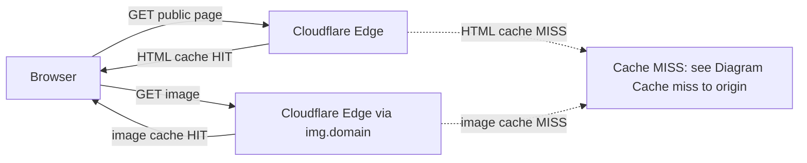
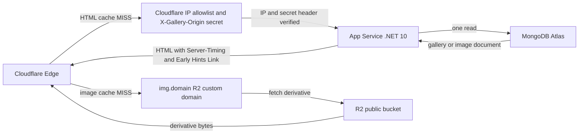
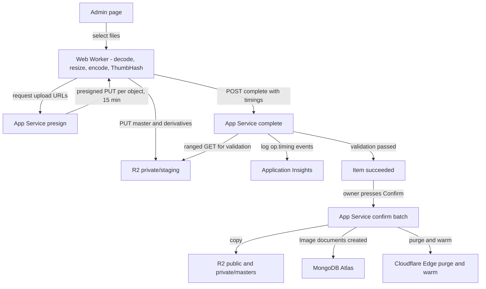
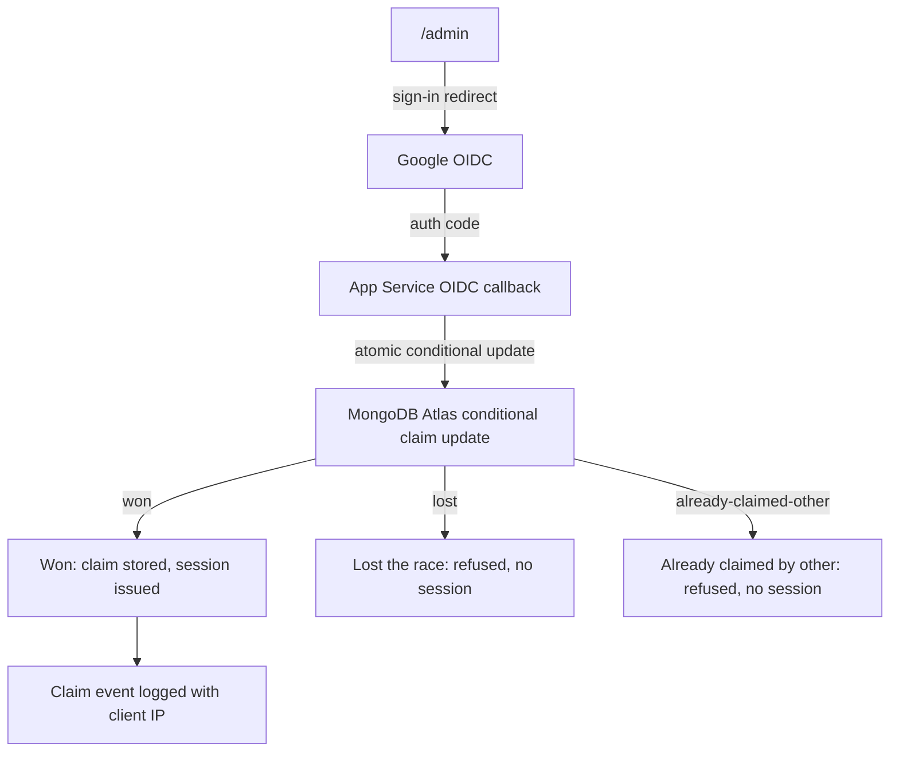
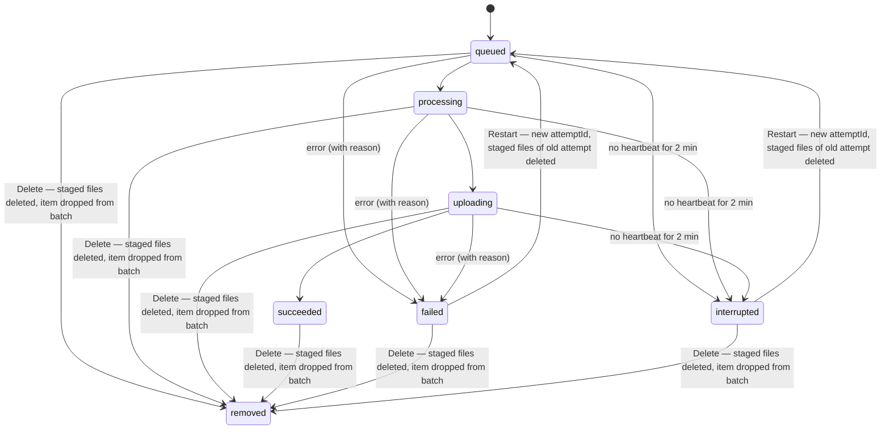
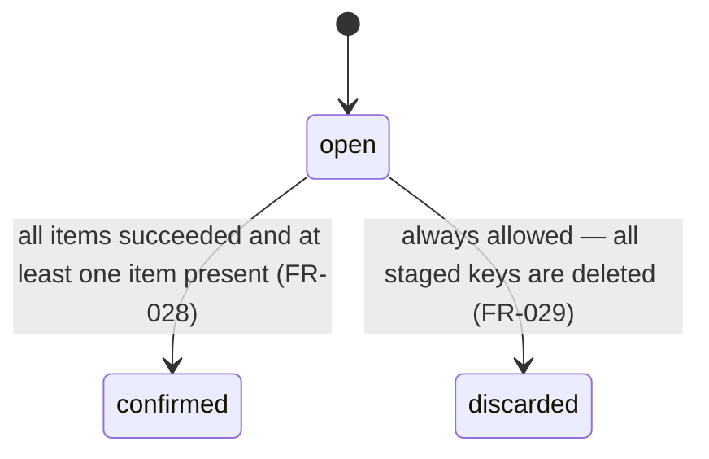

# Gallery Architecture and Stack Design

Source of truth for later features (Constitution VII.2). Generated from specs/001-architecture-stack-design/draft/ — do not edit by hand.

## 1. Overview

This document is the Gallery architecture and stack design. It is the source of truth for all
later features (Constitution VII.2). Any plan that deviates from it must say so in its
Constitution Check and update this document in the same feature. No application source, project
files, or infrastructure changes are produced here; those belong to the first build feature
(FR-001, FR-022).

**Stack at a glance** (Platform Constraints v6.1.0):

- **Application**: .NET 10 minimal APIs, server-rendered HTML; htmx and web components for admin
  interactivity.
- **Hosting**: Azure App Service (Linux, one Basic B2 plan); the origin accepts traffic only from
  Cloudflare.
- **Edge**: Cloudflare DNS, proxy, cache, and TLS in Full (strict) mode. Never Flexible.
- **Identity**: Google OIDC, with a cookie session that has a 7-day sliding expiry renewed while
  it is in use.
- **Data**: MongoDB Atlas free tier, same region as the app.
- **Image storage**: Cloudflare R2 behind a storage abstraction. Two buckets: a public bucket of
  derivatives reachable only through the image hostname, and a private bucket of staged uploads and
  masters kept permanently. The app uses a bucket-scoped credential; uploads use short-lived
  presigned URLs (Constitution 4.0.0, III.9).
- **Image delivery**: derivatives are served on a custom image hostname attached to the public
  bucket as an R2 custom domain, through the Cloudflare cache. Browsers never fetch from the R2 S3
  endpoint or an r2.dev URL.
- **Observability**: workspace-based Azure Application Insights with 30-day retention and a daily
  ingestion cap that keeps it inside the free monthly allowance (VIII.4).
- **Forwarded headers**: the app honors `CF-Connecting-IP` and the forwarded scheme from
  Cloudflare so that generated URLs and audit logs are correct.

**Scale assumption**: cost projections and sizing figures throughout this document assume
approximately 5,000 library images, 50 galleries, and low thousands of visitor page views per
month.

**How to read this document**: Section 2 is the decision record; each entry states one
architectural area with its choice, rationale, alternatives rejected, and pivot cost. Section 3
has four system diagrams covering the main request paths. Sections 4 and 5 define the content
model and the lifecycle of every event that changes stored records or visible pages. Section 6
covers edge cases. Section 7 traces every numbered constitution rule to a mechanism and a
verification method. Section 8 gives the cost table and the configured spending limits. Section 9
is the accepted-risk register. Section 10 lists items deferred to later features. Section 11 is
the source list.

This document is machine-validated by `specs/001-architecture-stack-design/evidence/validate.sh`,
which checks headings, labels, diagrams, traceability, cost figures, and hygiene before any
human review.

## 2. Decision Record

### D-01: App Service Linux B2 with .NET 10 Minimal APIs
**Area**: hosting-runtime
**Status**: given
**Choice**: One Azure App Service Linux Basic B2 plan `portfolio-plan` with the Web App `portfolio-web` in West US (resource group `portfolio`), made by hand by the owner (feature 012; D-24 withdrawn). Always On is enabled; Publish = Code on the built-in .NET 10 (LTS) stack, running .NET 10 minimal APIs. The deploy artifact is the framework-dependent output of `dotnet publish src/Gallery.Web -c Release`. TLS ends at the platform front end, so the app reads the scheme and client IP from forwarded headers, trusted only behind the origin guard (D-03) (012 research R-01, R-04).
**Rationale**: Platform Constraints (v5.0.0) fix the hosting to Azure App Service Linux, one Basic plan no larger than B2, and the runtime to .NET 10 minimal APIs; Constitution VIII.1 (5.0.0) bounds the fixed recurring cost to one B2 plan, and the owner chose B2 (012 decisions #5). Always On keeps the worker process loaded (research R-08; 012 research R-04).
**Alternatives**: B1, the earlier ceiling, was replaced by the owner's choice of B2 (constitution 5.0.0); scaling back down is one setting and needs no amendment (012 decisions #5). Container publish was rejected by the owner: it needs a registry and an image build. Self-contained publish was rejected: the built-in stack already has the runtime, and self-contained triples the artifact (012 research R-01).
**Pivot cost**: high: changing the host or runtime requires a constitution amendment, redoing the runbook (`infra/README.md`) and the access restrictions, and re-validating all cost projections; scaling the plan between B1 and B2 is low, one setting (012 decisions #5).

### D-02: Cloudflare Free in Full (Strict) TLS Mode with Origin CA
**Area**: edge-dns-tls
**Status**: given
**Choice**: Cloudflare Free plan with DNS proxy, Full (strict) TLS mode, and a 15-year Cloudflare Origin CA certificate installed on the origin [cf Q5]. Feature 012: the certificate is for `port.zacal.me`, converted to a password-protected PFX locally, uploaded to App Service and bound to the custom domain with SNI; the PFX and its private key never enter the repository (012 research R-13).
**Rationale**: Constitution VIII.2 mandates free TLS certificates; Platform Constraints (v3.0.0) specify Cloudflare DNS, proxy, cache, and TLS in Full (strict) mode — never Flexible. Cloudflare Universal SSL covers the edge; the Origin CA is free and lasts 15 years (research R-01; [cf Q5]).
**Alternatives**: Flexible TLS mode was rejected because it leaves the edge-to-origin hop unencrypted and the Platform Constraints forbid it. A paid or publicly trusted origin certificate was rejected by Constitution VIII.2. Cache Reserve was rejected as paid-only [cf Q8]. A Cloudflare Worker in front of the origin was rejected as unnecessary because Cache Rules already handle the session-cookie bypass (research R-01). The free App Service Managed Certificate was rejected in feature 012: since 28 July 2025 it is validated over HTTP by DigiCert, and Microsoft Q&A reports issuance and renewal failing behind a Cloudflare-proxied CNAME, a failure that would surface only at renewal (012 research R-13; 012 decisions #14).
**Pivot cost**: low: switching to a different edge or TLS provider requires DNS record changes and replacing the origin certificate, with no data migration.

### D-03: Cloudflare IP Allowlist plus Secret Origin Header
**Area**: origin-lockdown
**Status**: chosen
**Choice**: Three layers, none of which needs a certificate on the origin (feature 012, 012 research R-04). (1) App Service access restrictions on the main site allow Cloudflare's published IPv4 and IPv6 ranges and deny everything else [az Q2]; the `scm` deploy site keeps its own unrestricted rules, protected by Entra sign-in because basic authentication is off, so GitHub-hosted runners can deploy. (2) A Cloudflare request-header transform rule on `port.zacal.me` sets the secret header `X-Gallery-Origin` on every request it forwards; the app refuses any request without the exact value with 403 and an empty body, compares it in constant time, and logs the refusal as `origin.refused` with method, path, status and duration. The secret is random, at least 32 characters, held only in the app setting `Hosting__OriginSecret` and the Cloudflare rule, never in the repository. (3) Only behind that guard does the app trust `CF-Connecting-IP` for the client IP and `X-Forwarded-Proto` for the scheme; the known networks and proxies lists are cleared because the platform front end's addresses are not published, so the origin secret is the trust anchor [cf Q6], [az Q7]. One switch, `Hosting:Edge = cloudflare`, turns on layers 2 and 3 together, and startup fails if the secret is shorter than 32 characters. Always On pings carry no header and get 403, which still keeps the worker loaded.
**Rationale**: Platform Constraints require that the origin accept traffic only from Cloudflare. An IP-only allowlist can be bypassed by any attacker routing through a Cloudflare account, because the ranges are public; the secret header, Cloudflare's documented HTTP header validation pattern, closes that gap. Trusting `CF-Connecting-IP` without the guard would let anyone forge the address in the claim log (Constitution I.5), so forwarding and the guard cannot be enabled separately. Without forwarded-scheme handling every request reaches Kestrel as http, and the Secure antiforgery cookie makes `/admin/signin` answer 500 (012 research R-01, R-04; 012 decisions #8, #9, #10).
**Alternatives**: Authenticated Origin Pulls, the earlier choice (decisions #14), was replaced in feature 012: on App Service the platform terminates TLS, client-certificate mode Required refuses Always On's own pings and still leaves certificate validation to the app, and the global AOP certificate is shared across all Cloudflare accounts, so on its own it proves no more than the IP list; a per-zone certificate adds an upload and rotation runbook for no gain over the secret. Cloudflare Tunnel was rejected because App Service cannot run `cloudflared` beside the app on the code stack. IP allowlist alone was rejected because the Cloudflare IP ranges are public and any Cloudflare account can be used to reach an IP-only origin [az Q2]. Exempting the Always On user agent from the guard was rejected because a user agent is trivially forged. Direct origin exposure without the allowlist was rejected because it would allow cache bypasses and expose the origin to unfiltered traffic.
**Pivot cost**: low: the guard is one app setting plus the Cloudflare transform rule, and the allowlist is an App Service configuration change, with no data migration; Authenticated Origin Pulls can be added later as a fourth layer (012 decisions #9).

### D-04: Google OIDC, Host-Prefixed Cookie, Atomic Conditional Claim
**Area**: identity-claim
**Status**: given
**Choice**: Google OIDC via the built-in ASP.NET OIDC handler; session stored in a `__Host-` prefixed cookie (Secure, HttpOnly, SameSite=Lax) with a 7-day sliding expiry; ownership established by an atomic conditional write to the datastore as specified in data-model.md; a winning claim emits a `claim` event to Application Insights carrying the Google subject, the client IP from `CF-Connecting-IP`, and the timestamp, which are also stored on the site document; no claim token is used (research R-11; decisions #3; spec FR-018). Feature 007 refinements (007 research R-01, R-03): the owner cookie scheme is bound to admin endpoints only, with no default authentication scheme and the framework's automatic single-scheme default suppressed, so public requests never read the session; every challenge sends `prompt=select_account`; the requested scope is `openid` only.
**Rationale**: Constitution I.1 requires the first successful Google OIDC sign-in from `/admin` to claim ownership atomically — when two sign-ins race, exactly one becomes owner and the other is refused; Constitution I.2 binds ownership to the Google subject identifier, never an email address; Constitution I.5 requires the claim event to be logged with identity, client IP, and timestamp; Platform Constraints (v3.0.0) specify Google OIDC with a 7-day sliding session renewed while in use (research R-11; decisions #3; spec FR-018).
**Alternatives**: An optional claim token to pre-seed the owner before the first sign-in was noted in Constitution I as a design option for the unclaimed-window risk but was not adopted. No other identity providers were evaluated because the constitution mandates Google OIDC.
**Pivot cost**: low: changing the session duration is a single configuration setting; switching the identity provider requires a constitution amendment and re-provisioning (decisions #3).

### D-05: MongoDB Atlas Free Cluster Co-Located with App Service
**Area**: datastore
**Status**: given
**Choice**: One MongoDB Atlas Free cluster `gallery-prod` on Azure `westus`, the same region as the App Service (Atlas Free is supported there: 012 `evidence/probe-atlas-region.txt`), with database `gallery`, database user `gallery-app` holding readWrite on `gallery` only, and network access limited to the app's outbound IPs. The committed script `infra/atlas.sh` creates the project, cluster, user and access list with the official Atlas CLI (`atlas auth login` in the browser, so no API key is stored); it is idempotent, takes the outbound IPs as arguments, and prints the generated password once for the owner to paste into the app setting (012 decisions #19, #22; [st Q7], [st Q10]). No datastore keep-alive is built: the first request after an Atlas Free pause reconnects (012 decisions #24, Constitution V.4).
**Rationale**: Platform Constraints (v3.0.0) specify MongoDB Atlas free tier in the same Azure region as the app; Constitution VIII.1 requires free tiers wherever one covers the need. The Free cluster supports transactions and unique indexes; at 5,000 images the document store occupies about 15 MB, which is 3% of the 0.5 GB quota; the 100 ops/s limit and 10 GB per 7 days of transfer are comfortable at the stated scale (research R-03; [st Q7], [st Q10]).
**Alternatives**: None; MongoDB Atlas Free is a binding Platform Constraint (v3.0.0) with no alternative datastores evaluated in this design. Creating the cluster by hand in the Atlas console was replaced by the committed script at the owner's request (012 decisions #19). A keep-alive timer against Atlas Free pauses was rejected by the owner as a marginal benefit (Constitution V.4; 012 decisions #24).
**Pivot cost**: medium: migrating to a different datastore requires updating the data-access layer, rewriting all queries, and performing a live data migration, though image files in R2 are unaffected.

### D-06: Explicit Antiforgery Validation on Every Admin State-Changing Request
**Area**: csrf
**Status**: chosen
**Choice**: An endpoint filter on the `/admin` route group calls the built-in antiforgery service's explicit validation for every request whose method is not GET, HEAD, OPTIONS or TRACE, and answers 400 without side effects when validation fails; the token is accepted from the form field or the `X-CSRF-TOKEN` header, so one filter covers HTML forms and the script-sent JSON endpoints (presign and complete); the antiforgery cookie is `__Host-` prefixed and always Secure; the built-in antiforgery middleware is not relied on (007 research R-04 and its probe; research R-11; [az Q8]).
**Rationale**: Constitution I.6 requires all admin state-changing requests to be protected against cross-site request forgery. The 007 probe showed the built-in middleware only records a result that form binding later checks, so POSTs whose handler binds no form (sign-in start, sign-out) succeeded with no token even with the require-token metadata; explicit validation refused them and accepted a valid token from either the form field or the header (007 research R-04; [az Q8]).
**Alternatives**: Built-in antiforgery middleware alone with header tokens for JSON endpoints (the original choice): rejected after the 007 probe because it leaves bodiless and non-binding POSTs unprotected. Per-endpoint validation calls: rejected because a new admin route could omit one; the group filter is closed by default.
**Pivot cost**: low: CSRF protection is implemented entirely in middleware configuration and does not affect stored data or external service integrations (research R-11).

### D-07: Storage layout
**Area**: storage-layout
**Status**: given
**Choice**: Two Cloudflare R2 buckets in the same Cloudflare account as the zone. The `public` bucket holds derivatives in Standard storage and is reachable only through `img.<domain>`, attached as an R2 custom domain; its r2.dev development URL is disabled. The `private` bucket has no public access of any kind and holds `staging/` (uploads in progress) and `masters/` (permanent originals). A lifecycle rule moves `masters/` objects to Infrequent Access storage after 30 days. Derivative object names are content hashes (`{sha256-16hex}.{avif|webp}`). The app reaches R2 through its S3-compatible API with one API token limited to Object Read and Write on these two buckets, supplied by configuration outside source control. The bucket names are configuration, so development and production use different buckets.
**Rationale**: Constitution Platform Constraints (4.0.0) bind R2 with two buckets and permanent masters (III.1), and III.9 binds the private bucket, the credential scope, and the disabled development URL. A separate bucket is required for privacy because a custom domain exposes the whole bucket it is attached to [st Q2]. Egress is free and the first 10 GB-month is free [st Q1]. Infrequent Access costs about a third less for files read only at upload time; its 30-day minimum and retrieval fee do not apply to masters that are kept and rarely read [st Q1]. Bucket-scoped Object Read and Write tokens exist [st Q11], which keeps a leaked credential away from account settings and other buckets.
**Alternatives**: Azure Blob Storage with managed identity (constitution 3.0.0) was replaced by the owner: it tied images to Azure while hosting is under review, and it needed Cloud Connector or a Worker for the image hostname. One bucket with prefixes was rejected because the custom domain would expose staging and masters. Masters in Standard storage forever was rejected for cost. An account-scoped or admin token was rejected by III.9. Sequential or title-derived derivative names are rejected because they are guessable, violating II.3 (decisions #9).
**Pivot cost**: high after launch: derivative URLs are immutable content-addressed hashes; moving storage again means copying every object and keeping `img.<domain>` URLs unchanged. Low before launch, since nothing is stored yet (decisions #9, #34).

### D-08: Upload intake
**Area**: upload-intake
**Status**: chosen
**Choice**: JPEG only, at most 20 MB per file; the admin page refuses any other file before processing starts, and the server enforces the same type and size limits again before presigning and when validating the staged master. Each upload is a direct browser PUT to `private/staging/{batchId}/{itemId}/{attemptId}/{name}` using an S3 presigned URL that allows PUT on that exact key only, carries the expected content type, and expires after 15 minutes. The `private` bucket's CORS policy allows PUT from the admin origin only [st Q3].
**Rationale**: A 20 MB file needs one PUT, so no multipart upload (spec FR-014). Sending files straight to R2 keeps 20 MB uploads off the single-vCPU origin. Presigned URLs give the browser a capability for one object and one method without ever giving it the credential (Constitution III.9; [st Q3]).
**Alternatives**: Streaming uploads through the app was rejected because the origin's CPU and memory are small (research R-05). Presigned POST policies and multipart upload are unnecessary at 20 MB. R2 temporary credentials were rejected: a presigned URL is narrower, one object and one method.
**Pivot cost**: medium: switching to a server-side streaming path requires a new upload endpoint, a change to the storage abstraction, and removal of the presign step (decisions #7).

### D-09: Client-side derivative pipeline
**Area**: client-derivatives
**Status**: chosen
**Choice**: A dedicated Web Worker runs the full pipeline: decode with `createImageBitmap(file, {imageOrientation:'from-image'})`, resize at ladder widths 320, 640, 960, 1280, 1920, and 2560 px with no upscaling past the source width, encode each width as AVIF and WebP with single-threaded jSquash WASM, output sRGB only (P3 exports are silently converted), compute a ThumbHash from a copy downscaled to at most 100 px on the long edge (ThumbHash's input limit; amended by feature 008, research R-02: originally "the 320 px bitmap") and render it to a ≤32 px WebP data URI stored on the image record. A source narrower than 320 px gets exactly one width, its own, in both formats (feature 008 Clarification 5). The widths to encode come from the server's read of the stored master, never from the page. The codec files (single-threaded AVIF encoder, SIMD WebP encoder, ThumbHash) are vendored from pinned npm tarballs into the app's static assets by a committed script, with no JS build step (feature 008 research R-01). Timings for decode with orientation (one platform call, so one timing), each resize and encode width, the placeholder, and the total are posted with the `complete` call and logged as `op.timing` events.
**Rationale**: Running in a Web Worker avoids blocking the admin page (research R-07 [br Q1, Q2]). Single-threaded jSquash builds require no COOP/COEP cross-origin isolation, reducing fragility on the admin page (decisions #10). sRGB-only output is chosen because jSquash has no ICC passthrough; this is a documented decision with low revert friction (decisions #12; research R-07 [br Q7]). The ThumbHash data URI is inlined as a stacked image layer fitted exactly like the photo (amended by feature 003, research R-03: originally "a CSS background"), so public pages need no JavaScript or per-image CSS for placeholders (decisions #13; research R-07 [br Q6]).
**Alternatives**: A native worker process on the owner's own machine (for example a Rust program) was rejected (FR-023): it would need an owner credential other than the browser session, which affects Constitution I.3 (every non-owner identity is refused and only the Google session is admin), and it adds an install step; its pivot cost is medium — add a scoped upload credential and an upload endpoint, with no change to the storage layout. Server-side encoding was rejected by Constitution III.8 and the small fixed-cost App Service plan (research R-08). Canvas `toBlob` for WebP was rejected because Safari cannot encode WebP from a canvas, and no browser reliably encodes AVIF natively (research R-07 [br Q3]). Multithreaded jSquash builds were rejected because they need COOP/COEP cross-origin isolation (decisions #10; [br Q4]).
**Pivot cost**: medium: adding ICC passthrough or switching encoders requires a new WASM build and changes to the pipeline; the rest of the Worker interface is unchanged (decisions #12).

### D-10: Server-side validation
**Area**: server-validation
**Status**: given
**Choice**: For each staged derivative, the server reads it with a ranged GET from the `private` bucket and parses only the container structure: AVIF (`ftyp` must be `avif`; dimensions from `ispe`; no `Exif` or XMP `infe`/`mime` items; `colr` box only with nclx; one `av01` item only, no `iref`, and an allowlist of item properties) and WebP (RIFF/WEBP with VP8, VP8L, or VP8X; ICC, EXIF, and XMP flags clear; no ICCP, EXIF, or XMP chunks). Any ICC profile is rejected (feature 008: stricter than III.5 allows, matching the second reader; real jSquash output carries none). MetadataExtractor is used as a second independent check and must report only allowlisted directories. The whole image is rejected if any derivative fails, and the placeholder preview is validated the same way. For the master, the server reads the JPEG header (SOF size and EXIF orientation, so stored dimensions are upright) and the EXIF camera-allowlist fields via a ranged download of the first 256 KB, retrying once with 1 MB; pixels are never decoded anywhere on the server. The server records each validated file's ETag, and confirm copies with `x-amz-copy-source-if-match` so a staged file overwritten after validation is never published (feature 008 research R-09).
**Rationale**: Constitution III.5 requires that the server validate every uploaded derivative by parsing the file structure, never trusting client-declared values. III.6 requires rejecting the whole image when any derivative fails. III.7 requires the server to extract the camera allowlist from the master. III.8 prohibits the origin from decoding or encoding pixels. A fixture AVIF and a fixture WebP, each with injected GPS, must be rejected (research R-06 [az Q5, Q6]; decisions #11).
**Alternatives**: Trusting client-declared dimension and metadata flags is prohibited by Constitution III.5. Using a full image decoder such as ImageSharp would violate III.8 and add image-decode CPU load to the fixed-cost App Service plan. MetadataExtractor alone without hand-written parsers was rejected because two independent readers are required for the GPS-rejection guarantee (decisions #11; research R-06).
**Pivot cost**: low: the parsers are about 200 lines each and are isolated behind a validation interface; replacing them does not affect storage, upload, or confirm paths (decisions #11).

### D-11: Upload batch lifecycle
**Area**: upload-batch
**Status**: chosen
**Choice**: At most one open batch exists, enforced by a unique partial index on `{state:"open"}`. A batch holds at most 100 items, a server setting enforced atomically on append (feature 008 Clarification 2); files picked while a batch is open join it. Each BatchItem has a state machine (`queued → processing → uploading → succeeded`; `failed` and `interrupted` from any non-terminal state, including `queued`, so a photo still waiting when the tab closed can be restarted (feature 008 Clarification 4); Restart resets to `queued` with a new `attemptId`; Delete removes the item and its staged objects). An item is marked interrupted when no heartbeat has arrived in 2 minutes, evaluated when the batch is read; the interrupted state is computed, never stored. Confirm is gated client- and server-side on every item being in `succeeded`; once accepted it locks the batch against every other change until it finishes, and each confirm copy step is idempotent. Staged files are deleted explicitly on delete, restart, rejection, discard, and confirm, and a 7-day R2 lifecycle rule on `staging/` is the backstop [st Q4]; no server timer sweep is built (feature 008 research R-13).
**Rationale**: A single open batch matches the single-owner model and prevents concurrent batch confusion (spec FR-029). Heartbeat-based interrupted detection requires no running timer and is deterministic on read (decisions #17; spec FR-026, FR-027). Idempotent confirm copies allow safe retry after a mid-confirm crash (data-model "Upload batch"; decisions #16; spec FR-028). The 7-day lifecycle rule is a free backstop requiring no error-path code (spec FR-030; decisions #16; research R-05 [st Q4]).
**Alternatives**: A server-side timer enforcing item timeouts in real time was rejected as unnecessary complexity when the interrupted state can be computed lazily on read (decisions #17). A best-effort server timer sweeping orphaned staged objects was dropped by feature 008: the lifecycle rule already covers it. Immediate staging cleanup on every failure path was rejected because the lifecycle rule backstop covers the same ground for free (decisions #16).
**Pivot cost**: low: the state machine and heartbeat logic are self-contained in the batch service; adding a real-time timer or changing the interrupted threshold requires only changes to that service (decisions #16, #17).

### D-12: Observability
**Area**: observability
**Status**: given
**Choice**: Workspace-based Application Insights `portfolio-appinsights` via the Azure Monitor OpenTelemetry distro, package `Azure.Monitor.OpenTelemetry.AspNetCore` 1.6.0, with sampling explicitly off: `SamplingRatio = 1.0`, `TracesPerSecond` unset, trace-based log sampling off (`EnableTraceBasedLogsSampler = false`), and Live Metrics off. The wiring is conditional: the distro is added only when `APPLICATIONINSIGHTS_CONNECTION_STRING` is set (App Service sets it when Application Insights is enabled), so local and test hosts are unchanged, and an unreachable ingestion endpoint never blocks a request. The JSON console logger stays, so the App Service log stream shows the same lines. `http.request` and `op.timing` events are ILogger structured logs whose fields land in `customDimensions` and are queryable via KQL by message-template prefix. Retention is 30 days; a 0.15 GB (150 MB) daily ingestion cap keeps usage inside the 5 GB/month free allowance. `Server-Timing` headers are sent on public pages. Evidence is collected by the saved KQL queries in `specs/012-production-infrastructure/evidence/kql/`, run with `az monitor app-insights query` by `evidence/kql.sh`, and committing the output (012 research R-06, R-09).
**Rationale**: Constitution Platform Constraints PC.8 requires workspace-based Application Insights with 30-day retention and a daily ingestion cap that keeps usage inside the free allowance (VIII.4). Sampling is off because the time-bound success criteria require every event; at low-thousands of origin requests per month, volume is about 2% of the free 5 GB (research R-09 [asl Q8, Q9]; decisions #4, #18; spec FR-020, FR-024). The distro's defaults, rate-limited sampling at 5 traces per second and dropping logs tied to unsampled traces, would silently thin the `http.request` and `op.timing` evidence, so both are turned off (012 research R-06; 012 decisions #13).
**Alternatives**: App Service file logs are free but not searchable and were rejected by the owner (decisions #4; research R-09). An external log service was rejected for adding a vendor without a cost or capability advantage over the included Application Insights free tier. The `Microsoft.OpenTelemetry` package, named here before feature 012, was replaced by `Azure.Monitor.OpenTelemetry.AspNetCore`: Microsoft ships both, the newer one adds an agent dependency set, and the Azure Monitor distro is smaller and exposes every switch needed (012 research R-06, probed in `evidence/probe-otel-options.txt`; 012 decisions #12).
**Pivot cost**: low: changing the telemetry backend is a one-package swap; the structured log schema and saved KQL queries are reusable on any OpenTelemetry-compatible backend (decisions #4).

### D-13: Library-First Content Model
**Area**: content-model
**Status**: chosen
**Choice**: Images are first-class objects in the owner's library. A gallery is an ordered selection of library images; one image can belong to any number of galleries. Images carry a required title (defaulting to the file name without its extension) and an optional caption shown in the solo view. Galleries carry a title and a description. On the galleries listing (`/g`; feature 011 moved it off the home page), galleries are ordered manually by the owner; within a gallery, images are ordered manually via an `items` id list. The cover image is the pinned image (`pinnedCover`) if set, otherwise `items[0]`; when the gallery has no images the cover is null. GalleryCard fields (coverImageId, placeholder, dimensions, imageCount) are denormalized onto each gallery and onto the site document's `homeCards` array so the galleries listing is a single datastore read. Amended by feature 011: the home page `/` shows only links and makes no datastore read.
**Rationale**: A library-first model lets one image appear in multiple curated galleries without duplication and decouples image identity from gallery membership (spec FR-009; data-model `Gallery`, `GalleryCard`; decisions #19). Denormalization satisfies the single-read listing constraint (data-model `homeCards`, IV.9).
**Alternatives**: Gallery-first (images exist only inside a gallery) was rejected because it requires duplication when one image appears in multiple galleries and couples delete semantics to gallery membership, complicating the hard-delete path (spec FR-013). A flat, gallery-less library was rejected because the spec requires manually ordered galleries with a cover and a description (spec FR-009).
**Pivot cost**: medium: changing from library-first to gallery-first after data exists requires restructuring the data model and migrating every gallery-membership and `homeCards` record; no URL changes occur.

### D-14: Visibility and Addressing
**Area**: visibility-addressing
**Status**: chosen
**Choice**: Gallery and image identities are 128-bit random values encoded in base32 (26 characters, never sequential, never derived from titles). Gallery pages use `/g/{id}/{slug}`; a stale or missing slug triggers a 301 redirect to the current canonical URL. New galleries default to `private`. Private galleries are marked `noindex` and excluded from the home-page listing, feeds, and sitemaps, but remain reachable by direct link. Library images and private-gallery images are unlisted; their derivatives are reachable by direct content-addressed URL on `img.<domain>` only (amended by constitution 4.0.0: the R2 bucket has no other public address, III.9). The app never emits R2 endpoint URLs in markup or API responses.
**Rationale**: Opaque base32 ids satisfy the unguessability rule so addresses cannot be inferred from titles or sequence numbers (Constitution II.3). The cosmetic `{slug}` segment keeps URLs readable while the stable id in the path satisfies the rename-without-breaking-links rule (Constitution II.4). Derivative names are content hashes, so they are unguessable in practice — derivatives are "unlisted, not secret" (spec FR-011, FR-012; D-19).
**Alternatives**: Sequential numeric IDs were rejected because they are guessable in violation of Constitution II.3. UUID v4 paths without a slug were rejected because the owner cannot produce readable share links; slug-only paths were rejected because renaming would break every shared link (II.4). Returning 404 for a stale slug was rejected because it breaks existing shares (II.4). Making the public bucket private and signing every URL was rejected because it prevents immutable edge caching (research R-04).
**Pivot cost**: high: changing the ID scheme after deployment changes every gallery and derivative URL, breaks all shared links, and requires an edge-purge of the full public namespace and a full data migration.

### D-26: Camera Grouping
**Area**: camera-grouping
**Status**: chosen
**Choice**: Added by feature 013 (specs/013-by-camera). Three public pages group visible photos by the camera that took them: `/c` (camera listing, `ContactSheet` 3 / 3 / 1 of camera cards), `/c/{slug}` (a camera's photos, 4 / 3 / 1) and `/c/{slug}/{imageId}` (the reused photo page, stepping within the camera). A derived collection `cameras` holds one document per camera with at least one visible photo: key (normalised make and model: trimmed, whitespace collapsed, case-folded), readable slug (from the display name, stable per key, `-2` suffixes on collision), display name (the photo page's own camera formatter over the newest photo), visible photo ids newest first, rank (count, then name) and a denormalised card. A photo is visible only when it is in at least one listed gallery (public with photos), is not being deleted, and has a make or model. The collection is written only by the site projection that already runs after every owner write (single writer, guarded by a source scan), and only for documents that changed. Each projection reports the changed cameras, and the owner operation adds their pages (P-CAM; title edits P-CAMTEXT) to the one edge purge it already sends.
**Rationale**: Visibility comes only from listed galleries, so a private-only or library-only photo never appears (Constitution II.2) and no upload is published as a side effect (Constitution II.5); a private-only camera and an unknown one answer the same not-found page. Denormalised cards keep the listing to one datastore read and the camera pages to two, matching the gallery pages (Constitution IV.9). Hooking the existing projection reaches every owner write path without new call sites. The decision is recorded here as the design-record update (Constitution VII.2).
**Alternatives**: Aggregating at request time (group images by camera, join listed galleries) was rejected: two or more reads and a scan of every image per uncached request (IV.9). Storing camera cards on the `site` document beside `homeCards` was rejected: the camera pages need each camera's full photo list, which would bloat the `/g` read. Denormalising a camera key onto each image was rejected: visibility lives on galleries, so the camera page would still need two reads, and a stale flag could show a private photo (research R-01).
**Pivot cost**: medium: the store, the reader and the purge input would move together; URLs `/c/...` would stay.

### D-15: Public Page Rendering
**Area**: public-rendering
**Status**: given
**Choice**: Public pages are server-rendered HTML with no client-side framework. Critical CSS is inlined; system fonts are used so no web-font request is made. The .NET 10 minimal-API host uses the built-in output cache for anonymous public pages. Images are served with a `<picture>` element listing the AVIF source first, then WebP, then ``, with `srcset` and `sizes` so every viewport gets the smallest sufficient derivative. Every `` carries the stored width and height. The solo view paints the gallery thumbnail, already in the browser cache, at full size as the image's initial layer and reveals the sharp `<picture>` over it once decoded; this is CSS layering, so it needs no JavaScript. The galleries listing (`/g`) renders from the denormalized `site.homeCards` in one datastore read; the home page (`/`) renders fixed links with no read (amended by feature 011). Pages work with JavaScript disabled; scripted behaviour on public pages is progressive enhancement only. Amended by feature 006 (research R-07): anonymous public HTML carries `Cache-Control: public, max-age=0, s-maxage=86400` and the origin output cache holds each page for 60 seconds.
**Rationale**: Constitution IV.8 requires dimensions in markup, IV.15 requires the thumbnail-first paint, and IV.9 requires a single home-page read. Constitution IV.22 prohibits shipping a client-side framework and mandates inlined critical CSS and system fonts. Constitution V.3 mandates that public pages work without JavaScript. Constitution IV.21 mandates origin output caching for public pages and one-year immutable caching for content-addressed assets. The `<picture>` element with AVIF-first ordering satisfies IV.6's format ladder (research R-10; [wp Q6]).
**Alternatives**: React or a similar SPA framework was rejected by Constitution IV.22 and V.3 (adds a dependency, the page fails without JS, and IV.22 prohibits it). Server-side image transcoding at view time was rejected by Constitution III.8 (origin MUST NOT decode pixels) and the IV precomputation model. An external web-font CDN was rejected by Constitution IV.22 (system fonts are the required default; a single self-hosted variable font is the allowed exception).
**Pivot cost**: medium: adding a client-side framework after launch requires replacing every server-rendered template and re-verifying compliance with Constitution IV.22 and V.3; removing it again would be equally disruptive.

### D-16: Edge Caching and Purge
**Area**: edge-cache
**Status**: chosen
**Choice**: Anonymous HTML responses for public pages are cached at the Cloudflare edge with a 1-day TTL. The cache is bypassed when the owner session cookie is present. On a content change, affected pages are purged by URL (limit: 800 URLs/s, 100 URLs per API call). Images are served on `img.<domain>`, the R2 custom domain of the `public` bucket (D-19), with a 1-year edge TTL matching each object's `Cache-Control: public, max-age=31536000, immutable` metadata. Derivative URLs on `img.<domain>` are purged by URL like pages. Smart Tiered Cache is enabled, which puts one upper tier next to the bucket [st Q2]. Public pages and their referenced derivatives are warmed after each purge. Amended by feature 009 (research R-06): every existing page is purged, which includes the pages of a private gallery that holds photos, because they are reachable by link and edge-cacheable. A page exists for the galleries listing and for every gallery with at least one photo, and for its photo pages. Amended by feature 011: the listing's purge address is `/g`; the home page `/` shows fixed links, so no owner change purges it. Purge and warm run after the owner's change is saved, in a background queue, and never delay or undo it. They sit behind one replaceable interface with three modes: log-only when no zone credentials are configured, development zone (purges and warms only image-file URLs on the development image hostname; page URLs stay log-only until hosting exists), and a recorder in tests. Warm requests the purged pages anonymously, then every AVIF width of the images in each page's first row. Amended by feature 012 (012 research R-07): production runs the same provider with page purge on (`Edge:PurgePages = true`, `Edge:SiteBaseUrl = https://port.zacal.me`, and a token limited to Zone > Cache Purge on `zacal.me`); its mode label stays `dev-zone` (012 decisions #16). Warm requests go through Cloudflare, so they carry the origin secret and pass the guard (D-03). A Cloudflare Cache Rule on `port.zacal.me` makes HTML eligible for caching and respects the origin's `s-maxage=86400`; it bypasses the cache when the request carries the `__Host-gallery` cookie and for every path under `/admin`, `/signin-oidc`, `/signout-callback-oidc` and `/ui`.
**Rationale**: A 1-day HTML TTL bounds the staleness window when a purge fails, satisfying IV.18's self-healing requirement. URL purge is the most precise and fastest purge available on the Free plan (research R-01; [cf Q1]). An R2 custom domain is part of the zone, so the zone's cache, cache rules, and URL purge apply to images with no proxy or Worker (research R-04; [st Q2]; decisions #15, #34). Tiered Cache reduces origin pull frequency ([cf Q2]).
**Alternatives**: Azure Front Door was rejected because it costs about $35/month, violating the Constitution VIII.1 cap (research R-04). Tag and prefix purge were rejected because the Free plan rate-limits them to 5 requests/min, which is too slow for a batch of page purges ([cf Q1]). Cache Reserve was rejected as paid-only ([cf Q1]). Serving images from the R2 S3 endpoint or an r2.dev URL was rejected: neither is cached, and III.9 forbids the development URL.
**Pivot cost**: low: adjusting TTL values and purge strategy is Cloudflare dashboard and Cache Rules configuration; image URLs do not depend on the storage service behind `img.<domain>` (decisions #15).

### D-17: Predictive Loading and View Transitions
**Area**: predictive-loading
**Status**: given
**Choice**: An inline Speculation Rules script prerenders gallery and image links at `eagerness: moderate`. A hover/touch script (~20 lines) adds a `<link rel=preload>` for the destination image's `srcset` on `pointerenter`/`touchstart`. The solo view prefetches the previous and next images after the `load` event. Both scripts check `navigator.connection?.saveData` and skip when Save-Data is true; Chromium also suppresses prerender automatically under Battery Saver. Cross-document View Transitions use `@view-transition {navigation:auto}` with `view-transition-name: img-{id}` on source and destination pages; unsupported browsers navigate normally. The LCP image gets `fetchpriority=high`; all others get `loading=lazy decoding=async`. Anonymous responses carry no `no-store` and pages have no `unload` handlers, keeping them bfcache-eligible. Early Hints are sent via the Cloudflare edge from the origin's `Link: rel=preload` headers; extension-free paths qualify ([cf Q3]; [wp Q8]). Amended by feature 006 (research R-07, R-08): `view-transition-name` is emitted as a per-page `<style>` block of `#p-{id}` rules because inline `style` is banned (D-21); hover preload applies to photo tiles only, whose destination image is known, while gallery cards rely on Speculation Rules; the origin's preload `Link` names the primary image only, since critical CSS is inlined and needs no fetch. Amended by feature 010 (research R-07): the same inline module also holds a 5-line key handler (Left/Right click the photo page's `rel=prev`/`rel=next` links, Escape clicks the gallery link, since owner review 1 the breadcrumb's gallery item; no modifier, not in a form field), registered BEFORE the Save-Data early return, so Save-Data suppresses fetching only and never the keys; nothing on the page mentions the keys.
**Rationale**: Constitution IV.11 mandates Speculation Rules for gallery and image links. Constitution IV.12 mandates hover/touch preload of the destination image. Constitution IV.13 mandates solo-view prefetch of previous and next images. Constitution IV.14 mandates Save-Data suppression. Constitution IV.16 mandates cross-document View Transitions with graceful fallback. Constitution IV.17 mandates high fetch priority on the primary image and lazy loading on others. Constitution IV.19 mandates Early Hints. Constitution IV.20 mandates bfcache eligibility. All mechanisms are confirmed available on the chosen stack (research R-10; [wp Q1–Q5, Q8]).
**Alternatives**: A JavaScript-only prefetch library without Speculation Rules was rejected because Speculation Rules add full prerendering at no extra cost and Chromium handles the Save-Data guard automatically (IV.11). Disabling View Transitions was rejected because Constitution IV.16 mandates them where supported. Omitting the Save-Data guard was rejected because Constitution IV.14 requires it. Skipping Early Hints was rejected because Constitution IV.19 requires them; the Cloudflare edge generates them from `Link` headers with no origin change needed ([cf Q3]).
**Pivot cost**: low: all features are progressive enhancement; adjusting or removing them requires changes to inline scripts and CSS only, with no data-model impact.

### D-18: Metered Cost Cap
**Area**: other
**Status**: given
**Choice**: Metered spend on everything beyond the fixed B2 plan is capped at $10/month by governance: exceeding it requires a constitution amendment. No budget alert is configured: the owner withdrew it ("No alert needed"; constitution 6.0.0; 012 decisions #21). The Application Insights daily ingestion cap of 0.15 GB (150 MB) on `portfolio-appinsights` is the only configured hard limit, because it is the only metered service in this design that offers one (Constitution VIII.4). The B2 plan, US$26.28/month at list price, is the fixed cost and has no metered component (012 research R-12).
**Rationale**: Constitution VIII.1 (6.0.0) caps metered spend at $10/month and no longer requires a spending alert; Constitution VIII.3 keeps the projected metered total under $7/month; Constitution VIII.4 requires that every metered service offering a hard spending limit have one configured inside the VIII.1 cap. Application Insights offers a daily ingestion cap; 150 MB/day keeps monthly ingestion well inside the 5 GB/month free allowance at about 4.5 GB/month worst case (research R-09; decisions #6). Nothing notifies the owner if Azure spend rises; this is bounded in practice because the plan is fixed-price and the ingestion cap limits the only metered Azure line (012 decisions #21).
**Alternatives**: The owner was offered caps of $2 (alert $1.50), $5 (alert $3), $10 (alert $7), or no cap, and chose $10 with a $7 alert in the hosting interview (decisions #6). That Azure budget alert at $7 and $10 was withdrawn by the owner in feature 012 (constitution 6.0.0); one budget on the resource group restores it with no code change. A higher daily Application Insights cap was rejected because 150 MB/day already keeps monthly ingestion inside the 5 GB free allowance (research R-09).
**Pivot cost**: low: changing the cap requires an amendment to Constitution VIII.1, and restoring an alert is one Azure budget in the portal; neither touches application code (012 decisions #21).

### D-19: Image Hostname
**Area**: other
**Status**: chosen
**Choice**: `img.<domain>` is attached to the `public` R2 bucket as an R2 custom domain in the same Cloudflare account, so image URLs are `https://img.<domain>/<hash>.<ext>`. The bucket's r2.dev development URL is disabled, and the app never emits an R2 S3 endpoint URL. A cache rule on `img.<domain>` caches everything with a 1-year edge TTL. Development and production use different public buckets, each attached to its own image hostname; the hostname is configuration.
**Rationale**: Constitution Platform Constraints (4.0.0) require that browsers fetch derivatives only through the image hostname and the Cloudflare cache, and III.9 requires the development URL to be off. A custom domain is the documented way to put an R2 bucket behind the zone's cache, WAF, and cache rules; the r2.dev URL supports none of them [st Q2, Q12]. This replaces the Azure-era Cloud Connector and Worker fallback, which existed only because Azure Blob needs its own Host header (constitution 3.0.0; decisions #5, #34).
**Alternatives**: A Worker in front of the bucket was rejected: code to maintain, and it would count every image request against the Workers free quota for no gain. The r2.dev URL was rejected by III.9 and because it is not cached [st Q2]. Serving images through the app was rejected because it puts image bytes on the origin.
**Pivot cost**: low: the hostname is a custom-domain attachment and a cache rule; image URLs do not change if the bucket behind them changes (decisions #34).

### D-20: Contact-Sheet Grid Component
**Area**: public-layout
**Status**: chosen
**Choice**: The galleries listing (gallery cards; the home page until feature 011 moved it to `/g`) and the gallery page (image thumbnails) render through one shared server-side contact-sheet component, modelled on Nadav Kander's works-in-series grid (https://www.nadavkander.com/works-in-series, measured 2026-10-27). The component takes a column count for each of three viewport classes: large (≥ 1200 px), medium (600–1199 px) and small (< 600 px). Each usage sets its own counts: the listing is 3 / 3 / 1 and gallery is 4 / 3 / 1. Every tile is a cell of one fixed shape (4:3 landscape by default; Kander's measured box is about 1.28:1). The whole photo is fitted inside the cell without cropping, centred horizontally and vertically, so landscapes fill the width and portraits sit as a narrower image in the middle; the unused part of the cell is the page background. The `` carries the stored width and height, `max-width:100%; max-height:100%`, and the inlined placeholder is an image layer positioned behind the photo, out of normal flow so it can never size the box, and inset 2% so it always sits inside the photo's area, never the empty cell (amended by feature 003, research R-03 and decision #28: originally "its own background"). The caption is the title only, one line, truncated with an ellipsis, centred under the cell: the gallery title on the listing, the image title in a gallery. No image counts, dates or other text. Outer margin and gap are 48 px (large), 32 px (medium) and 16 px (small), close to Kander's measured values. The `sizes` attribute and the CSS grid are both generated from the same column counts and spacing, so the browser picks the derivative for the real rendered cell width. The first row at the large column count (3 on the listing, 4 in a gallery) gets `fetchpriority=high` and eager loading; the rest are lazy. Every tile is a plain link and carries the `view-transition-name` from D-17. The component is pure CSS grid and needs no JavaScript.
**Rationale**: The owner picked Kander's grid from the reference board (docs/ux-research/moodboard.html) and asked for one component shared by home and gallery, with per-viewport column counts, every photo shown whole (letterboxed) and centred, and title-only captions. Fitting without cropping keeps every image whole in the grid; centring gives rows a common axis when shapes differ. Generating `sizes` from the same column config as the CSS keeps downloads matched to the layout (Constitution IV.6), stored dimensions keep the layout stable at first paint (Constitution IV.8), and pure CSS keeps public pages working without JavaScript (Constitution V.3). `imageCount` stays on GalleryCard because Constitution IV.9 requires it there, but it is not rendered (decisions #24).
**Alternatives**: A uniform crop (Kander's own treatment) was rejected by the owner: portraits lose their top and bottom in the grid. Each photo at its own shape (ragged rows or masonry) was rejected because rows stop lining up. A 3-column grid inside galleries was rejected in favour of Kander's split (3 on home, 4 in a series). Kander's "Series of N" subtitle and long per-image captions were rejected by the owner (title only). Separate home and gallery components were rejected because they would drift. Owner-editable column counts in admin were not chosen; counts are set per usage in the template, keeping admin scope minimal (Constitution V.1).
**Pivot cost**: low: column counts, breakpoints, cell ratio, spacing and caption treatment are component parameters and CSS; no stored data or URLs depend on them (decisions #24).

### D-21: Atomic Component Architecture and Template Engine
**Area**: component-architecture
**Status**: chosen
**Choice**: UI is organised by atomic design. Public components are server-rendered Razor components returned from minimal-API endpoints (`RazorComponentResult`, built into .NET 10). Interactive admin organisms are web components with htmx. Tokens (values, not components): spacing 48 / 32 / 16 px, breakpoints 1200 / 600 px, cell ratio 4:3, type scale, colours. Atoms: `Picture` (the only way an image is rendered: AVIF then WebP sources, `srcset`/`sizes`, stored width and height, inlined placeholder, fetch priority and loading mode, `view-transition-name`), `Title` (one line, ellipsis), `TextLink`, `ExifField` (one formatted value; renders nothing when empty); admin-only `Button`, `Input`, `Switch`, `SelectMark` (amended by feature 005: `TagChip` dropped, since the content model has no tags), `Icon` and `IconButton` (amended by feature 015, specs/015-tile-icon-controls/contracts/components.md K1-K2: Lucide 1.70.0 icons, ISC, vendored as path strings, inline SVG in the text colour; an icon is added only when a page uses it). Molecules: `Tile` (a link wrapping a `Picture` fitted and centred in a fixed cell, plus a `Title`), `MetadataBar` (row of `ExifField`s), `Pager` (previous / next `TextLink`s), `Brand`, `Nav`. Organisms: `ContactSheet` (grid of `Tile`s with per-viewport column counts; generates the grid CSS and `sizes` from the same config, D-20), `SoloViewer` (thumbnail-first layer, `Picture`, `MetadataBar`, `Pager`), `SiteHeader`; admin molecules `BatchItem`, `CoverMarker`, `DragHandle`, `SelectionBar`, `DangerConfirm`, `VisibilityToggle`, `TokenCombobox` (amended by feature 014, specs/014-gallery-combobox/contracts/components.md K1: a generic multi-value combobox, tokens plus a filtered listbox with an optional "+ text" create row, data-agnostic, behaviour in the admin script); admin organisms `OwnerBar`, `SidePanel`, `UploadDropzone`, `BatchFooter`, `GalleryBuilder`, `SignInCard`, and admin grids reuse `ContactSheet` and `Tile` through optional overlay, class, and caption parameters (amended by feature 005: `TagEditor` dropped; components under `Components/Admin/`, specified in specs/005-admin-ui-components/contracts/admin-components.md). Templates: `PublicLayout` (header, inlined critical CSS, Speculation Rules, view-transition CSS, no scripts beyond D-17) and `AdminLayout` (owner bar plus optional side panel, D-23; htmx, the antiforgery header, and admin web components are added by the first admin feature with real behaviour; feature 005 ships it with no scripts). Pages: `/` is `PublicLayout` + `ContactSheet` of gallery cards (3 / 3 / 1); `/g/{id}/{slug}` is `PublicLayout` + `ContactSheet` of images (4 / 3 / 1); `/g/{id}/{slug}/{imageId}` is `PublicLayout` + `SoloViewer`; amended by feature 013 (D-26): `/c` is `PublicLayout` + `ContactSheet` of camera cards (3 / 3 / 1), `/c/{slug}` is `PublicLayout` + `ContactSheet` of a camera's photos (4 / 3 / 1), and `/c/{slug}/{imageId}` is `PublicLayout` + `SoloViewer` with the camera trail; `/admin/*` is `AdminLayout` + admin organisms. There is no separate picture-link component: a linked picture exists only inside `Tile`, which owns the link, and the solo image is deliberately not a link because no larger or original file is offered (Constitution III.1). Each component's CSS lives beside it in a `.razor.css` file. The SDK's CSS isolation bundles these with selectors scoped per component, so the order between components doesn't matter. Tokens are single-sourced in C#, emitted as CSS custom properties, and placed first. Tokens plus the bundle are inlined as the critical CSS (amended by feature 003, research R-02). Inline `style` attributes are banned and a test enforces it. An unlinked `/ui/` index with one page per component renders every level and state with sample data. It is mapped in Development only until owner sign-in exists, then owner-only (amended by feature 003: originally `/styleguide`). A component is extracted only when it has a second consumer, or when the owner designates it reusable (feature 014). Amended by feature 010 (specs/010-navigation-improvements/contracts/components.md): `TextLink` gains an optional `Tap` parameter whose one rule gives a 44×44 tap box with the visible text unchanged; `Pager` gains an optional centre slot (`Here`) and a narrow-screen stack mode, and its links use `Tap`; new molecules `GalleryLink` (the photo page's `← {gallery} · N / total` link back to the photo's tile), `GalleryNeighbours` (previous/next gallery links at the end of a listed gallery, rendering nothing when neither exists) and `MembershipStatus` (the library tile's linked first-gallery status with `+N`; replaced by feature 015 with `PhotoActions`, the library tile's gallery/view/edit icon row); `SiteHeader` renders no `Nav` when given no items, and `PublicLayout` passes none, so the brand is the public header's only link; `PublicLayout`'s scripts stay the D-17 module, which now includes the key handler. Further amended by 010 owner review 1: `GalleryLink` and the Pager's stacking were replaced by a `Breadcrumb` molecule (ancestors as tap-sized links, the current page last, centred under the header on public gallery and photo pages and under the owner bar on the admin builder), a `PhotoCount` molecule (`N / total` in the Pager's centre), and a `PageHeading` molecule (page title plus page actions); Pager side tracks never shrink below their words, so Previous and Next are always whole. Amended again by 010 owner review 2 (contracts/owner-review-2.md): on the public site `SiteHeader` IS the breadcrumb (no `Brand`, no `Nav`), present on every page with home's trail `Galleries`; the trail is left-aligned on the page margin and separated by `/`. Amended by 010 owner review 3 (constitution IX): `PublicLayout` and `AdminLayout` are each the one container for their site; they own the chrome and the gap under it (no page's first element carries a top margin), every admin page with the owner bar shows a breadcrumb (a section root's is its own name), and the breadcrumb row is always 44 px tall. Amended by feature 011 (specs/011-home-page/contracts/components.md): `/` is the home page, `PublicLayout` with the `Fill` option (main fills the space under the header) holding `Nav` in its `Home` mode (stacked, centred links at the new `TypeDisplay` 48 px token; `Nav`'s default output is unchanged), and `/g` is the galleries listing; every public trail is built by one `Trails` helper and starts at `Home` (home's trail is `Home`; the listing's `Home / Galleries`).
**Rationale**: The owner asked for atomic organisation. Routing every image through one `Picture` atom concentrates Constitution IV.6, IV.7, IV.8, IV.16 and IV.17 in one place, implemented and tested once. Razor components ship with .NET (Constitution V.2, no extra package), compose through parameters and child content, and render plain HTML, so public pages work without JavaScript (Constitution V.3) and ship no client framework (Constitution IV.22). One concatenated, inlined stylesheet satisfies IV.22's inlined critical CSS (decisions #25).
**Alternatives**: RazorSlices was rejected: it is an extra package and composes through layouts and partials rather than nested components. Razor Pages and MVC views were rejected as heavier than minimal APIs for four public routes. Web components on public pages were rejected because they need JavaScript to render (Constitution V.3, IV.22). A separate `PictureLink` molecule was rejected because `Tile` is its only consumer. Finer splitting (for example a `Cell` atom) waits for a second consumer (Constitution V.1).
**Pivot cost**: low: nothing is built yet; after implementation it becomes medium, since moving to another template engine means rewriting about 15 small components, with no impact on data, URLs or CSS (decisions #25).

### D-22: Solution and Project Layout
**Area**: solution-layout
**Status**: chosen
**Choice**: `Gallery.slnx` holds four projects, all created with `dotnet` CLI commands from the SDK's bundled templates: `src/Gallery.Web` (`web --no-https`), the single deployable app; `src/Gallery.Core` (`classlib`), pure logic that references no other project; `tests/Gallery.Core.Tests` and `tests/Gallery.Web.Tests` (`xunit`). Project references run Web → Core, Core.Tests → Core, and Web.Tests → Web and Core. The SDK is pinned in `global.json` to the latest released .NET 10 patch with `rollForward: latestPatch` (10.0.403 at acceptance). The scaffold adds no packages beyond template output. Packages (MongoDB.Driver, Azure.Storage.Blobs, Azure.Identity, Testcontainers, Playwright), local services (docker-compose with Mongo and Azurite), and browser assets each arrive with the feature that first needs them, justified in that feature's plan.
**Rationale**: Accepted from proposal P-01 by feature 002 (specs/002-local-app-scaffold). The owner restricted the scaffold to the projects themselves, with no added dependencies. Constitution VI requires CLI scaffolding. Keeping Core free of web and storage references lets the rule-heavy code, including the Principle III metadata rejection, be unit-tested without containers. Adding each dependency with its first consumer keeps every package traceable to a requirement (Constitution V.2).
**Alternatives**: Scaffolding with packages, health checks, and test containers up front was rejected by the owner. A separate Storage/Infrastructure project was rejected: two thin classes with one consumer. A Razor class library for components was rejected because there is only one app. The xUnit v3 template was deferred because it is an extra template install. A `latestFeature` SDK roll-forward was rejected because it makes builds non-reproducible.
**Pivot cost**: low: splitting a project out later is a file move plus `dotnet sln add`, and raising the SDK pin is one `global.json` value.

### D-23: Admin Layout Direction: Site with a Frame
**Area**: admin-layout
**Status**: chosen
**Choice**: Each admin page renders as the visitor sees it, with a thin owner layer on top: a slim top bar (admin page links, a View link to the public page, one filled primary action) and, where editing is needed, a right-hand panel. The admin is not a separate dashboard. Admin pages live on their own `/admin/*` routes. Each one renders through `AdminLayout` and the same public organisms (`ContactSheet`, `Tile`, `Picture`), with the same column counts and spacing as its public counterpart. Page by page:
- **Sign-in**: one "Sign in with Google" card over the first cover in the galleries listing (the same `homeCards` read). On an unclaimed site the card says the first sign-in claims the site, and a refused non-owner sees the same card with one sentence saying why.
- **Upload batch**: the whole page is a drop target with the JPEG-only and 20 MB limits stated before picking, and a bad file is refused on pick with its name and reason. Batch items fill a contact sheet, and each tile shows its state, with Restart and Delete on failed or interrupted tiles. A footer holds the count, progress, Discard, and the one Confirm action.
- **Library**: a contact sheet of every image, with a select circle on each tile, bulk actions opened from a selection count, and title and caption editing in the side panel, and gallery membership through a TokenCombobox (amended by feature 014: add to existing galleries, create private ones from typed text, remove; applied on Save), photo titles on the photo and a gallery/view/edit icon row, where edit and gallery toggle the side panel (feature 015).
- **Gallery list**: the listing grid, with private galleries dimmed. Each card has a drag handle, a Public switch, and a View link.
- **Gallery builder**: the gallery grid with drag reorder (a ghost slot shows where the item will land) and per-tile controls (drag handle, the cover control, Remove) in a row under each tile's title (per-tile controls as icons, with the title on the photo, feature 015), never as corner overlays on the cell: photos are letterboxed, so a corner can be empty background or the edge of a small portrait (amended by feature 005 browser review and feature 009). The only mark drawn over a photo is the library's select mark. The side panel holds title, description, and Public, and delete sits in a separate danger area as red text with no fill, naming the gallery.

Amended by feature 010 (owner review 1, specs/010-navigation-improvements/contracts/owner-review-1.md): the top bar is identical on every admin page (brand, Upload, Library, Galleries, View site ↗, Sign out; only the current page differs) and holds no page action. A page-level create action sits in the page's heading row, right-aligned beside the page title (New gallery on the gallery list). Pages with a parent (the gallery builder) show a breadcrumb under the bar (`Galleries / {title}`); since 010 owner review 3 section pages show their own name there, so content starts at the same height on every admin page.

Design for these states found no public reference and is owed by the wireframe step: claim and refusal screens, the in-browser processing and interrupted item states, keyboard reorder, the publish warning, the current-cover marker, the input saving and saved states, and image-delete confirmation (docs/ux-research/admin-moodboard.html).
**Rationale**: The owner picked direction A from the admin reference board (feature 004, docs/ux-research/admin-moodboard.html). The references were Lychee's signed-in album page and Ghost's site-with-settings-column, plus Immich's in-place cover mode and Uppy's batch footer for the details. Reusing the public organisms is what D-21 already planned for the library. It keeps admin and public from drifting and keeps the admin component count lowest (Constitution V.1). Separate `/admin/*` routes, rather than an owner layer on the public URLs, keep htmx and admin web components off public pages (Constitution IV.22, V.3). They also keep owner markup out of edge-cacheable HTML, which no longer depends on the session bypass alone (Constitution IV.18).
**Alternatives**: Direction B, a separate photo-manager-style workbench (PhotoPrism, Immich), was not chosen: it needs its own shell, and it would drift from the public look. Direction C, plain server-rendered forms with up/down reordering (GOV.UK, Primer), was not chosen: ordering a 40-image gallery with buttons is slow. It remains the no-script fallback for the file field. Rendering the owner layer on the public URLs themselves was rejected. One response would then vary by session, and a failed cache bypass could serve admin markup or scripts to visitors (Constitution IV.18, IV.22).
**Pivot cost**: low: nothing is built yet. After the admin ships it is medium: the owner layer and admin organisms would be rewritten, with no impact on data, URLs, or the public pages.

### D-24: Infrastructure as Code (Withdrawn: Runbook and Settings Check)
**Area**: infrastructure-as-code
**Status**: chosen
**Choice**: Withdrawn by the owner in feature 012 ("I'm just making it by hand"; 012 decisions #4): no infrastructure-as-code tool manages production. Every resource is made by hand by the owner from the ordered runbook `infra/README.md`, in which each step names exact values and ends with a check line, except the Atlas project, cluster, user and access list, which the committed script `infra/atlas.sh` creates with the official Atlas CLI (D-05). Drift is detected by `infra/check.sh`, a read-only settings check pinned to the subscription and resource group `portfolio`: it reads with `az ... show|list`, HTTP GET, `dig` and `curl`, prints one `PASS` or `FAIL` line per setting (secrets as presence and length only), and exits non-zero on any FAIL. Cloudflare and R2 settings are checked by their observable outcome, with no Cloudflare API token (constitution 6.1.0 V.4; 012 decisions #27). The Cloudflare IP ranges are fetched live, so a range change shows up as a FAIL on the access-restriction row. Secrets are App Service app settings entered by the owner in the portal; there is no Key Vault.
**Rationale**: The owner chose to build production by hand. A runbook plus a read-only check keeps what infrastructure-as-code was chosen for, exact repeatable values and drift detection when a dashboard setting is edited, without a state store or provisioning credentials kept anywhere (Constitution VI prefers official CLIs, used by `infra/atlas.sh`; Constitution V.4 proportional effort). Owner step O-08 proves drift detection live by turning one real setting off and seeing its row FAIL (012 research R-10).
**Alternatives**: OpenTofu over one root module with the Azure, Cloudflare and Atlas providers and state in a dedicated storage account, accepted from proposal P-02 option A and on hold since constitution 4.0.0, was withdrawn by the owner in feature 012. Bicep through `az` with a curl script for Cloudflare was not chosen: the cross-provider wiring becomes hand glue and Cloudflare changes cannot be previewed. Dashboards with a checklist alone were rejected: there is nothing to diff against, which the read-only check now supplies. A check self-test with recorded fixtures and Cloudflare API rows behind a read-only token were dropped under Constitution V.4, because each was a second proof of something already proven (012 decisions #27). Key Vault was rejected: metered per operation, and one more component for a handful of secrets.
**Pivot cost**: low: the check rows map one to one to resources if infrastructure-as-code returns (012 decisions #4).

### D-25: Deployment Pipeline
**Area**: deployment-pipeline
**Status**: chosen
**Choice**: GitHub Actions in the `zzacal/port` repository, workflow `.github/workflows/ci.yml`. A `test` job runs the full suite on every push to any branch, on `macos-latest`, where Homebrew installs the encoders at the paths the tests expect, Google Chrome is preinstalled, and Docker runs through Colima. A `deploy` job runs only on `refs/heads/main`, `needs: test`, and deploys the artifact the test job uploads, so the deployed bits are the tested bits, with `azure/webapps-deploy` to `portfolio-web`. It signs in with `azure/login` using OIDC as the user-assigned managed identity `portfolio-deploy`, whose federated credential subject is `repo:zzacal/port:ref:refs/heads/main` and whose only role is Website Contributor on `portfolio-web`. The deploy job declares no `environment:`, because an environment changes the OIDC subject and the login would fail. The three non-secret ids (`AZURE_CLIENT_ID`, `AZURE_TENANT_ID`, `AZURE_SUBSCRIPTION_ID`) are GitHub repository variables; no credential is stored in GitHub, and basic authentication stays disabled, so there is no publish profile. There is one environment and no staging slot. If Colima cannot start on the runner, the fallback is `ubuntu-latest` with configurable encoder paths, never a trimmed suite (012 research R-02, R-03; 012 decisions #2, #6, #7, #15).
**Rationale**: Accepted from proposal P-03 by the owner. Tests on every push catch a broken branch before the local merge into `main`, and deploying only from `main` matches the owner's workflow of merging locally and pushing. OIDC means no long-lived secret exists to leak or rotate. The managed identity needs no directory rights, and the name-based subject matches because the repository's OIDC customization is the default (checked with `gh api`). Website Contributor on the one app limits what a compromised workflow can do; a change it makes to the app's settings is caught by `infra/check.sh` (D-24). The Basic plan has no deployment slots, and slots would need Standard S1, which exceeds Constitution VIII.1. The repository is public, so macOS runner minutes are free (012 research R-03).
**Alternatives**: Running the workflow only on `main` was not chosen because branches would go untested until merge. Deploying from the owner's machine with `az webapp deploy` was not chosen because no test gate would stand between a commit and production; it remains the manual fallback. A publish profile or client secret in GitHub secrets was rejected: a long-lived password that needs basic authentication on. The portal's Continuous deployment was rejected because it commits its own workflow that deploys without our tests. An Entra app registration with a federated credential, the earlier choice, was replaced in feature 012: it is likely blocked in the company tenant, and the managed identity needs no directory rights. `environment: production` on the deploy job was rejected because it changes the OIDC subject (012 decisions #7).
**Pivot cost**: low: the pipeline is one workflow file plus one managed identity; adding environments needs a second federated credential, and switching to manual `az webapp deploy` needs no infrastructure change (012 decisions #7).

## 3. System Diagrams

The one-page component overview is [docs/architecture.html](architecture.html): a standalone HTML
and SVG file that opens in any browser. The four diagrams below are the request paths it summarizes.

### Diagram: Visitor public page



### Diagram: Cache miss to origin



### Diagram: Owner upload to library



### Diagram: Owner sign-in and claim



## 4. Content Model

### Owner (collection `site`, single document `_id: "site"`)

The claim is a single conditional update, `{_id:"site", claimedSubject:null}` → set. A matched count
of 1 means the caller won the claim, and 0 means it lost the race (I.1). No web route ever writes
this document after the claim (I.4).

| Field | Type | Rule |
|---|---|---|
| claimedSubject | string? | Google `sub`. Null means the site is unclaimed (I.2). |
| claimedAt | datetime? | |
| claimedIp | string? | Taken from CF-Connecting-IP (I.5, PC.9). |
| homeOrder | id[] | Every gallery id, public and private, in the owner's manual order. Private galleries keep their position so publishing restores them in place. |
| homeCards | GalleryCard[] | Denormalized cards for the public galleries in `homeOrder` that hold at least one image (II.6), so the galleries listing `/g` is one read (IV.9). |

### Image (collection `images`)

An Image exists only after its batch is confirmed. It has no state field (FR-017).

| Field | Type | Rule |
|---|---|---|
| _id | id | Public identity of the image. |
| title | string | Required. 1–200 characters. Defaults to the file name without its extension. |
| caption | string? | 0–2000 characters, plain text. Shown only in the solo view. |
| width, height | int | Pixel size of the source after orientation is applied. Written into markup (IV.8). |
| placeholder | { color: "#rrggbb", preview: data URI } | Preview is a WebP of at most 32 px on the long edge and at most about 1 KB. It is inlined in the markup (IV.7). |
| camera | { make, model, lens, focalMm, fNumber, exposure, iso }? | Extracted by the server from the master, allowlisted fields only (III.3, III.7). |
| derivatives | { w: int, avif: key, webp: key, bytesAvif, bytesWebp }[] | Ladder widths at or below the source width (IV.6). Keys are content-addressed. |
| createdAt | datetime | |
| galleryIds | id[] | Back-references, so that deleting an image can find every gallery that must be fixed and purged. |

### Gallery (collection `galleries`)

| Field | Type | Rule |
|---|---|---|
| _id | id | Stable identity (II.4). |
| slug | string | Generated from the title. Cosmetic only: the URL is `/g/{id}/{slug}`, and a wrong slug redirects with 301 to the current one (II.4). |
| title | string | 1–200 characters. |
| description | string? | 0–5000 characters, plain text. |
| visibility | `public` \| `private` | Defaults to `private` (II.5). |
| items | id[] | Image ids in the owner's order. Membership and position are the same thing. |
| pinnedCover | id? | Must be an element of `items`. Cleared if that image leaves the gallery. |
| card | GalleryCard | Recomputed whenever `items`, `pinnedCover`, or a member image changes. |
| nav | `{ prev?, next? }`? | Amended by feature 010. The previous and next LISTED galleries in `homeOrder` (`{ id, slug, title }` each), so the gallery page shows them with its existing read. Written only by the site projection that already runs after every owner write (single writer, guarded by a source scan); absent on any gallery that is not listed (private, or public with no items), never naming an unlisted gallery (II.2), and absent when the gallery has no neighbour. A nav-only change does not touch `updatedAt`. |
| updatedAt | datetime | |

### GalleryCard

A GalleryCard is `{ galleryId, slug, title, coverImageId?, coverPlaceholder, coverWidth,
coverHeight, coverDerivatives, imageCount }`. The cover is `pinnedCover` if set, otherwise
`items[0]`. When the gallery has no items, the cover is null and the card is kept out of
`homeCards` (II.6, E-16).

### Camera group (collection `cameras`, derived; amended by feature 013)

Written only by the site projection (D-26). Deleting the collection and running any projection
rebuilds it. A camera with no visible photo has no document, so its address is not found.

| Field | Type | Rule |
|---|---|---|
| _id | string | Grouping key: normalised make + U+001F + normalised model (trim, collapse whitespace, lower-case invariant). Never both empty. |
| slug | string | From the display name; unique (indexed). A key keeps its stored slug while it stays unique; a new colliding key takes `-2`, `-3`... |
| name | string | The photo page's camera formatter over the newest visible photo's make and model. |
| items | id[] | Visible photo ids, `createdAt` desc then `_id` asc, each once. Visible = in a listed gallery, not deleting, has a make or model. |
| rank | int | Listing position: count desc, then name ignore-case, then key (indexed). |
| card | CameraCard | `{ slug, name, imageCount, cover }`, cover in the GalleryCard cover shape for `items[0]`, so `/c` is one read (IV.9). |

### Upload Batch (collection `batches`, at most one with `state: open`)

A unique partial index on `{state:"open"}` enforces a single open batch (FR-029, D-11).

| Field | Type | Rule |
|---|---|---|
| _id | id | |
| state | `open` \| `confirmed` \| `discarded` | A unique partial index on `{state:"open"}` enforces a single open batch (FR-029). |
| items | BatchItem[] | |
| createdAt, updatedAt | datetime | |

### BatchItem

| Field | Type | Rule |
|---|---|---|
| itemId | id | Becomes the Image `_id` when the batch is confirmed. |
| fileName | string | Shown when the owner is asked to pick the file again (FR-027). |
| fileSize | int | 20 MB at most (FR-014). |
| state | `queued` \| `processing` \| `uploading` \| `succeeded` \| `failed` \| `interrupted` | `interrupted` is computed on read from `heartbeatAt`, never stored (D-11). |
| reason | string? | Set when the state is `failed`. |
| masterStored | bool | Lets Restart reuse the staged master (FR-027). |
| derivativesStored | key[] | |
| heartbeatAt | datetime | Updated by the client while it works on the item. |
| attemptId | id | A new value on each Restart. Uploads that carry a stale attemptId are refused. |
| validated | { width, height, placeholder, camera, derivatives }? | Set by the server when the item reaches `succeeded`. |

### Item State Machine



### Batch State Machine



On confirm, each item's derivatives and master are copied out of staging (see the Storage Layout
section below), its Image document is created, and the batch is marked confirmed. A confirm that
crashes partway through can be re-run (D-11).

### Storage Layout

There are two R2 buckets (D-07). Only `public` is reachable from outside, and only as
`img.<domain>` (D-19). Keys below are `bucket/key`.

```
private/staging/{batchId}/{itemId}/{attemptId}/master.jpg         replaced on confirm by:
private/masters/{imageId}.jpg                                     kept permanently; Infrequent Access after 30 days
private/staging/{batchId}/{itemId}/{attemptId}/{w}.{avif|webp}    deleted after confirm
public/{sha256-16hex}.{avif|webp}                                 immutable (IV.21)
```

Derivative names are content hashes, so their addresses are unguessable and content-addressed
(II.3, FR-011). They are stored with object metadata
`Cache-Control: public, max-age=31536000, immutable`, which the edge respects.

On confirm, for each item:

1. Copy the staged derivatives into the `public` bucket.
2. Copy the master into `private/masters/`.
3. Delete the staged objects.

These are server-side copies inside R2. The confirm step is idempotent per item.

A lifecycle rule deletes `private/staging/` objects 7 days after creation. This is the backstop
sweep for orphaned files (FR-030).

Deleting an image (FR-013) deletes `private/masters/{imageId}.jpg` and every `public/` derivative
that no remaining image references, then purges the URLs of the files actually deleted at the edge.
Derivative names are content hashes, so the same file uploaded twice shares its public names; a
shared name stays until its last image is deleted (amended by feature 009, Clarification 3).

Gallery membership is stored on the Gallery (`items`), which is authoritative. An Image's
`galleryIds` is a derived index, rewritten for every affected image after each membership change,
so a write interrupted between the two documents is repaired by repeating it (feature 009,
research R-01).

### Cover Rule

The gallery cover is the `pinnedCover` image if that field is set and the image is still a member
of `items`. If `pinnedCover` is cleared—because the pinned image was removed from the gallery or
deleted—or was never set, the cover falls back to `items[0]`. When the gallery has no items, the
cover is null and the GalleryCard is never listed (II.6, E-16). The `card` field on Gallery is recomputed whenever
`items`, `pinnedCover`, or a member image changes (D-13).

### Visibility Rule

A library image appears on no public page, listing, feed, or sitemap unless it is a member of at
least one gallery whose `visibility` is `public` (II.5, FR-011, D-14). Galleries default to
`private` and must be explicitly published by the owner. An image's derivatives are always at
content-addressed (`sha256`-derived), unguessable addresses: they remain reachable by direct URL
even when the image is in no public gallery, but they are never listed anywhere. All ids are
128-bit random values, base32-encoded, 26 characters, never sequential and never derived from titles
(II.3). Gallery URLs follow the pattern `/g/{id}/{slug}`; the id is the stable address, while the
slug is cosmetic—a stale slug triggers a 301 redirect to the current one (D-14).

## 5. Lifecycle

### L-01: Image succeeded in batch
**Records**: The BatchItem state changes from `processing` or `uploading` to `succeeded`; the `validated` field is set with width, height, placeholder, camera metadata, and derivative keys (data-model BatchItem; D-11).
**Storage**: Staged derivatives and the staged master are already in `private/staging/` from the prior upload step; no new storage operations occur at this point (data-model Storage layout; D-07).
**Pages and caches**: No public page or edge cache is affected. The library and all public pages are unchanged until L-05 (FR-017; D-11).
**Visitor sees**: Nothing changes. The image is not yet in the library, and no public page or listing references it (FR-011; FR-017).

### L-02: Image failed or interrupted in batch
**Records**: The BatchItem state changes to `failed` (with a reason string) or `interrupted`; `heartbeatAt` stops advancing for interrupted items, which are detected as interrupted when the batch is next read (data-model BatchItem; D-11; decisions #17).
**Storage**: Staged objects already written remain in `private/staging/` until the owner chooses Restart or Delete, or until the 7-day lifecycle sweep removes them (data-model; D-11; decisions #16).
**Pages and caches**: No public page or edge cache is affected. The library and all public pages are unchanged until L-05 (FR-017).
**Visitor sees**: Nothing changes. The image is not in the library (FR-017; FR-011).

### L-03: Image restarted
**Records**: The BatchItem state returns to `queued`; a new `attemptId` is generated; staged objects from the previous attempt are deleted if the master already reached the server (`masterStored` is checked) and the owner is not re-using it; if the master was not stored, `masterStored` remains false and the owner is asked to pick the same named file again (data-model BatchItem; FR-027; D-11).
**Storage**: Previous-attempt staged derivatives are deleted from `private/staging/`. If `masterStored` is true, the staged master is reused; otherwise nothing is in storage until the next upload (FR-027; D-11; decisions #16).
**Pages and caches**: No public page or edge cache is affected (FR-017).
**Visitor sees**: Nothing changes. The batch remains open and unconfirmed (FR-017; FR-011).

### L-04: Image deleted from batch
**Records**: The BatchItem is removed from the batch's `items` array; the batch's `updatedAt` is refreshed (data-model BatchItem; FR-027).
**Storage**: All staged objects for that item — master and all derivatives — are deleted from `private/staging/` immediately; the 7-day lifecycle sweep acts as a backstop if the explicit delete fails (data-model; FR-030; D-11; decisions #16).
**Pages and caches**: No public page or edge cache is affected (FR-017).
**Visitor sees**: Nothing changes. The item was never in the library (FR-017; FR-011).

### L-05: Batch confirmed
**Records**: Each BatchItem's `itemId` becomes the `_id` of a new Image document; the Image documents are written to the `images` collection with all validated fields; the batch `state` changes to `confirmed`; every Gallery whose `items` array contains an id from this batch has its `card` recomputed; `site.homeCards` is refreshed for any affected gallery in `homeOrder` (data-model; D-11; D-13; FR-017).
**Storage**: For each item: (1) staged derivatives are copied from `private/staging/` to `public/` with `Cache-Control: public, max-age=31536000, immutable`; (2) the staged master is copied to `private/masters/{imageId}.jpg`; (3) all staged objects are deleted. These are server-side copies inside R2 and the confirm step is idempotent per item (data-model Storage layout; D-07; decisions #1, #2, #8, #9).
**Pages and caches**: If any affected gallery is public, the galleries listing and that gallery's page are purged by URL at the edge (up to 100 URLs per call, 800/s) and then warmed. The purge is best-effort; a failed purge self-heals within the 1-day HTML edge TTL (D-16; decisions #15; R-01).
**Visitor sees**: Images from the confirmed batch appear in any public gallery they belong to immediately after purge and warm; visitors hitting a cached page see the new images within at most 1 day if purge fails (D-16; FR-017).

### L-06: Batch discarded
**Records**: The batch `state` changes to `discarded` (data-model; FR-029).
**Storage**: All staged objects for every item in the batch — masters and derivatives — are deleted from `private/staging/` immediately; the 7-day lifecycle policy is the backstop for any that were not cleaned up (data-model; FR-029; FR-030; D-11; decisions #16).
**Pages and caches**: No public page or edge cache is affected. No Image documents were ever created for this batch (FR-017).
**Visitor sees**: Nothing changes. The library is unaffected (FR-017; FR-011).

### L-07: Image added to gallery
**Records**: The image's `_id` is appended to the Gallery `items` array at the owner's chosen position; the gallery's `card` is recomputed if the image becomes the new cover (first item or pinned cover); `galleryIds` on the Image document gains this gallery's id; `site.homeCards` is updated if the gallery is in `homeOrder` and is public (data-model Gallery, Image; D-13; FR-009).
**Storage**: No storage operations. The image's derivatives are already in `public/` from L-05 (D-07).
**Pages and caches**: The gallery page and the photo pages whose neighbours change are purged and re-warmed, plus the galleries listing if the gallery is public (D-16; decisions #15; R-01). Amended by feature 009 (research R-06): pages of a private gallery that holds photos are purged too, since they are reachable by link and edge-cacheable. Amended by feature 010: every photo page shows its position ("N / total"), so a photo page whose index changed, and every photo page of a gallery whose size changed, is purged too. Amended by feature 010 (P-NAV): every gallery page whose stored previous/next gallery links changed is purged (the first photo added to an empty public gallery lists it), as computed by the site projection. Amended by feature 013 (P-CAM, D-26): the camera listing `/c`, the affected camera pages `/c/{slug}` (old and new slug) and their changed camera photo pages are purged too, as computed by the site projection.
**Visitor sees**: If the gallery is public, the image appears in the gallery and on the listing card after purge and warm, within at most 1 day if purge fails (D-16; FR-011).

### L-08: Image removed from gallery
**Records**: The image's `_id` is removed from the Gallery `items` array; if the image was the `pinnedCover`, the pin is cleared and the cover falls back to the new first item (or null if the gallery is empty); the gallery `card` is recomputed; `galleryIds` on the Image document loses this gallery's id; `site.homeCards` is updated if the gallery is public and in `homeOrder`, and drops the gallery when this was its last image; the gallery stays public (Constitution II.6) (data-model Gallery, Image; D-13; FR-009).
**Storage**: No storage operations. Derivatives remain in `public/` because the image may still be in other galleries or the library (D-07; FR-013).
**Pages and caches**: The gallery page, the removed photo's page in this gallery and the photo pages whose neighbours change are purged and re-warmed, plus the galleries listing if the gallery is public (D-16; decisions #15; R-01). Amended by feature 009 (research R-06): pages of a private gallery that holds photos are purged too, since they are reachable by link and edge-cacheable. Amended by feature 010: every photo page shows its position ("N / total"), so a photo page whose index changed, and every photo page of a gallery whose size changed, is purged too. Amended by feature 010 (P-NAV): every gallery page whose stored previous/next gallery links changed is purged (removing the last photo of a listed gallery unlists it), as computed by the site projection. Amended by feature 013 (P-CAM, D-26): the camera listing `/c`, the affected camera pages `/c/{slug}` (old and new slug) and their changed camera photo pages are purged too, as computed by the site projection.
**Visitor sees**: If the gallery was public, the image disappears from the gallery page and the listing card after purge and warm, within at most 1 day if purge fails (D-16; FR-011). If it was the gallery's last image, the gallery leaves the galleries listing and its page answers 404 until an image is added again (E-16; II.6).

### L-09: Image deleted
**Records**: The Image document is removed from `images`; the image's `_id` is removed from `items` in every Gallery document in `galleryIds`; for each affected gallery, `pinnedCover` is cleared if it matched, the `card` is recomputed, and `site.homeCards` is updated for public galleries in `homeOrder`, dropping any gallery left with no images (II.6; E-16) (data-model Image, Gallery; D-13; FR-013).
**Storage**: Hard delete: `private/masters/{imageId}.jpg` is deleted from the `private` bucket, and every `public/{hash}.{avif|webp}` derivative that no remaining image references is deleted from the `public` bucket (a name shared with an identical upload stays; amended by feature 009). A missing object counts as deleted; a failed delete is logged and leaves an unlisted leftover. These are immediate deletions triggered by the app (data-model; D-07; FR-013; decisions #1, #2).
**Pages and caches**: An immediate edge purge is issued for every derivative URL actually deleted and for every page that referenced the image: the pages of every affected gallery that still has a page, public or private, and the galleries listing when any of them is public (amended by feature 009). The purge is best-effort at up to 100 URLs per call and 800/s (D-16; decisions #15; R-01; FR-013). Copies already held in visitor browser caches can persist for up to the immutable `max-age=31536000` lifetime because `immutable` objects carry no `must-revalidate`; this is an accepted risk (FR-013; decisions #9; spec Assumptions). Amended by feature 010: every photo page shows its position ("N / total"), so a photo page whose index changed, and every photo page of a gallery whose size changed, is purged too. Amended by feature 010 (P-NAV): every gallery page whose stored previous/next gallery links changed is purged (a gallery left empty is unlisted), as computed by the site projection. Amended by feature 013 (P-CAM, D-26): the camera listing `/c`, the affected camera pages `/c/{slug}` (old and new slug) and their changed camera photo pages are purged too, as computed by the site projection.
**Visitor sees**: The image ceases to appear on public gallery pages and the galleries listing after purge and warm. Visitors who have the derivative URLs cached in their browser may continue to load them for up to 1 year; this caveat is an accepted risk documented in the risk register (FR-013; spec Assumptions).

### L-10: Gallery created
**Records**: A new Gallery document is inserted with `visibility: "private"`, an empty `items` array, no `pinnedCover`, and a generated 128-bit base32 `_id` and slug. The gallery id is appended to the end of `site.homeOrder`, which holds every gallery so a private gallery keeps its position when published; `site.homeCards` is unchanged because the gallery is private (data-model Gallery, Owner; D-13; D-14; FR-009).
**Storage**: No storage operations (D-07).
**Pages and caches**: No public page or edge cache is affected. The gallery starts private (II.5; D-14).
**Visitor sees**: Nothing. The gallery is private and does not appear in any public listing, feed, or sitemap (FR-011; D-14).

### L-11: Gallery made public
**Records**: Refused when the gallery's `items` is empty: the owner is told the gallery needs at least one image, and nothing changes (Constitution II.6). Otherwise the Gallery `visibility` changes to `"public"`; `site.homeCards` gains the gallery's `card` at the position given by `site.homeOrder` (data-model Gallery, Owner; D-14; FR-009).
**Storage**: No storage operations. Derivatives for all member images are already in `public/` (D-07).
**Pages and caches**: The gallery page, its photo pages and the galleries listing are purged and re-warmed at the edge (D-16; decisions #15; R-01). The gallery page changes from `noindex` to indexable. A failed purge is bounded by the 1-day HTML edge TTL (D-16; decisions #15). Amended by feature 010 (P-NAV): every gallery page whose stored previous/next gallery links changed is purged: the published gallery and its new neighbours, as computed by the site projection. Amended by feature 013 (P-CAM, D-26): the camera listing `/c`, the affected camera pages `/c/{slug}` (old and new slug) and their changed camera photo pages are purged too, as computed by the site projection.
**Visitor sees**: The gallery and its images appear on the galleries listing and the gallery page after purge and warm, within at most 1 day if purge fails (D-16; FR-011).

### L-12: Gallery made private
**Records**: The Gallery `visibility` changes to `"private"`; its card is removed from `site.homeCards`; it keeps its position in `site.homeOrder` so republishing restores it in place (data-model Gallery, Owner; D-14; FR-009).
**Storage**: No storage operations. Derivatives remain in `public/` because the image addresses are permanent and unlisted (D-07; FR-012).
**Pages and caches**: The gallery page, its photo pages and the galleries listing are purged by URL at the edge immediately. A failed purge means the gallery page and its listing-card entry remain visible at the edge for up to the 1-day HTML TTL (D-16; decisions #15; R-01; II.2). The gallery page is re-served with `noindex` on the next origin hit. Amended by feature 010 (P-NAV): every gallery page whose stored previous/next gallery links changed is purged: its old neighbours, and the gallery itself so its cached page stops showing neighbour links (II.2), as computed by the site projection. Amended by feature 013 (P-CAM, D-26): the camera listing `/c`, the affected camera pages `/c/{slug}` (old and new slug) and their changed camera photo pages are purged too, as computed by the site projection.
**Visitor sees**: The gallery ceases to appear on the galleries listing and its page is marked non-indexable after purge; with a failed purge, up-to-1-day edge staleness is the bound (II.2; D-16; FR-011).

### L-13: Gallery renamed
**Records**: The Gallery `title` is updated and a new `slug` is generated from the new title; the old slug is superseded. The `_id` is unchanged (data-model Gallery; D-14; FR-009).
**Storage**: No storage operations (D-07).
**Pages and caches**: The gallery page at the new URL (`/g/{id}/{new-slug}`) is served immediately; requests to the old URL (`/g/{id}/{old-slug}`) are served with a 301 redirect to the new URL by the app (D-14; decisions #15). Both the old and new gallery page URLs and the photo pages under each are purged, plus the galleries listing if the gallery is public, and the new URLs are re-warmed (D-16). The gallery must hold a photo for any of these pages to exist (II.6). Amended by feature 010 (P-NAV): every gallery page whose stored previous/next gallery links changed is purged: its neighbours, whose links carry its title and slug, as computed by the site projection.
**Visitor sees**: Previously shared links (`/g/{id}/{old-slug}`) continue to resolve via 301 to the new URL. No content is lost (D-14; II.4; FR-009).

### L-14: Gallery reordered
**Records**: `site.homeOrder` is updated to reflect the new gallery positions (public and private alike); `site.homeCards` is recomputed in the new order for public galleries (data-model Owner; D-13; FR-009).
**Storage**: No storage operations (D-07).
**Pages and caches**: The galleries listing is purged and re-warmed at the edge (D-16; decisions #15; R-01). Amended by feature 010 (P-NAV): every gallery page whose stored previous/next gallery links changed is purged: every listed gallery whose neighbours changed in the new order, as computed by the site projection.
**Visitor sees**: The galleries listing shows galleries in the new order after purge and warm, within at most 1 day if purge fails (D-16).

### L-15: Images reordered
**Records**: The Gallery `items` array is updated to reflect the new image order; if the gallery has no `pinnedCover`, the `card.coverImageId` changes to the new first item, and the `card` is recomputed; `site.homeCards` is updated for affected public galleries in `homeOrder` (data-model Gallery; D-13; FR-009).
**Storage**: No storage operations (D-07).
**Pages and caches**: The gallery page and the photo pages whose neighbours change are purged and re-warmed, plus the galleries listing if the gallery is public (D-16; decisions #15; R-01). Amended by feature 009 (research R-06): pages of a private gallery that holds photos are purged too, since they are reachable by link and edge-cacheable. Amended by feature 010: every photo page shows its position ("N / total"), so a photo page whose index changed is purged too.
**Visitor sees**: If the gallery is public, the gallery page shows images in the new order and the listing card may show a new cover after purge and warm, within at most 1 day if purge fails (D-16; FR-009).

### L-16: Gallery cover changed
**Records**: The Gallery `pinnedCover` is set to the chosen image id (which must be an element of `items`); the `card` is recomputed with the new cover image's placeholder and derivatives; `site.homeCards` is updated if the gallery is public and in `homeOrder` (data-model Gallery; D-13; FR-009).
**Storage**: No storage operations. The new cover image's derivatives are already in `public/` (D-07).
**Pages and caches**: The gallery page is purged and re-warmed, plus the galleries listing if the gallery is public (D-16; decisions #15; R-01). Amended by feature 009 (research R-06): pages of a private gallery that holds photos are purged too, since they are reachable by link and edge-cacheable.
**Visitor sees**: If the gallery is public, the listing card and the gallery page show the new cover image after purge and warm, within at most 1 day if purge fails (D-16; FR-009).

### L-17: Gallery deleted
**Records**: The Gallery document is removed from `galleries`; the gallery's `_id` is removed from `site.homeOrder`; the corresponding card is removed from `site.homeCards`; `galleryIds` on every member Image document is updated to remove this gallery's id (data-model Gallery, Image, Owner; D-13; D-14; FR-013).
**Storage**: No storage operations. Deleting a gallery MUST NOT delete the library images; their masters and derivatives remain in storage (FR-013; D-07).
**Pages and caches**: The gallery page and its photo pages are purged, plus the galleries listing if the gallery was public, which is re-warmed (D-16; decisions #15; R-01). The gallery page ceases to be served after purge. Amended by feature 009 (research R-06): pages of a private gallery that holds photos are purged too, since they are reachable by link and edge-cacheable. Amended by feature 010 (P-NAV): every gallery page whose stored previous/next gallery links changed is purged: its old neighbours, as computed by the site projection. Amended by feature 013 (P-CAM, D-26): the camera listing `/c`, the affected camera pages `/c/{slug}` (old and new slug) and their changed camera photo pages are purged too, as computed by the site projection.
**Visitor sees**: The gallery disappears from the galleries listing and the gallery URL returns 404 after purge and warm, within at most 1 day if purge fails (D-16; FR-013). Member images remain in the library and in any other galleries they belong to.

## 6. Edge Cases

### E-01: Claim race — two sign-ins on an unclaimed site
**Outcome**: Exactly one caller wins. The other receives no session and the site remains owned by the winner (Constitution I.1).
**Mechanism**: D-04 executes a single conditional update `{claimedSubject: null}` → set; MongoDB's atomic matched-count of 1 means the caller won, 0 means it lost. No second update is ever issued (data-model Owner).

### E-02: Stranger claims the site before the owner
**Outcome**: The stranger becomes owner. Detection is the claim log event (claimedAt, claimedIp). Recovery is an out-of-band datastore reset (Constitution I.4).
**Mechanism**: D-04 writes claimedSubject, claimedAt, and claimedIp atomically. No web route can overwrite a set claimedSubject (data-model Owner). The owner's subsequent sign-in fails the conditional update and receives no session.

### E-03: Tab closed or connection lost mid-batch
**Outcome**: When the owner returns, the open batch is still there. Images that had succeeded remain succeeded; images that were waiting, processing, or uploading with no progress for more than two minutes are shown as interrupted with Restart and Delete. Nothing has entered the library.
**Mechanism**: D-11 persists the batch on the server (FR-017). D-11 (decisions #17) evaluates the heartbeat field: no heartbeat for 2 minutes transitions the item to interrupted when the batch is next read. L-02 captures the failed-or-interrupted state; L-05 has not fired, so no image is in the library.

### E-04: Restart when master never reached the server
**Outcome**: The owner is prompted to pick that same named file again. If they pick a different file, it is treated as a new image with a new attemptId.
**Mechanism**: D-11 stores masterStored and fileName on each BatchItem (data-model BatchItem). On Restart, D-11 checks masterStored; if false, the UI names the original fileName and requires re-selection. A new attemptId is issued (FR-027); any staged files from the prior attempt are deleted.

### E-05: Browser out of memory or format encode failure
**Outcome**: That image is marked failed with the reason; it shows Restart and Delete. The rest of the batch continues unaffected.
**Mechanism**: D-09 catches per-image errors in the Web Worker and posts a failed state with the reason string to the main thread (FR-026). D-11 records the reason on the BatchItem; other items continue in their own Worker tasks.

### E-06: Derivative reaches server with embedded metadata, wrong dimensions, or disallowed format
**Outcome**: The server rejects the whole image (FR-016). Every staged file for that image is discarded, and the item shows as failed with the rejection reason and offers Restart and Delete.
**Mechanism**: D-10 runs hand-written AVIF and WebP structural parsers plus MetadataExtractor; any metadata present, dimension mismatch, or disallowed format causes rejection. Staged objects for the item are deleted. The BatchItem transitions to failed with the reason (data-model item state machine).

### E-07: Owner tries to confirm a batch with failed or interrupted images
**Outcome**: Confirmation is refused — by the page and by the server — and the page states how many images still need Restart or Delete.
**Mechanism**: D-11 enforces FR-028: the Confirm action is disabled client-side until every remaining item is succeeded, and the server independently rejects a confirm request if any item is not in the succeeded state.

### E-08: Owner tries to start a new upload while a batch is unconfirmed
**Outcome**: The upload page shows the existing open batch, and newly picked files join it (up to the 100-photo limit); no second batch is started.
**Mechanism**: D-11 enforces FR-029 via the unique partial index on `{state:"open"}` in the batches collection (data-model Upload batch). The server returns the open batch's URL; no second batch document can be inserted while one is open.

### E-09: Selected file is not a JPEG, is over 20 MB, or is a corrupt JPEG
**Outcome**: The file is rejected with the reason before it joins the batch; nothing is stored and no upload begins.
**Mechanism**: D-08 (FR-014) refuses the file in the browser before any processing starts, then enforces the same rules server-side. The rejected file never appears as a BatchItem; the batch and storage are unaffected.

### E-10: JPEG carries EXIF orientation, GPS, maker notes, or embedded thumbnail
**Outcome**: Orientation is applied before encoding. Nothing beyond the camera-allowlist fields survives in any derivative or in the stored metadata.
**Mechanism**: D-09 reads and applies EXIF orientation in the Web Worker before the resize-and-encode ladder; the encoded derivatives carry no EXIF (Constitution III). D-10 runs structural parsers plus MetadataExtractor on every uploaded file; any metadata outside the allowlist causes rejection (Constitution III.5–III.8). The server extracts allowlisted camera fields from the master by ranged download without decoding pixels (D-10, decisions #11).

### E-11: Source image is smaller than the smallest ladder width
**Outcome**: No upscaling occurs; only widths at or below the source width are produced. A source narrower than 320 px gets exactly one width, its own, in AVIF and WebP (feature 008 Clarification 5).
**Mechanism**: D-09 checks each ladder step against the source dimensions and skips any width that would require upscaling (Constitution IV.6; decisions #10). The derivatives array on the Image document contains only the widths that were actually generated (data-model Image).

### E-12: Edge purge fails after a visibility change
**Outcome**: Stale HTML is served for at most one day. After the TTL expires the edge re-fetches from the origin.
**Mechanism**: D-16 sets a 1-day edge TTL on HTML pages (decisions #15). A failed purge leaves at most one day of staleness before natural expiry (Constitution II.2, IV.18). L-11 (Gallery made public) and L-12 (Gallery made private) trigger purge-and-warm; even when purge fails the bounded TTL is the safety net.

### E-13: Datastore is lost
**Outcome**: All gallery structure, ordering, image titles, captions, gallery descriptions, gallery visibility, and the claim record are permanently lost (accepted risk). The owner rebuilds from local exports by re-uploading images and re-creating galleries.
**Mechanism**: D-05 (Atlas Free, no backup mechanism) and FR-019 record this as an accepted risk. Image masters remain in R2 `private/masters/` (D-07, decisions #2); derivatives remain in `public/`. Nothing in the datastore is recoverable from the stack (data-model Owner, Image, Gallery).

### E-14: Cover image removed from gallery or deleted
**Outcome**: If it was the pinned cover, the pin is cleared. The cover falls back to the first image in the gallery's order, or to an empty card when no images remain. The denormalized GalleryCard and the galleries listing are refreshed immediately.
**Mechanism**: D-13 defines the cover rule (pinnedCover cleared if the image leaves items; fallback to items[0] or null; data-model Gallery). L-08 (Image removed from gallery) and L-09 (Image deleted) recompute the Gallery card and trigger D-16 purge of the galleries listing and gallery page (Constitution IV.9).

### E-15: Gallery reordered with no pinned cover and the first image changes
**Outcome**: The cover changes to the new first image. The listing card is refreshed.
**Mechanism**: D-13 derives the cover from items[0] when pinnedCover is null (data-model Gallery). L-14 (Gallery reordered) recomputes the GalleryCard and triggers a D-16 purge of the galleries listing and the gallery page.

### E-16: Gallery has no images
**Outcome**: Visitors never see it (Constitution II.6, amended 4.2.0). An empty gallery is left out of the galleries listing even when its visibility is public, and its page answers 404 "Not found" whatever its visibility. The owner cannot make an empty gallery public: the publish action refuses and says the gallery needs at least one image. A public gallery whose last image is removed or deleted stays public, is hidden until it holds an image again, and reappears in its `homeOrder` position without being republished.
**Mechanism**: D-13 still computes the GalleryCard with a null cover and `imageCount` 0 for an empty gallery, but `site.homeCards` holds only public galleries with `imageCount` ≥ 1, so the galleries listing stays one read (IV.9). The gallery route checks `items` after its one gallery read and returns the D-15 not-found page with `noindex`; the photo route already returns 404 for any image not in `items`. The publish precondition is enforced by the L-11 action (feature 009): the server reads `items` and refuses an empty gallery with "Add a photo before making this gallery public", whatever the request carries, and the gallery list and builder render the Public switch disabled with that reason. The seed manifest check that stood in for it before 009 retired with the seed.

### E-17: Owner deletes an image by mistake
**Outcome**: There is no trash and no undo through the site. The image is permanently gone. Recovery is re-uploading from local exports. Its gallery memberships, positions, title, and caption are lost.
**Mechanism**: D-13 and FR-019 record this as an accepted risk (no backups). L-09 (Image deleted) hard-deletes the master from `private/masters/`, every derivative from `public/` that no remaining image shares (feature 009), and all gallery memberships, then triggers D-16 edge purge of derivative URLs and every public page that referenced the image (FR-013).

### E-18: Edge purge fails after an image is deleted
**Outcome**: The edge serves cached derivatives until their immutable-cache TTL expires (up to one year). Storage no longer has the files, so once the edge cache entry expires the files are gone everywhere.
**Mechanism**: D-07 sets `Cache-Control: public, max-age=31536000, immutable` on all `public/` derivatives (data-model Storage layout, Constitution IV.21). L-09 triggers D-16 URL purge of the files actually deleted (a name shared with a remaining image is neither deleted nor purged; feature 009); if the purge fails, the derivative is unreachable from storage but may remain in the edge cache until the TTL expires. This bound is stated as the browser-cache persistence caveat in the accepted-risk register (FR-013).

### E-19: Free-tier limit reached or ingestion cap hit
**Outcome**: Atlas at 0.5 GB stops accepting writes, returning errors to the app; the Application Insights 0.15 GB (150 MB) daily cap stops ingesting logs for the rest of that day. No spending alert fires, because none is configured (constitution 6.0.0), and no automatic action halts the service.
**Mechanism**: D-05 (Atlas Free, 0.5 GB limit) — writes fail with a quota error when the limit is reached; D-12 (decisions #4) — the 150 MB daily cap is configured on `portfolio-appinsights` (D-18, Constitution VIII.4) and checked by `infra/check.sh` row AZ-15; D-18 (Constitution VIII.1, 6.0.0; 012 decisions #21) — no budget alert exists, so metered Azure spend is bounded by the fixed-price plan and the ingestion cap, and the $10 cap remains a governance limit whose breach requires an amendment (spec FR-020, FR-006).

## 7. Traceability Matrix

One row per numbered rule in constitution v6.1.0, plus one per Platform Constraints bullet (`PC.n`,
in order). A rule with no numbered list (VI) counts as one rule. Status `deferred:first-build-feature`
marks rules whose mechanism is designed here but whose compliance is a provisioning setting that
can only be checked once the resource exists.

| Rule | Mechanism | Verification | Status |
|---|---|---|---|
| I.1 | D-04: first `/admin` Google sign-in on an unclaimed site claims it with one conditional update; the loser of a race is refused | integration test: two concurrent claims against real Mongo, exactly one wins | designed |
| I.2 | D-04: `claimedSubject` stores the Google `sub`, never an email | integration test: same email with a different `sub` is refused | designed |
| I.3 | D-04: every non-owner identity is refused and receives no session cookie | integration test: second identity gets 403 and no `Set-Cookie` | designed |
| I.4 | D-04: no route writes `site` after the claim; recovery is a datastore operation | integration test: route inventory shows no claim-reset endpoint | designed |
| I.5 | D-04, D-12: claim event logged with `sub`, client IP from `CF-Connecting-IP`, timestamp | log query: claim event present with all three fields | designed |
| I.6 | D-06: explicit antiforgery validation filter on every non-safe `/admin` request, token from form field or `X-CSRF-TOKEN` header | integration test: admin POST without token is rejected, with and without an owner session (007 AdminAccessTests I-4) | designed |
| II.1 | D-15: public pages need no account, cookie, or consent | integration test: anonymous GET of every public route returns 200 with no `Set-Cookie` | designed |
| II.2 | D-14, D-16: private galleries absent from the galleries listing (`/g`), listings, sitemap; `noindex`; reachable by link; purge on change, 1-day TTL bound; gallery `nav` stored only on listed galleries and rendered only when public (feature 010) | integration test: private gallery absent from listings and carries `noindex`; L-12; nav projection test: no stored `nav` names or sits on an unlisted gallery, and a planted stale `nav` on a private gallery renders no neighbour links; source scan: only the site projection writes `nav` (feature 010); camera projection test: only photos of listed galleries enter `cameras`, and a private-only camera answers the same 404 as an unknown one; source scan: only the site projection writes `cameras` (feature 013, D-26) | designed |
| II.3 | D-14, D-07: 128-bit base32 ids; content-hash derivative names | integration test: ids are 26-char base32 and differ across titles | designed |
| II.4 | D-14: `/g/{id}/{slug}`, stale slug 301s to current | integration test: renamed gallery old URL returns 301 to new URL | designed |
| II.5 | D-14, D-13: galleries default private; upload and edit never change visibility | integration test: new gallery and confirmed batch leave visibility private | designed |
| II.6 | D-13, D-14, D-15, E-16, L-11: `homeCards` holds only public galleries with images; an empty gallery's page is 404; the L-11 publish action refuses an empty gallery with "Add a photo before making this gallery public" and changes nothing (feature 009) | integration test: empty public gallery absent from `/g` and its page 404; publish refusal test: a publish POST for an empty gallery, with and without a form body, answers the refusal and leaves `visibility` and `site` unchanged; the Public switch of an empty gallery renders disabled with the reason (009) | designed |
| III.1 | D-07: masters in the `private` R2 bucket, no public access, no route serves them | config check: `private` bucket has no custom domain and no r2.dev URL; route inventory has no master route | designed |
| III.9 | D-07, D-08, D-19: private bucket, bucket-scoped Object Read and Write token from configuration, presigned PUT per object for 15 minutes or less, r2.dev disabled | integration test: a presigned URL allows only PUT on its own key and expires; config check: token scope and bucket public-access settings; markup assertion that no credential or S3 endpoint appears in served HTML or script | designed |
| III.10 | Retired by feature 009: the seed command, manifest and seed-only code are removed, so no path seeds content; the rule is a permission that is no longer used. The one-time removal command that deletes seeded content keeps the seed's target guard | source scan: no `seed` command, `Seeder` or manifest remains; integration test: the removal command exits non-zero and changes nothing unless the environment is Development, the public bucket name starts with `gallery-dev-`, and the database name ends with `_dev` | n/a: seeding retired by feature 009 |
| III.2 | D-09, D-10: visitors receive only client-generated, server-validated derivatives | integration test: only validated derivatives are copied to `public` on confirm | designed |
| III.3 | D-10: camera allowlist extracted at upload; derivatives carry no metadata | integration test: rendered camera fields equal the allowlist subset | designed |
| III.4 | D-09: `createImageBitmap` applies orientation before encoding | browser measurement: rotated-EXIF fixture produces upright derivatives | designed |
| III.5 | D-10: AVIF and WebP structure parsers plus MetadataExtractor; client values never trusted | integration test: GPS-injected AVIF and WebP fixtures are rejected | designed |
| III.6 | D-10, D-11: any failing derivative rejects the whole image and stores nothing public | integration test: one bad derivative fails the item and leaves `public` untouched | designed |
| III.7 | D-10: allowlist read by the server from the master via ranged download | integration test: client-supplied camera values are ignored | designed |
| III.8 | D-10, D-15: origin parses headers only; no pixel decode or encode | document review: dependency list contains no image codec; D-10 | designed |
| IV.1 | D-12: `http.request` event per request with route, status, duration | log query: every request has route, status, duration | designed |
| IV.2 | D-12, D-09: `op.timing` events for each storage, query, purge op; browser timings posted with `complete` | log query: `op.timing` present for each named op | designed |
| IV.3 | D-12: `Server-Timing` on public pages | markup/header assertion: `Server-Timing` header on public responses | designed |
| IV.4 | D-12: sampling off; saved KQL query per time-bound criterion | log query: saved queries reproduce each time-bound criterion | designed |
| IV.5 | Section 7: each perceived-performance rule has a verification method | markup/header assertion: this matrix lists one for IV.11 to IV.22 | designed |
| IV.6 | D-09, D-15: 320 to 2560 ladder, AVIF and WebP, `<picture>` with `srcset` and `sizes`, no upscaling | markup/header assertion: `<picture>` has AVIF and WebP sources with `srcset` and `sizes` | designed |
| IV.7 | D-09, D-13: ThumbHash data URI and dominant color stored; the data URI is inlined as a stacked image layer (feature 003 R-03) | markup/header assertion: image slots carry the inlined placeholder, no extra request | designed |
| IV.8 | D-13, D-15: width and height stored and emitted | markup/header assertion: every `` has width and height attributes | designed |
| IV.9 | D-13: denormalized `homeCards` on the site document | markup/header assertion: the galleries listing `/g` issues exactly one datastore read and the home page `/` none (`op.timing` count; feature 011); the camera listing `/c` exactly one read of the denormalised `cameras` cards (feature 013, D-26) | designed |
| IV.10 | D-16: purge then warm on publish or edit; Tiered Cache on | log query: purge and warm events follow each public change | designed |
| IV.11 | D-17: inline Speculation Rules, prerender at moderate eagerness | markup/header assertion: public pages contain the `speculationrules` script | designed |
| IV.12 | D-17: hover and touch preload script | browser measurement: hover on a thumbnail starts the destination image fetch | designed |
| IV.13 | D-17: solo view prefetches previous and next after load | browser measurement: previous and next fetched after `load` | designed |
| IV.14 | D-17: Save-Data guard in scripts; Chromium suppresses speculation | browser measurement: with Save-Data on, no speculative fetches occur | designed |
| IV.15 | D-15, D-17: solo view paints cached thumbnail full size, sharp image revealed on decode | browser measurement: first paint of solo view shows the thumbnail | designed |
| IV.16 | D-17: `@view-transition` and `view-transition-name: img-{id}` | markup/header assertion: both pages declare the transition and matching names | designed |
| IV.17 | D-17: primary image `fetchpriority=high`, others `loading=lazy decoding=async` | markup/header assertion: attribute assertions on rendered pages | designed |
| IV.18 | D-16: HTML edge-cached 1 day, bypassed with session cookie, purged on change | markup/header assertion: anonymous response is cacheable; owner response bypasses | designed |
| IV.19 | D-17, D-16: origin sends `Link: rel=preload`; edge emits 103 | markup/header assertion: `Link` preload headers on public pages | designed |
| IV.20 | D-17: no `unload` handlers, no `no-store` on anonymous responses | markup/header assertion: no `no-store` header and no `unload` in served script | designed |
| IV.21 | D-07, D-15: content-hash names with one-year immutable caching; Always On; output caching | markup/header assertion: derivative `Cache-Control` is `public, max-age=31536000, immutable` | designed |
| IV.22 | D-15: no client framework, inlined critical CSS, system fonts | markup/header assertion: no framework bundle or font request in public HTML | designed |
| V.1 | Section 10 and spec scope: no comments, likes, search, multi-user, analytics | document review: every capability traces to spec 001 | designed |
| V.2 | research.md dependency table justifies every package | document review: package list matches the justification table | designed |
| V.3 | D-15: public pages work without JavaScript; admin may require it | integration test: public routes render complete HTML with no script execution | designed |
| V.4 | Each plan states the benefit and cost of every addition beyond the literal request and drops the marginal ones (012 decisions #24, #27) | document review: the plan's Constitution Check lists additions with benefit and cost | designed |
| VI.1 | Section 10: scaffolding with `dotnet new`, `az`, `wrangler` | document review: no scaffolding happens in this feature | n/a:no scaffolding in a documents-only feature |
| VII.1 | This document is feature 001, documents only | document review: feature 001 adds no source or infrastructure | n/a:satisfied by this feature itself |
| VII.2 | Section 10 and the document header: later deviations must update this document | document review: later plans cite this document in their Constitution Check | designed |
| VII.3 | Section 2: every decision has rationale, alternatives, pivot cost | document review: validate.sh C2 counts all four fields | designed |
| VIII.1 | Section 8, D-01, D-18: one B2 plan fixed (US$26.28/month list price); metered total about $1 against the $10 cap; no budget alert (constitution 6.0.0) | config check: `infra/check.sh` AZ-01 plan sku is B2 Linux; document review: validate.sh C7 metered total under $7 | designed |
| VIII.2 | D-02: Universal SSL at the edge, Origin CA at the origin | config check: origin certificate issuer is Cloudflare Origin CA | designed |
| VIII.3 | Section 8: every metered dimension with free limit, unit price, projection | document review: validate.sh C7 | designed |
| VIII.4 | Section 8, D-18, D-12: Application Insights 150 MB daily cap | config check: `infra/check.sh` AZ-15 daily cap 0.15 GB on `portfolio-appinsights` | designed |
| IX.1 | D-21, D-23 (amended by 010 owner review 3): shared chrome renders at the same position, height and spacing on every page of a site | automated test: LayoutConsistencyBrowserTests | designed |
| IX.2 | D-21, D-23: PublicLayout and AdminLayout are each the one container that owns the chrome and the gap under it; pages carry no top margin on their first element | automated test: LayoutConsistencyBrowserTests; grep in 010 evidence/verify.sh | designed |
| IX.3 | D-21: the breadcrumb row is one tap height (Tokens.Tap) with or without a link | automated test: LayoutConsistencyBrowserTests (home's trail has no link) | designed |
| IX.4 | 010 decisions row 56: measured browser test over every public and admin page type at narrow and wide widths | automated test: LayoutConsistencyBrowserTests; non-vacuity break 10 | designed |
| PC.1 | D-01, D-15: .NET 10 minimal APIs, server-rendered HTML, htmx and web components for admin | document review: D-01 and D-15 | deferred:first-build-feature |
| PC.2 | D-01, D-03: App Service Linux B2; Cloudflare IP allowlist on the main site plus the secret `X-Gallery-Origin` header checked by the app in constant time | config check: `infra/check.sh` AZ-08 access restrictions equal the live Cloudflare ranges with default deny, NET-01 the origin's default hostname answers 403; integration test: a request without the exact origin secret is refused with 403 | designed |
| PC.3 | D-02: Cloudflare proxy, cache, Full (strict) TLS | config check: zone SSL mode is Full (strict) | deferred:first-build-feature |
| PC.4 | D-04: Google OIDC, `__Host-` cookie with 7-day sliding expiry | integration test: session cookie attributes and expiry | designed |
| PC.5 | D-05: Atlas Free `gallery-prod` on Azure `westus`, the app's region, created by `infra/atlas.sh` | config check: cluster tier and region | deferred:first-build-feature |
| PC.6 | D-07, D-08: R2 `public` and `private` buckets, bucket-scoped credential, presigned uploads | config check: bucket access settings and token scope | deferred:first-build-feature |
| PC.7 | D-16, D-19: `img.<domain>` as the R2 custom domain through the Cloudflare cache | config check: custom domain attached and r2.dev disabled; markup assertion that no R2 endpoint URL is emitted | deferred:first-build-feature |
| PC.8 | D-12: workspace-based Application Insights, 30-day retention, daily cap | config check: `infra/check.sh` AZ-15 daily cap and AZ-16 retention | deferred:first-build-feature |
| PC.9 | D-03: forwarded headers trusted only behind the origin guard (`Hosting:Edge = cloudflare`): client IP from `CF-Connecting-IP`, scheme from `X-Forwarded-Proto`; known networks cleared, the origin secret is the trust anchor | integration test: with the guard on, the logged client IP equals `CF-Connecting-IP` and the scheme is https; with it off, the headers are ignored | designed |

## 8. Cost and Free-Tier Budget

The cost projections below assume a personal site at the scale stated in the spec Assumptions: about
5,000 library images, about 50 galleries, and low thousands of visitor page views a month. This
scale is used for every Projected cell and is stated here so the table can be re-checked if the
scale changes.

| Service | Dimension | Free limit | Projected | Overage behaviour |
|---|---|---|---|---|
| Azure App Service | Linux B2 `portfolio-plan`, West US, Always On — fixed monthly plan | none | US$26.28/month list price (owner's portal summary; 012 research R-12) | n/a — fixed plan; no metered component |
| Cloudflare R2 | storage: `public` derivatives (Standard) and `private` masters (Infrequent Access after 30 days) | 10 GB-month Standard [st Q1] | ~$0.60–$0.80/month: ~11 GB derivatives, of which 1 GB is above the free 10 GB at $0.015/GB-month, plus ~60–75 GB masters at $0.01/GB-month [st Q1] | billed per GB-month; Infrequent Access has a 30-day minimum and a retrieval fee, which apply only to masters [st Q1] |
| Cloudflare R2 | Class A operations — staging PUTs and confirm copies, ~125,000/year | 1 million/month [st Q1, Q5] | $0.00 | $4.50/million [st Q1] |
| Cloudflare R2 | Class B operations — origin pulls on edge cache misses, validation reads | 10 million/month [st Q1] | $0.00 at low-thousands of page views | $0.36/million [st Q1] |
| Cloudflare R2 | egress | free on all storage classes [st Q1] | $0.00 | n/a — no egress charge [st Q1] |
| Application Insights | data ingestion | 5 GB/month free; 150 MB daily cap configured [asl Q8, Q9] | $0.00 at ~100 MB/month (~2% of free allowance) [asl Q9] | ingestion stops for the rest of the day when the daily cap is hit; ~$2.30/GB above 5 GB/month [asl Q8] |
| Application Insights | data retention | 90 days included free [asl Q8] | $0.00 at 30-day retention policy [asl Q8] | billed per GB-day above 90 days; not applicable at 30-day retention |
| MongoDB Atlas | storage, connections, ops/s, transfer — Free tier | 0.5 GB storage, 500 connections, 100 ops/s, 10 GB/7 days [st Q7] | $0.00 at ~15 MB and minimal ops/s [R-03] | upgrade to paid cluster required; no partial overage on Free tier [st Q7] |
| Cloudflare | edge cache, URL purge (800 URLs/s, 100 per call), Tiered Cache, Early Hints | all included on Free plan [cf Q1–Q5] | $0.00 | n/a — Free plan features [cf Q1] |
| Cloudflare | Origin CA certificate, 15-year | free [cf Q5] | $0.00 | n/a — free; non-renewable before the 15-year term |
| TOTAL fixed | — | — | US$26.28/month (App Service B2 only; 012 research R-12) | — |
| TOTAL metered | — | — | $1.00/month at 5,000 images, 50 galleries, low-thousands of page views [R-02] | projection threshold $7 (Constitution VIII.3); cap at $10 (Constitution VIII.1); no alert (constitution 6.0.0) |

**Configured limits**: The one hard limit is the Application Insights daily ingestion cap of
0.15 GB (150 MB) on `portfolio-appinsights`, with 30-day retention, which keeps monthly ingestion
under the 5 GB free allowance (Constitution VIII.4; decisions #4; research R-09). It is the only
control on metered Azure spend. No budget alert is configured: the owner withdrew it (constitution
6.0.0; 012 decisions #21), so nothing notifies the owner if Azure spend rises. This is bounded in
practice because the B2 plan is fixed-price and the ingestion cap limits the only metered Azure
line. The $10 cap is a governance limit: exceeding it requires an amendment, and one Azure budget
on the resource group restores an alert with no code change. R2 is billed by Cloudflare and offers
no hard spending limit, so VIII.4 adds nothing there; the projected R2 cost is under $1/month, and
the owner checks it on the Cloudflare billing page.

The B2 figure is the list price from the owner's Azure portal summary (012 research R-12); the
other unit prices come from the sources cited in each row.

## 9. Accepted-Risk Register

### R-01: No claim token — unclaimed window on first deploy

**Failure**: From deploy until the owner's first sign-in at `/admin`, anyone with a Google account who reaches it first becomes owner (spec Assumptions).
**Detection**: The claim log event (Constitution I.5) records the identity, client IP, and timestamp; the real owner's subsequent sign-in is refused because the site is already claimed.
**Recovery**: Out-of-band datastore reset by the operator (Constitution I.4); no web-accessible reset path exists. Prevention is runbook step 9 (`infra/README.md`, feature 012): right after the first deploy the owner opens `https://port.zacal.me/admin`, signs in, and confirms one `auth.claim` with their Google subject with `evidence/kql.sh claim`; the address is not shared before that step.
**Reversal cost**: Low — a claim token checked at claim time can be added later without changing the data model (spec Assumptions).

### R-02: No backups — datastore and master loss is permanent

**Failure**: Losing the datastore loses every gallery, its order, image titles and captions, gallery descriptions, visibility, and the claim; losing the storage account loses the masters (spec Assumptions).
**Detection**: Site content is absent when the owner accesses it; Azure service health notifications indicate resource outage.
**Recovery**: The owner's local exports are the only recovery path; rebuilding galleries is manual (spec Assumptions).
**Reversal cost**: Low — a scheduled datastore export into private storage can be added later for cents a month (spec Assumptions).

### R-03: Deletion not instant everywhere — browser cache persistence

**Failure**: A deleted image's derivatives can persist in visitors' browser caches for up to the immutable-cache lifetime, because derivative responses carry `Cache-Control: max-age=31536000, immutable` (spec Assumptions; FR-013; Constitution IV.21).
**Detection**: Undetectable from the server; a visitor with a cached copy can still view the derivative until the cache entry expires naturally.
**Recovery**: Hard delete removes the master and all derivatives from storage and purges the edge immediately; browser-cached copies have no server-side removal path (spec Assumptions; FR-013).
**Reversal cost**: Medium — removing immutable-cache headers from derivatives would require amending Constitution IV.21; the practical bound on staleness is one cache lifetime (1 year for derivatives).

### R-04: Unlisted is not secret — private derivative addresses are reachable

**Failure**: Anyone holding a derivative address of a library-only or private-gallery image can view it on `img.<domain>`, because the `public` bucket serves every object it holds (spec Assumptions; FR-012; D-19).
**Detection**: No server-side record of direct URL access exists; exposure of a derivative address cannot be detected retroactively.
**Recovery**: No recovery path within the system; derivative names are unguessable content hashes (decisions #9). Since constitution 4.0.0 there is no second address: the r2.dev URL is disabled and the R2 S3 endpoint needs a credential (III.9), so the only way in is `img.<domain>`, which the zone's security rules cover.
**Reversal cost**: High after launch — derivative addresses are content-hash URLs embedded in the edge cache and in any previously shared links; changing the addressing scheme requires re-generating all derivatives with new names (decisions #9).

### R-05: 30-day log retention — audit events and timing evidence expire

**Failure**: Timing evidence and audit events older than 30 days are gone, and the claim event in particular must be checked within that window; when the daily ingestion cap is hit, logs stop being ingested for the rest of that day (spec Assumptions; research R-09).
**Detection**: Application Insights daily cap metric in the Azure portal shows when ingestion has stopped for the day; log gaps appear as query results with no events in that interval (research R-09).
**Recovery**: No recovery of expired or dropped logs; the 150 MB daily cap and 5 GB monthly free allowance keep normal-traffic days from hitting the cap, so drops are rare (research R-09; decisions #4).
**Reversal cost**: Low — retention can be extended up to 90 days at no extra cost; the daily cap can be raised; the exporter can be switched to a longer-retention service at any time (decisions #4).

### R-06: Stored R2 credential — masters readable if it leaks

**Failure**: The app holds an R2 token with Object Read and Write on both buckets. Anyone who obtains it can read every master and staged upload, and can overwrite or delete objects, until the token is rotated (Constitution 4.0.0, III.9; decisions #34).
**Detection**: Unexpected Class B operations or storage changes on the Cloudflare R2 metrics page; masters or derivatives missing or altered.
**Recovery**: Roll the token in the Cloudflare dashboard and update the app's configuration; derivatives can be regenerated from masters only by re-uploading. The token cannot reach account settings, the zone, or other buckets (III.9). The order is runbook step 10 (`infra/README.md`, feature 012): create the new token, update the app setting, restart, verify, then revoke the old one; the same step covers the purge token, the origin secret, the Google secret and the Origin CA certificate.
**Reversal cost**: Low — R2 temporary credentials or a Worker binding can replace the stored token later without changing object keys or URLs.

### R-07: client-generated derivatives — metadata leak if admin page has a bug

**Failure**: A bug in the admin page could produce a derivative that leaks metadata (location, camera data, or other EXIF or XMP content) before it is uploaded (spec Assumptions; FR-016).
**Detection**: Server-side validation (FR-016) rejects any derivative whose AVIF or WebP structure contains an Exif or XMP item, or whose MetadataExtractor report is non-empty; the image is reported to the owner as failed with the reason (research R-06; decisions #11).
**Recovery**: The failed image shows Restart and Delete; no metadata-leaking derivative reaches the library because the server discards it before acceptance (FR-026; decisions #11).
**Reversal cost**: Low — the server validation is already the authoritative check; tightening the parser rules requires only a code change with no data migration (decisions #11).

## 10. Deferred to Later Features

This design decides *what* and *why*. The items below are owned by build features (FR-022; order and
ownership in `docs/roadmap.md`) or are facts that can only be confirmed at provisioning time. None of them reopens a
decision. If one turns out differently than assumed, the dependent decision is updated here first
(Constitution VII.2).

- **Provisioning, infrastructure-as-code, and deployment**: closed by feature 012. D-24 is
  withdrawn: production is made by hand from the runbook `infra/README.md` and checked by the
  read-only `infra/check.sh`. D-25 is built as `.github/workflows/ci.yml`. The remaining owner-only
  steps are listed in `specs/012-production-infrastructure/tasks.md`.
- **Application scaffolding**: `dotnet new` solution and projects, `dotnet add package` for the
  packages justified in research.md (Constitution VI, V.2). Depends on D-01 and D-10.
- **Verify unit prices**: closed by feature 012: B2 at US$26.28/month list price from the owner's
  portal summary; Application Insights stays inside the free 5 GB/month under the daily cap. Depends on D-18.
- **Choose the Atlas region**: closed by feature 012: Azure `westus`, the App Service region,
  where Atlas Free is supported (012 `evidence/probe-atlas-region.txt`). Depends on D-05.
- **Measure real sizes**: the ThumbHash data-URI bytes, which must stay at or under about 1 KB, and
  the real derivative bytes per image, which must be checked against the 2.2 MB estimate behind
  section 8. Depends on D-09 and D-18.
- **Saved KQL evidence queries**: closed by feature 012: one committed query per time-bound success
  criterion in `specs/012-production-infrastructure/evidence/kql/`, run by `evidence/kql.sh` with
  `az monitor app-insights query`; the exact `customDimensions` column names are confirmed on the
  first production query (owner step). Depends on D-12.
- **Server-validation fixtures**: an AVIF and a WebP file with injected GPS, both of which must be
  rejected (Constitution III rationale). Depends on D-10.

## 11. Sources

Every external fact in this document carries a tag such as `[cf Q3]`. The tag points to the research note
`specs/001-architecture-stack-design/research-notes/<file>.md`, which holds the fetched quote. The
URLs below are the fetched pages, grouped by note.

### cf: research-notes/cloudflare.md

- [cf] https://developers.cloudflare.com/cache/how-to/purge-cache
- [cf] https://developers.cloudflare.com/cache/how-to/tiered-cache/
- [cf] https://developers.cloudflare.com/cache/advanced-configuration/early-hints/
- [cf] https://developers.cloudflare.com/cache/how-to/cache-rules/
- [cf] https://developers.cloudflare.com/cache/how-to/cache-rules/settings/
- [cf] https://developers.cloudflare.com/use-cases/solutions/encrypt-all-keep-site-secure
- [cf] https://developers.cloudflare.com/ssl/origin-configuration/origin-ca/
- [cf] https://www.cloudflare.com/ips
- [cf] https://developers.cloudflare.com/fundamentals/concepts/cloudflare-ip-addresses/
- [cf] https://developers.cloudflare.com/ssl/origin-configuration/authenticated-origin-pull/
- [cf] https://developers.cloudflare.com/workers/platform/limits/
- [cf] https://developers.cloudflare.com/cache/advanced-configuration/cache-reserve/
- [cf] https://developers.cloudflare.com/cache/concepts/default-cache-behavior/
- [cf] https://developers.cloudflare.com/fundamentals/api/reference/limits/

### st: research-notes/storage-datastore.md

The R2 entries (st Q1 to Q6, Q11, Q12) are current again since constitution 4.0.0 moved image
storage back to R2. The Atlas entries (st Q7 to Q10) are current.

- [st] https://developers.cloudflare.com/r2/pricing/
- [st] https://developers.cloudflare.com/r2/buckets/public-buckets/
- [st] https://developers.cloudflare.com/r2/api/s3/presigned-urls/
- [st] https://developers.cloudflare.com/r2/objects/upload-objects/
- [st] https://developers.cloudflare.com/r2/buckets/object-lifecycles/
- [st] https://www.mongodb.com/docs/atlas/reference/free-shared-limitations/
- [st] https://www.mongodb.com/docs/atlas/reference/microsoft-azure/
- [st] https://www.mongodb.com/docs/atlas/backup/cloud-backup/free-cluster-backup/
- [st] https://developers.cloudflare.com/r2/buckets/cors/
- [st] https://developers.cloudflare.com/r2/api/tokens/
- [st] https://developers.cloudflare.com/cache/interaction-cloudflare-products/r2/

### br: research-notes/browser-encoding.md

- [br] https://developer.mozilla.org/en-US/docs/Web/API/Window/createImageBitmap
- [br] https://developer.mozilla.org/en-US/docs/Web/CSS/image-orientation
- [br] https://pqina.nl/blog/canvas-area-exceeds-the-maximum-limit/
- [br] https://pqina.nl/blog/total-canvas-memory-use-exceeds-the-maximum-limit/
- [br] https://gasan.ai.kr/tools/mockup/en/guides/export-resolution
- [br] https://stackoverflow.com/questions/6081483/maximum-size-of-a-canvas-element
- [br] https://developer.mozilla.org/en-US/docs/Web/API/HTMLCanvasElement/toBlob
- [br] https://caniuse.com/mdn-api_htmlcanvaselement_toblob_type_parameter_webp
- [br] https://issues.chromium.org/issues/40848792
- [br] https://minipx.com/blog/image-compression-api-canvas
- [br] https://www.npmjs.com/package/@jsquash/avif
- [br] https://github.com/jamsinclair/jSquash
- [br] https://dev.to/kyungju_leebenjie_519b/image-codecs-in-the-browser-with-jsquash-seven-decisions-the-readme-doesnt-make-for-you-4bid
- [br] https://github.com/dharanish-v/omni-compress/blob/master/CLAUDE.md
- [br] https://openimages.app/resize-image
- [br] https://abdelrahmansoltan.hashnode.dev/frontend-image-resizing
- [br] https://github.com/nodeca/pica/blob/master/README.md
- [br] https://evanw.github.io/thumbhash/
- [br] https://metacpan.org/pod/Image::ThumbHash
- [br] https://www.npmjs.com/package/@unpic/placeholder
- [br] https://dev.to/vladimirvovk/better-image-placeholders-with-thumbhash-43mj
- [br] https://github.com/Junhui20/webcvt/blob/main/packages/image-jsquash-avif/README.md
- [br] https://dev.to/linmingren/browser-based-image-compression-with-jsquash-a-pure-frontend-implementation-f3g

### az: research-notes/azure-dotnet.md

- [az] https://azure.microsoft.com/en-us/pricing/details/app-service/linux/
- [az] https://arvindrsingh.me/en/blog/2024/08/reduce-cost-of-azure-app-services/
- [az] https://learn.microsoft.com/en-us/azure/app-service/tutorial-secure-domain-certificate
- [az] https://learn.microsoft.com/en-us/azure/app-service/app-service-ip-restrictions?tabs=azurecli
- [az] https://learn.microsoft.com/en-ca/azure/app-service/overview-access-restrictions
- [az] https://learn.microsoft.com/en-us/azure/app-service/troubleshoot-diagnostic-logs
- [az] https://learn.microsoft.com/en-us/answers/questions/211065/logging-net-core-web-api-with-azure
- [az] https://learn.microsoft.com/en-us/azure/azure-functions/dedicated-plan
- [az] https://learn.microsoft.com/en-us/answers/questions/2264075/azure-app-service-getting-restarted-abruptly
- [az] https://learn.microsoft.com/en-us/answers/questions/2285488/additional-cost-for-turning-on-always-on-for-azure
- [az] https://www.nuget.org/packages/metadataextractor/
- [az] https://github.com/drewnoakes/metadata-extractor-dotnet/blob/main/LICENSE
- [az] https://aomediacodec.github.io/av1-avif
- [az] https://developers.google.com/speed/webp/docs/riff_container
- [az] https://learn.microsoft.com/en-us/aspnet/core/host-and-deploy/proxy-load-balancer?view=aspnetcore-10.0
- [az] https://devblogs.microsoft.com/dotnet/asp-net-core-updates-in-dotnet-8-preview-7
- [az] https://learn.microsoft.com/en-us/aspnet/core/performance/caching/output

### wp: research-notes/web-platform.md

- [wp] https://developer.mozilla.org/en-US/docs/Web/API/Speculation_Rules_API
- [wp] https://developer.chrome.com/docs/web-platform/prerender-pages
- [wp] https://developer.chrome.com/docs/web-platform/view-transitions/cross-document
- [wp] https://blogs.abhipanseriya.dev/blog/view-transitions-went-cross-browser-the-spa-lost-its-best-excuse
- [wp] https://botmonster.com/web-dev/cross-document-view-transitions-mpa-page-navigation
- [wp] https://web.dev/articles/bfcache
- [wp] https://developer.chrome.com/docs/web-platform/bfcache-ccns
- [wp] https://developer.chrome.com/docs/devtools/application/back-forward-cache
- [wp] https://developer.mozilla.org/en-US/docs/Web/HTTP/Reference/Headers/Save-Data
- [wp] https://web.dev/articles/optimizing-content-efficiency-save-data
- [wp] https://http.dev/save-data
- [wp] https://developer.mozilla.org/en-US/docs/Web/HTML/Reference/Attributes/fetchpriority
- [wp] https://developer.mozilla.org/en-US/docs/Web/API/HTMLImageElement/decoding
- [wp] https://developer.mozilla.org/en-US/docs/Web/Performance/Guides/Lazy_loading
- [wp] https://caniuse.com/avif
- [wp] https://caniuse.com/srcset
- [wp] https://publishing-project.rivendellweb.net/exploring-the-picture-element/
- [wp] https://developer.mozilla.org/en-US/docs/Web/API/PerformanceResourceTiming/serverTiming
- [wp] https://developer.mozilla.org/en-US/docs/Web/HTTP/Reference/Headers/Server-Timing
- [wp] https://developer.mozilla.org/en-US/docs/Web/HTTP/Reference/Headers/Timing-Allow-Origin
- [wp] https://webspecification.com/blog/103-early-hints
- [wp] https://corewebvitals.io/pagespeed/103-early-hints
- [wp] https://csmbac.com/topics/http-103-early-hints
- [wp] https://developer.mozilla.org/en-US/docs/Web/HTTP/Reference/Headers/Cache-Control
- [wp] https://httpwg.org/specs/rfc8246.html

### asl: research-notes/azure-storage-logs.md

- [asl] https://azure.microsoft.com/en-us/pricing/details/storage/blobs/
- [asl] https://learn.microsoft.com/en-us/azure/storage/blobs/access-tiers-overview
- [asl] https://learn.microsoft.com/en-us/azure/storage/blobs/azcopy-cost-estimation
- [asl] https://azure.microsoft.com/en-us/pricing/details/bandwidth/
- [asl] https://learn.microsoft.com/en-us/azure/storage/blobs/anonymous-read-access-configure
- [asl] https://developers.cloudflare.com/rules/origin-rules/
- [asl] https://blog.cloudflare.com/cloud-connector/
- [asl] https://developers.cloudflare.com/rules/cloud-connector/providers/
- [asl] https://learn.microsoft.com/en-us/rest/api/storageservices/put-blob
- [asl] https://learn.microsoft.com/en-us/azure/storage/blobs/storage-blob-user-delegation-sas-create-cli
- [asl] https://learn.microsoft.com/en-us/azure/storage/common/sas-expiration-policy
- [asl] https://learn.microsoft.com/en-us/azure/storage/blobs/quickstart-blobs-javascript-browser
- [asl] https://learn.microsoft.com/en-us/azure/storage/blobs/lifecycle-management-overview
- [asl] https://learn.microsoft.com/en-us/azure/storage/blobs/storage-blob-copy
- [asl] https://learn.microsoft.com/en-my/azure/storage/blobs/map-rest-apis-transaction-categories
- [asl] https://github.com/MicrosoftDocs/azure-docs/blob/main/articles/storage/blobs/cost-estimate-archive-retrieval-copy-blob.md
- [asl] https://azure.microsoft.com/en-us/pricing/details/monitor/
- [asl] https://learn.microsoft.com/en-us/azure/azure-monitor/logs/cost-logs
- [asl] https://learn.microsoft.com/en-us/answers/questions/349683/application-insights-pricing
- [asl] https://learn.microsoft.com/en-us/azure/azure-monitor/app/opentelemetry-enable
- [asl] https://learn.microsoft.com/en-us/azure/azure-monitor/app/opentelemetry-add-modify
- [asl] https://learn.microsoft.com/en-us/azure/azure-monitor/app/opentelemetry-sampling
- [asl] https://learn.microsoft.com/en-us/azure/storage/blobs/storage-blob-download
- [asl] https://learn.microsoft.com/en-us/dotnet/api/azure.storage.blobs
- [asl] https://www.nuget.org/packages/Azure.Storage.Blobs
- [asl] https://azure.microsoft.com/en-us/pricing/calculator/
