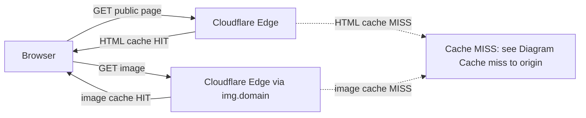
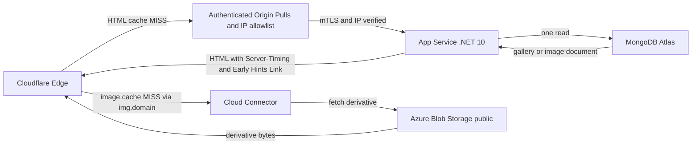
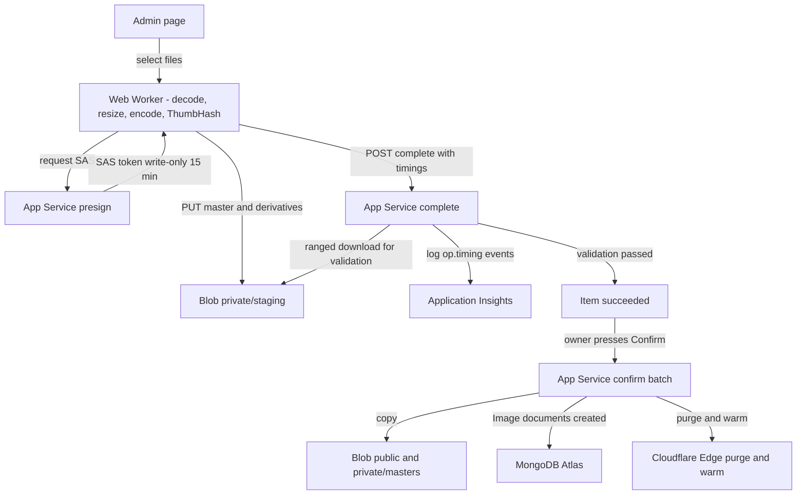
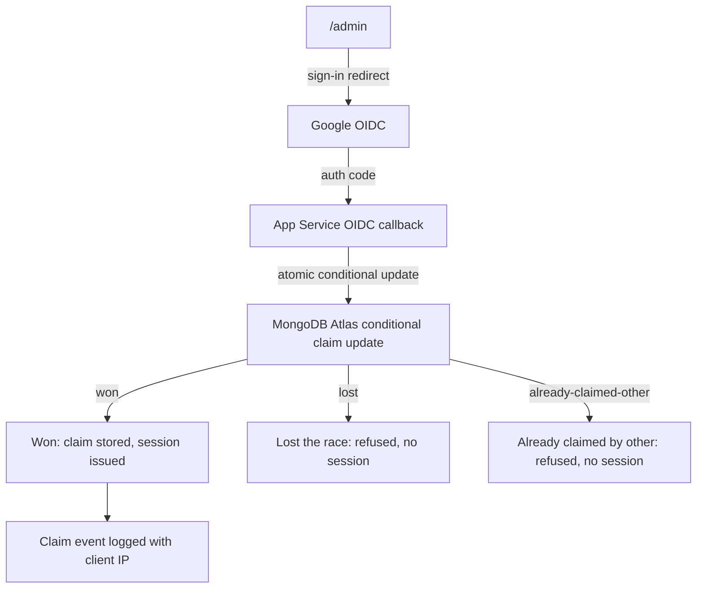

## 3. System Diagrams

The one-page component overview is [docs/architecture.html](architecture.html): a standalone HTML
and SVG file that opens in any browser. The four diagrams below are the request paths it summarizes.

### Diagram: Visitor public page

### Diagram: Cache miss to origin

### Diagram: Owner upload to library

### Diagram: Owner sign-in and claim

