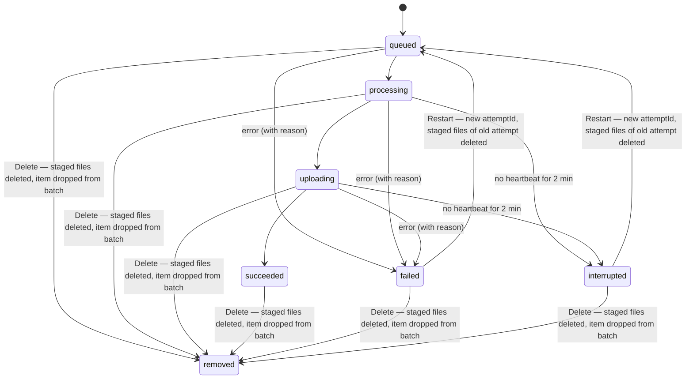
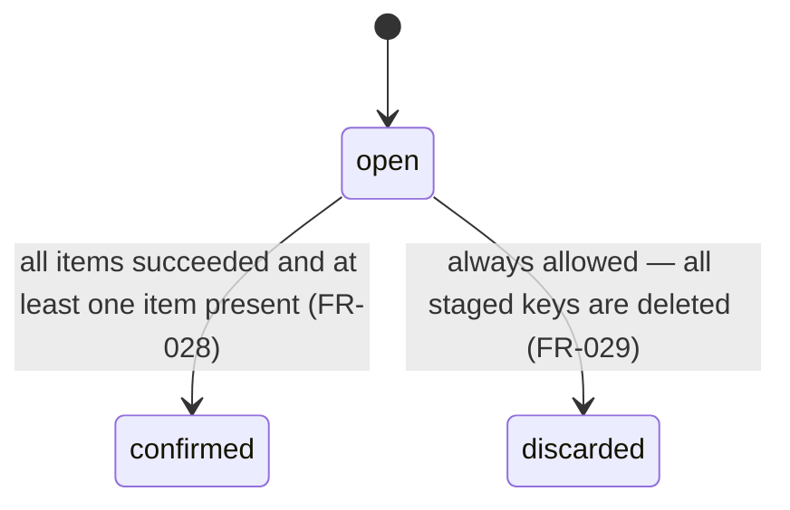

## 4. Content Model

### Owner (collection `site`, single document `_id: "site"`)

The claim is a single conditional update, `{_id:"site", claimedSubject:null}` → set. A matched count
of 1 means the caller won the claim, and 0 means it lost the race (I.1). No web route ever writes
this document after the claim (I.4).

| Field | Type | Rule |
|---|---|---|
| claimedSubject | string? | Google `sub`. Null means the site is unclaimed (I.2). |
| claimedAt | datetime? | |
| claimedIp | string? | Taken from CF-Connecting-IP (I.5, PC.9). |
| homeOrder | id[] | Every gallery id, public and private, in the owner's manual order. Private galleries keep their position so publishing restores them in place. |
| homeCards | GalleryCard[] | Denormalized cards for the public galleries in `homeOrder`, so the home page is one read (IV.9). |

### Image (collection `images`)

An Image exists only after its batch is confirmed. It has no state field (FR-017).

| Field | Type | Rule |
|---|---|---|
| _id | id | Public identity of the image. |
| title | string | Required. 1–200 characters. Defaults to the file name without its extension. |
| caption | string? | 0–2000 characters, plain text. Shown only in the solo view. |
| width, height | int | Pixel size of the source after orientation is applied. Written into markup (IV.8). |
| placeholder | { color: "#rrggbb", preview: data URI } | Preview is a WebP of at most 32 px on the long edge and at most about 1 KB. It is inlined in the markup (IV.7). |
| camera | { make, model, lens, focalMm, fNumber, exposure, iso }? | Extracted by the server from the master, allowlisted fields only (III.3, III.7). |
| derivatives | { w: int, avif: key, webp: key, bytesAvif, bytesWebp }[] | Ladder widths at or below the source width (IV.6). Keys are content-addressed. |
| createdAt | datetime | |
| galleryIds | id[] | Back-references, so that deleting an image can find every gallery that must be fixed and purged. |

### Gallery (collection `galleries`)

| Field | Type | Rule |
|---|---|---|
| _id | id | Stable identity (II.4). |
| slug | string | Generated from the title. Cosmetic only: the URL is `/g/{id}/{slug}`, and a wrong slug redirects with 301 to the current one (II.4). |
| title | string | 1–200 characters. |
| description | string? | 0–5000 characters, plain text. |
| visibility | `public` \| `private` | Defaults to `private` (II.5). |
| items | id[] | Image ids in the owner's order. Membership and position are the same thing. |
| pinnedCover | id? | Must be an element of `items`. Cleared if that image leaves the gallery. |
| card | GalleryCard | Recomputed whenever `items`, `pinnedCover`, or a member image changes. |
| updatedAt | datetime | |

### GalleryCard

A GalleryCard is `{ galleryId, slug, title, coverImageId?, coverPlaceholder, coverWidth,
coverHeight, coverDerivatives, imageCount }`. The cover is `pinnedCover` if set, otherwise
`items[0]`. When the gallery has no items, the cover is null and the card renders empty.

### Upload Batch (collection `batches`, at most one with `state: open`)

A unique partial index on `{state:"open"}` enforces a single open batch (FR-029, D-11).

| Field | Type | Rule |
|---|---|---|
| _id | id | |
| state | `open` \| `confirmed` \| `discarded` | A unique partial index on `{state:"open"}` enforces a single open batch (FR-029). |
| items | BatchItem[] | |
| createdAt, updatedAt | datetime | |

### BatchItem

| Field | Type | Rule |
|---|---|---|
| itemId | id | Becomes the Image `_id` when the batch is confirmed. |
| fileName | string | Shown when the owner is asked to pick the file again (FR-027). |
| fileSize | int | 20 MB at most (FR-014). |
| state | `queued` \| `processing` \| `uploading` \| `succeeded` \| `failed` \| `interrupted` | |
| reason | string? | Set when the state is `failed`. |
| masterStored | bool | Lets Restart reuse the staged master (FR-027). |
| derivativesStored | key[] | |
| heartbeatAt | datetime | Updated by the client while it works on the item. |
| attemptId | id | A new value on each Restart. Uploads that carry a stale attemptId are refused. |
| validated | { width, height, placeholder, camera, derivatives }? | Set by the server when the item reaches `succeeded`. |

### Item State Machine



### Batch State Machine



On confirm, each item's derivatives and master are copied out of staging (see the Storage Layout
section below), its Image document is created, and the batch is marked confirmed. A confirm that
crashes partway through can be re-run (D-11).

### Storage Layout

There are two R2 buckets (D-07). Only `public` is reachable from outside, and only as
`img.<domain>` (D-19). Keys below are `bucket/key`.

```
private/staging/{batchId}/{itemId}/{attemptId}/master.jpg         replaced on confirm by:
private/masters/{imageId}.jpg                                     kept permanently; Infrequent Access after 30 days
private/staging/{batchId}/{itemId}/{attemptId}/{w}.{avif|webp}    deleted after confirm
public/{sha256-16hex}.{avif|webp}                                 immutable (IV.21)
```

Derivative names are content hashes, so their addresses are unguessable and content-addressed
(II.3, FR-011). They are stored with object metadata
`Cache-Control: public, max-age=31536000, immutable`, which the edge respects.

On confirm, for each item:

1. Copy the staged derivatives into the `public` bucket.
2. Copy the master into `private/masters/`.
3. Delete the staged objects.

These are server-side copies inside R2. The confirm step is idempotent per item.

A lifecycle rule deletes `private/staging/` objects 7 days after creation. This is the backstop
sweep for orphaned files (FR-030).

Deleting an image (FR-013) deletes `private/masters/{imageId}.jpg` and every `public/` derivative,
then purges the image URLs at the edge.

### Cover Rule

The gallery cover is the `pinnedCover` image if that field is set and the image is still a member
of `items`. If `pinnedCover` is cleared—because the pinned image was removed from the gallery or
deleted—or was never set, the cover falls back to `items[0]`. When the gallery has no items, the
cover is null and the GalleryCard renders empty. The `card` field on Gallery is recomputed whenever
`items`, `pinnedCover`, or a member image changes (D-13).

### Visibility Rule

A library image appears on no public page, listing, feed, or sitemap unless it is a member of at
least one gallery whose `visibility` is `public` (II.5, FR-011, D-14). Galleries default to
`private` and must be explicitly published by the owner. An image's derivatives are always at
content-addressed (`sha256`-derived), unguessable addresses: they remain reachable by direct URL
even when the image is in no public gallery, but they are never listed anywhere. All ids are
128-bit random values, base32-encoded, 26 characters, never sequential and never derived from titles
(II.3). Gallery URLs follow the pattern `/g/{id}/{slug}`; the id is the stable address, while the
slug is cosmetic—a stale slug triggers a 301 redirect to the current one (D-14).
