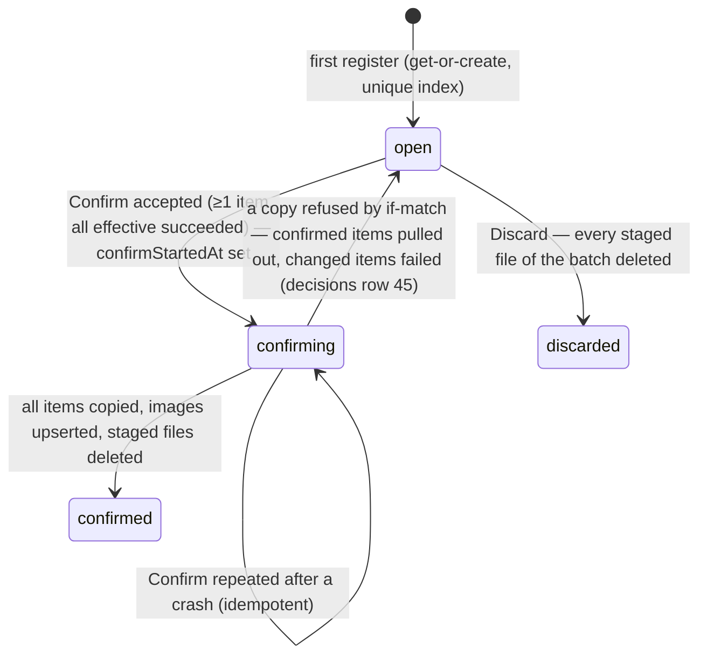

# Data Model: 008 Upload Pipeline into the Library

Design record source: `docs/design.md` §4 "Upload Batch", "BatchItem", "Item State Machine",
"Batch State Machine", "Storage Layout", "Image". This file records the shapes as built, including
the deviations listed in plan.md "Design record updates". Field names are the BSON names. The C#
document classes live in `src/Gallery.Web/Data/Documents.cs` (existing) and
`src/Gallery.Web/Data/BatchDocuments.cs` (new).

## Settings (`UploadOptions`, config section `Upload`)

| Key | Default | Rule |
|---|---|---|
| `MaxFileBytes` | 20971520 | 20 MB per original (FR-002, D-08). Shown on the page as `MaxMb = MaxFileBytes / 1048576`. |
| `MaxPhotosPerBatch` | 100 | Clarification 2 (FR-002). Also sizes `POST /admin/upload/items`'s body limit (research R-15). |
| `PresignMinutes` | 15 | Must be 1–15. `ImageStore` already throws above 15 (III.9). |
| `HeartbeatTimeoutSeconds` | 120 | Clarification 4 / D-11. |
| `MasterHeaderBytes` | 262144 | First ranged read of the master (D-10). A single retry uses 1048576. |
| `PlaceholderMaxBytes` | 1536 | Decoded bytes of the preview WebP ("about 1 KB", FR-025). |
| `PlaceholderMaxEdge` | 32 | FR-016, IV.7. |
| `Ladder` | 320,640,960,1280,1920,2560 | IV.6. Lives in `Gallery.Core.Images.Ladder`, not in config, so it can't drift from IV.6. |

The page reads these values from the same options instance the server enforces with (FR-002).

## Ladder rule (`Gallery.Core.Images.Ladder.For(int uprightWidth)`)

- Returns every ladder width ≤ `uprightWidth`, ascending.
- When `uprightWidth < 320`, it returns `[uprightWidth]` (Clarification 5, FR-015).
- It never returns a width above the source (E-11). Expected height for width `w` is
  `round(w × H / W)`, accepted at ±2 px (matching `DerivativeValidator`).

## Upload batch (collection `batches`)

| Field | Type | Rule |
|---|---|---|
| `_id` | string | `OpaqueId.NewId()` (26-char base32). |
| `state` | `"open"` \| `"confirmed"` \| `"discarded"` | Unique partial index `{state:1}` where `state:"open"` → at most one open (FR-007, D-11). |
| `items` | BatchItem[] | Ordered by registration time. Max `MaxPhotosPerBatch`. |
| `createdAt`, `updatedAt` | datetime (UTC) | |
| `confirmStartedAt` | datetime? | Set once by the first Confirm. Present = confirm in progress; only Confirm may run (research R-09). |
| `confirmedAt`, `discardedAt` | datetime? | Terminal timestamps. |
| `confirmedCount` | int? | Photos added; the confirmed-result page reads it. |

Index creation: `batches_open_unique` is created by the batch store on first use, never at startup
(the app must boot without Mongo; 006 rule).

## Batch item (embedded in `batches.items`)

| Field | Type | Rule |
|---|---|---|
| `itemId` | string | OpaqueId. Becomes `images._id` on confirm (FR-031). |
| `fileName` | string | Picked name, 1–255 chars, no path separators or control chars (stripped server-side). Shown on the tile and in the "pick it again" prompt (E-04). |
| `fileSize` | long | Bytes declared at register; must be ≤ `MaxFileBytes`. The stored master's real length is checked separately. |
| `state` | `"queued"` \| `"processing"` \| `"uploading"` \| `"succeeded"` \| `"failed"` | STORED state. `interrupted` is never stored (see "Effective state"). |
| `percent` | int 0–100 | Upload progress, shown while uploading. |
| `reason` | string? | Set with `failed`; ≤ 200 chars; fixed server strings or a sanitised client reason. Never a value read from a file. |
| `attemptId` | string | OpaqueId. New on every Restart. Every item request must carry it; a mismatch answers 409 (FR-011, FR-019). |
| `heartbeatAt` | datetime | Set on register and by every progress, master, complete and restart call. |
| `master` | { length: long, etag: string, width: int, height: int }? | Set by the master check (research R-06). `width`/`height` are UPRIGHT. Present = "original is stored" (`masterStored` in the design record). |
| `stored` | string[] | Names of the current attempt's sizes the server has seen (`"{w}.avif"`…), for cleanup and the UI. |
| `validated` | Validated? | Set only when the item becomes `succeeded` (L-01). |

`Validated`:

| Field | Type | Rule |
|---|---|---|
| `width`, `height` | int | From the master header (FR-022), upright. |
| `placeholder` | { color: `#rrggbb`, preview: `data:image/webp;base64,…` } | FR-016, FR-025. `color` matches `^#[0-9a-f]{6}$`. |
| `camera` | CameraDoc? | From `CameraFields.Read` on the master prefix (FR-027). |
| `sizes` | { w, avifKey, webpKey, avifEtag, webpEtag, bytesAvif, bytesWebp }[] | `*Key` = public name `{sha256-16hex}.{ext}` computed at validation from the bytes the server read. `*Etag` is used by confirm's copy-if-match (research R-09). |
| `masterEtag` | string | Same purpose, for the master copy. |

### Staged keys (private bucket)

```
staging/{batchId}/{itemId}/{attemptId}/master.jpg
staging/{batchId}/{itemId}/{attemptId}/{w}.avif
staging/{batchId}/{itemId}/{attemptId}/{w}.webp
```

The server builds every key from stored ids. The browser never sends a key (FR-019, FR-020).

### Effective state (Clarification 4, FR-010)

`Effective(item, now)`:
- `interrupted` when `state ∈ {queued, processing, uploading}` and `now − heartbeatAt > 120 s`;
- otherwise `state`.

It is evaluated on every read and before every write that needs an active item. Mapping to the
005 component enum `BatchItemState`: queued→Queued, processing→Processing, uploading→Uploading,
succeeded→Succeeded, failed→Failed, interrupted→Interrupted. Tile copy: "Waiting", "Preparing
sizes", "Uploading N%", "Ready", the reason, and "Stopped before finishing".

### Item state machine (as built; supersedes the design-record diagram per plan.md)

```mermaid
stateDiagram-v2
    [*] --> queued : register (master permission issued)
    queued --> processing : progress(processing)
    processing --> uploading : progress(uploading, %)
    uploading --> succeeded : complete → validation passes
    queued --> failed : master check fails / client error
    processing --> failed : client error (out of memory, encode)
    uploading --> failed : validation fails (whole photo rejected, staged files deleted)
    queued --> interrupted : no heartbeat for 2 min (computed on read)
    processing --> interrupted : no heartbeat for 2 min (computed on read)
    uploading --> interrupted : no heartbeat for 2 min (computed on read)
    failed --> queued : Restart — new attemptId; old attempt's sizes deleted; master kept if stored (copied to the new attempt)
    interrupted --> queued : Restart — same
    queued --> removed : Delete — all staged files deleted
    processing --> removed : Delete
    uploading --> removed : Delete
    succeeded --> removed : Delete
    failed --> removed : Delete
    interrupted --> removed : Delete
```



Restart with a stored master (FR-011): the server copies
`…/{oldAttempt}/master.jpg` → `…/{newAttempt}/master.jpg` (a server-side copy, if-match on the
recorded ETag). It deletes the old attempt prefix, keeps `master`, and returns size permissions
straight away. With no stored master, it returns `needsFile: true` and a fresh master permission,
and the page asks for the file named `fileName` (E-04). Keys always carry the current attempt, so
"files of the old attempt can never be mistaken for current ones".

### Batch state machine



`confirming` is `state:"open"` plus `confirmStartedAt != null`. It is not a separate stored
state, so the unique open index still holds during confirm.

### Validation rules (summary; detail in contracts/http.md and research R-05–R-07)

- Register: content type `image/jpeg`; `0 < size ≤ MaxFileBytes`; current count + accepted ≤
  `MaxPhotosPerBatch`; the batch is not confirming.
- Master check: length ≤ `MaxFileBytes`; JPEG per reader; SOF present; orientation applied to
  width and height.
- Complete:
  - The master is re-checked with the same length, ETag and dimensions.
  - The expected set is `Ladder.For(width)` × {avif, webp}. Every one must be present (HEAD) and
    pass reader 1 + reader 2 + agreement.
  - The placeholder must be a WebP data URI, ≤ 1536 bytes, long edge ≤ 32, metadata-free, and pass
    both readers.
  - `color` must match the hex pattern.
  - Any failure rejects the whole item: state `failed`, `reason` set, and the attempt prefix deleted
    (FR-026).

## Library image (collection `images`, existing `ImageDoc`)

Unchanged fields, written once by confirm with `$setOnInsert`:

| Field | Value from upload |
|---|---|
| `_id` | `itemId` |
| `title` | `fileName` without its last extension, trimmed to 200 chars, `"Untitled"` if empty (D-13) |
| `caption` | absent |
| `width`, `height` | `validated.width/height` |
| `placeholder` | `validated.placeholder` |
| `camera` | `validated.camera` (absent when null) |
| `derivatives` | `[{ w, avif: avifKey, webp: webpKey, bytesAvif, bytesWebp }]` ascending |
| `galleryIds` | `[]` (FR-033) |
| `createdAt` | confirm time |
| `seedKey`, `sourceHash` | ABSENT. The type changes to `string?` + `[BsonIgnoreIfNull]` (research R-10, FR-035). |

## Public and master objects

| Object | Key | Written by | Headers |
|---|---|---|---|
| size | `public/{sha256-16hex}.{avif\|webp}` | confirm, server-side copy, if-match | `Content-Type` image/avif or image/webp; `Cache-Control: public, max-age=31536000, immutable` (IV.21) |
| master | `private/masters/{imageId}.jpg` | confirm, server-side copy, if-match | `Content-Type: image/jpeg`; never public (III.1) |

## Lifecycle mapping (L-01–L-06 as built)

| Lifecycle | Trigger | Records | Storage |
|---|---|---|---|
| L-01 succeeded | `complete` passes | item `state=succeeded`, `validated` set | none new |
| L-02 failed / interrupted | rejection, client fail, or 2 min silence | `failed` + reason, or computed `interrupted` | rejection deletes the attempt prefix; interrupted keeps it until Restart/Delete/7-day rule |
| L-03 restarted | `…/restart` | new `attemptId`, `state=queued`, `stored=[]`, `percent=0` | master copied to new attempt if stored; old attempt prefix deleted |
| L-04 deleted from batch | `…/delete` | item `$pull`ed | item prefix deleted |
| L-05 confirmed | `/confirm` | images upserted; batch `confirmed` | sizes → public, master → masters, batch staging deleted; NO purge/warm (FR-033) |
| L-06 discarded | `/discard` | batch `discarded` | batch prefix deleted |
